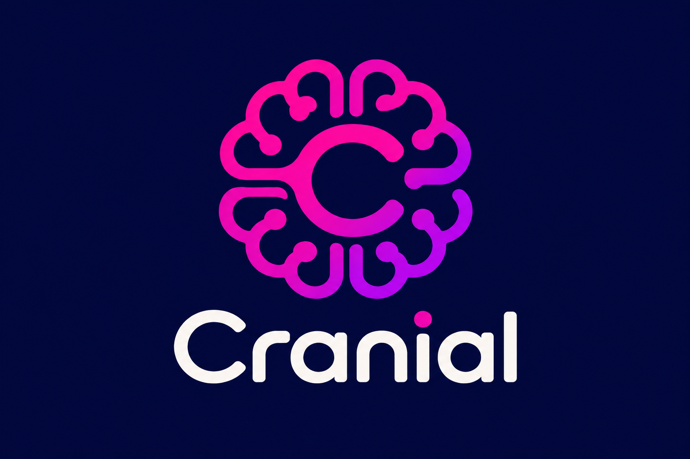

# CRANIAL — Universal AI Integration Platform



> **Tagline:** One Brain. Many Connections.

> **Document purpose:** This file is the primary project-context document for an AI coding agent. It explains the product vision, architecture, capabilities, integrations, boundaries, security requirements, and recommended implementation backlog.
>
> **Project principle:** Build one independent, reusable AI platform that provides shared intelligence capabilities to Peggy, the Store Management System (SMS), the Worker App, e-commerce, and future applications.

---

## Table of Contents

- [Part I: Architectural Blueprint & Specifications
](#part-i-architectural-blueprint--specifications)
  - [Table of Contents
](#table-of-contents)
- [Part I: Architectural Blueprint & Specifications
](#part-i-architectural-blueprint--specifications)
  - [1. Project Identity and Vision
](#1-project-identity-and-vision)
  - [2. Architecture and Ownership Boundaries
](#2-architecture-and-ownership-boundaries)
  - [3. Deployment and Integration Decisions
](#3-deployment-and-integration-decisions)
  - [4. Local-First and Cost Policy
](#4-local-first-and-cost-policy)
  - [5. Core Platform Modules
](#5-core-platform-modules)
  - [6. Shared Intelligence Capabilities
](#6-shared-intelligence-capabilities)
  - [7. Application Integration Examples
](#7-application-integration-examples)
  - [8. API Contract
](#8-api-contract)
  - [9. Asynchronous Processing
](#9-asynchronous-processing)
  - [10. Multi-Tenancy, Authorization, and Privacy
](#10-multi-tenancy-authorization-and-privacy)
  - [11. Suggested Database Domains
](#11-suggested-database-domains)
  - [12. Admin Dashboard
](#12-admin-dashboard)
  - [13. Security and Reliability Requirements
](#13-security-and-reliability-requirements)
  - [14. Testing and Evaluation
](#14-testing-and-evaluation)
  - [15. Development Strategy and Phases
](#15-development-strategy-and-phases)
  - [16. Initial Integration Priorities
](#16-initial-integration-priorities)
  - [17. Suggested Backend Structure
](#17-suggested-backend-structure)
  - [18. Coding Agent Rules
](#18-coding-agent-rules)
  - [19. Definition of Done
](#19-definition-of-done)
- [Part II: Implemented Features
](#part-ii-implemented-features)
  - [Phase 1 — Platform Foundation (Completed)
](#phase-1--platform-foundation-completed)
  - [Phase 2 — Provider Infrastructure, Model Registry, Routing & Telemetry (Completed)
](#phase-2--provider-infrastructure-model-registry-routing--telemetry-completed)
  - [Phase 3 — Orchestration and Prompt/Schema Management (Completed)
](#phase-3--orchestration-and-promptschema-management-completed)
  - [Phase 4 & Section 20.8 — Conversational Intelligence (Completed)](#phase-4--section-208--conversational-intelligence-completed)
  - [Section 20.2 Model and Provider Management Improvements (Completed)
](#section-202-model-and-provider-management-improvements-completed)
  - [Dual Language Support — English & Bahasa Indonesia (Completed)
](#dual-language-support--english--bahasa-indonesia-completed)
  - [Phase 5 & Section 20.4 — Document Intelligence and OCR (Completed)
](#phase-5--section-204--document-intelligence-and-ocr-completed)
  - [Phase 6 & Section 20.5 — Knowledge Intelligence and RAG (Completed)
](#phase-6--section-205--knowledge-intelligence-and-rag-completed)
  - [Phase 7 & Section 20.6 — Data Intelligence and Analytics (Completed)
](#phase-7--section-206--data-intelligence-and-analytics-completed)
  - [Phase 8 & Section 20.7 — Decision Intelligence and Optimization (Completed)
](#phase-8--section-207--decision-intelligence-and-optimization-completed)
  - [Phase 9 & Section 20.9 — Customer Intelligence (Completed)
](#phase-9--section-209--customer-intelligence-completed)
  - [Phase 10 — Application Integrations, Client SDKs & MCP Readiness (Completed)
](#phase-10--application-integrations-client-sdks--mcp-readiness-completed)
  - [Phase 8 & Section 20.7 — Decision Intelligence and Optimization (Completed)
](#phase-8--section-207--decision-intelligence-and-optimization-completed)
  - [Phase 9 & Section 20.9 — Customer Intelligence (Completed)
](#phase-9--section-209--customer-intelligence-completed)
  - [Phase 10 — Application Integrations, Client SDKs & MCP Readiness (Completed)
](#phase-10--application-integrations-client-sdks--mcp-readiness-completed)
  - [Section 20.12 — Admin Dashboard UI/UX & Operator Experience (Completed)
](#section-2012--admin-dashboard-uiux--operator-experience-completed)
- [Part III: Product Backlog & Improvements (Section 20)
](#part-iii-product-backlog--improvements-section-20)
  - [20.1 Foundation and architecture
](#201-foundation-and-architecture)
  - [20.2 Model and provider management
](#202-model-and-provider-management)
  - [20.3 Orchestration and workflow improvements
](#203-orchestration-and-workflow-improvements)
  - [20.4 Document intelligence and OCR
](#204-document-intelligence-and-ocr)
  - [20.5 Knowledge intelligence and RAG
](#205-knowledge-intelligence-and-rag)
  - [20.6 Data intelligence and analytics
](#206-data-intelligence-and-analytics)
  - [20.7 Decision intelligence and optimization
](#207-decision-intelligence-and-optimization)
  - [20.8 Conversational intelligence](#208-conversational-intelligence)
  - [20.9 Customer intelligence
](#209-customer-intelligence)
  - [20.10 Security, privacy, and governance
](#2010-security-privacy-and-governance)
  - [20.11 Performance, scalability, and reliability
](#2011-performance-scalability-and-reliability)
  - [20.12 Admin dashboard UI/UX
](#2012-admin-dashboard-uiux)
  - [20.13 Developer experience and integrations
](#2013-developer-experience-and-integrations)
  - [20.14 Operations and observability
](#2014-operations-and-observability)
  - [20.15 Testing and quality improvements
](#2015-testing-and-quality-improvements)
  - [20.16 Future major feature candidates
](#2016-future-major-feature-candidates)
- [Part IV: Governance, Prioritization & Principles
](#part-iv-governance-prioritization--principles)
  - [21. Backlog Prioritization Guidance
](#21-backlog-prioritization-guidance)
  - [22. Final Architectural Principles
](#22-final-architectural-principles)

---

# Part I: Architectural Blueprint & Specifications

---

## Table of Contents

- [Part I: Architectural Blueprint & Specifications](#part-i-architectural-blueprint--specifications)
  - [1. Project Identity and Vision](#1-project-identity-and-vision)
  - [2. Architecture and Ownership Boundaries](#2-architecture-and-ownership-boundaries)
  - [3. Deployment and Integration Decisions](#3-deployment-and-integration-decisions)
  - [4. Local-First and Cost Policy](#4-local-first-and-cost-policy)
  - [5. Core Platform Modules](#5-core-platform-modules)
  - [6. Shared Intelligence Capabilities](#6-shared-intelligence-capabilities)
  - [7. Application Integration Examples](#7-application-integration-examples)
  - [8. API Contract](#8-api-contract)
  - [9. Asynchronous Processing](#9-asynchronous-processing)
  - [10. Multi-Tenancy, Authorization, and Privacy](#10-multi-tenancy-authorization-and-privacy)
  - [11. Suggested Database Domains](#11-suggested-database-domains)
  - [12. Admin Dashboard](#12-admin-dashboard)
  - [13. Security and Reliability Requirements](#13-security-and-reliability-requirements)
  - [14. Testing and Evaluation](#14-testing-and-evaluation)
  - [15. Development Strategy and Phases](#15-development-strategy-and-phases)
  - [16. Initial Integration Priorities](#16-initial-integration-priorities)
  - [17. Suggested Backend Structure](#17-suggested-backend-structure)
  - [18. Coding Agent Rules](#18-coding-agent-rules)
  - [19. Definition of Done](#19-definition-of-done)
- [Part II: Implemented Features](#part-ii-implemented-features)
  - [Phase 1 — Platform Foundation](#phase-1--platform-foundation-completed)
  - [Phase 2 — Provider Infrastructure, Model Registry, Routing & Telemetry](#phase-2--provider-infrastructure-model-registry-routing--telemetry-completed)
  - [Phase 3 — Orchestration and Prompt/Schema Management](#phase-3--orchestration-and-promptschema-management-completed)
  - [Section 20.2 — Model and Provider Management Improvements](#section-202-model-and-provider-management-improvements-completed)
  - [Dual Language Support — English & Bahasa Indonesia](#dual-language-support---english--bahasa-indonesia-completed)
  - [Phase 5 & Section 20.4 — Document Intelligence and OCR](#phase-5--section-204---document-intelligence-and-ocr-completed)
  - [Phase 6 & Section 20.5 — Knowledge Intelligence and RAG](#phase-6--section-205---knowledge-intelligence-and-rag-completed)
  - [Phase 7 & Section 20.6 — Data Intelligence and Analytics](#phase-7--section-206---data-intelligence-and-analytics-completed)
  - [Phase 8 & Section 20.7 — Decision Intelligence and Optimization](#phase-8--section-207--decision-intelligence-and-optimization-completed)
  - [Phase 9 & Section 20.9 — Customer Intelligence](#phase-9--section-209--customer-intelligence-completed)
  - [Phase 10 — Application Integrations, Client SDKs & MCP Readiness](#phase-10--application-integrations-client-sdks--mcp-readiness-completed)
  - [Section 20.12 — Admin Dashboard UI/UX & Operator Experience](#section-2012--admin-dashboard-uiux--operator-experience-completed)
- [Part III: Product Backlog & Improvements](#part-iii-product-backlog--improvements)
  - [20.1 Foundation and architecture](#201-foundation-and-architecture)
  - [20.2 Model and provider management](#202-model-and-provider-management)
  - [20.3 Orchestration and workflow improvements](#203-orchestration-and-workflow-improvements)
  - [20.4 Document intelligence and OCR](#204-document-intelligence-and-ocr)
  - [20.5 Knowledge intelligence and RAG](#205-knowledge-intelligence-and-rag)
  - [20.6 Data intelligence and analytics](#206-data-intelligence-and-analytics)
  - [20.7 Decision intelligence and optimization](#207-decision-intelligence-and-optimization)
  - [20.8 Conversational intelligence](#208-conversational-intelligence)
  - [20.9 Customer intelligence](#209-customer-intelligence)
  - [20.10 Security, privacy, and governance](#2010-security-privacy-and-governance)
  - [20.11 Performance, scalability, and reliability](#2011-performance-scalability-and-reliability)
  - [20.12 Admin dashboard UI/UX](#2012-admin-dashboard-uiux)
  - [20.13 Developer experience and integrations](#2013-developer-experience-and-integrations)
  - [20.14 Operations and observability](#2014-operations-and-observability)
  - [20.15 Testing and quality improvements](#2015-testing-and-quality-improvements)
  - [20.16 Future major feature candidates](#2016-future-major-feature-candidates)
- [Part IV: Governance, Prioritization & Principles](#part-iv-governance-prioritization--principles)
  - [21. Backlog Prioritization Guidance](#21-backlog-prioritization-guidance)
  - [22. Final Architectural Principles](#22-final-architectural-principles)

---

# Part I: Architectural Blueprint & Specifications

---

## 1. Project Identity and Vision

### 1.1 Project Name and Philosophy

- **Project name:** CRANIAL
- **Platform designation:** Universal AI Integration Platform
- **Tagline:** One Brain. Many Connections.
- **Conceptual inspiration:** The twelve pairs of cranial nerves, which connect the brain and brainstem with different parts of the body.

CRANIAL is the shared communication, integration, and orchestration layer through which independent applications access AI models, tools, and reusable intelligence capabilities. The name expresses the platform's role as a connection layer; it does **not** imply that CRANIAL develops, owns, or trains its own foundational AI models. CRANIAL may orchestrate local open-source models and explicitly configured external providers.

The biological analogy is a product philosophy and branding concept, not a literal technical architecture. Do not map individual capabilities or applications rigidly to the twelve cranial nerves. Preserve provider independence, modularity, and the ability to replace models and services without changing application contracts.

Use **CRANIAL** as the proper project and platform name in documentation, code comments where a product name is appropriate, admin branding, diagrams, API documentation, and deployment examples. Use **Universal AI Integration Platform** as its descriptive category, not as a competing project name.

---


CRANIAL is an independent Universal AI Integration Platform that centralizes reusable AI and document-processing capabilities for multiple applications.

It is not an AI feature embedded inside one application. It is a shared platform with its own backend, database, administration interface, deployment lifecycle, configuration, monitoring, and API.

Applications consume its capabilities through authenticated REST APIs. Official SDKs may be provided as convenience wrappers, and MCP integrations may be added where useful. REST remains the stable primary integration contract.

The platform should be provider-independent and **local-first**. It must be usable without mandatory paid AI APIs. Open-source models and tools should be preferred where practical, while optional hosted providers can be configured explicitly.

### 1.2 Applications to support

- **Peggy:** Personal and collaborative money management, financial tracking, internal ledger management, financial intelligence, and financial education.
- **SMS (Store Management System):** Store operations, sales, inventory, profitability, products, workers, tasks, deliveries, and business reporting.
- **Worker App:** A restricted application for workers to access assigned tasks, operational information, and approved workflows.
- **E-commerce:** Product discovery, customer questions, order support, product recommendations, reviews, and customer service.
- **Future applications:** The platform must support registering additional applications without redesigning its core architecture.

### 1.3 Product objectives

1. Centralize reusable AI, OCR, extraction, embedding, retrieval, and orchestration capabilities.
2. Avoid implementing and maintaining separate AI engines in every application.
3. Allow each application to consume only the capabilities it is authorized to use.
4. Keep application business logic, primary data, validation, and transaction processing inside the owning application.
5. Support local inference and open-source processing to minimize recurring provider/API expenses.
6. Make AI requests observable, auditable, testable, configurable, and cost-controlled.
7. Provide a modular architecture that can grow without prematurely becoming a distributed microservice system.

### 1.4 Non-objectives

The platform must not:

- Replace the applications' primary backends or databases.
- Become the source of truth for financial, inventory, order, customer, or operational records.
- Execute financial transactions, payment processing, bank transfers, or settlement.
- Directly mutate application business records without the owning application's validated API/workflow.
- Give an LLM unrestricted SQL, shell, filesystem, or application database access.
- Require paid hosted AI services to operate.
- Assume that an LLM is the correct solution for deterministic calculations, authorization, routing, or business rules.

---

## 2. Architecture and Ownership Boundaries

### 2.1 High-level architecture

```text
+------------------+  +------------------+  +------------------+  +------------------+
|      Peggy       |  |       SMS        |  |    Worker App    |  |   E-commerce     |
| Flutter + API    |  | Web + API        |  | Mobile + API     |  | Web + API        |
+--------+---------+  +--------+---------+  +--------+---------+  +--------+---------+
         |                     |                     |                     |
         +---------------------+---------------------+---------------------+
                                       |
                              Authenticated REST API
                           Optional SDKs / Optional MCP
                                       |
                    +----------------------------------------+
                    |                 CRANIAL                |
                    |                                        |
                    | API Gateway / Application Auth        |
                    | AI Orchestrator / Model Router          |
                    | Prompt + Schema Registry                |
                    | Tool Registry + Workflow Engine         |
                    | Capability Services                     |
                    | Usage / Audit / Evaluation / Monitoring |
                    | Admin API                                |
                    +-------------------+--------------------+
                                        |
             +--------------------------+---------------------------+
             |                          |                           |
      +------+-------+          +-------+------+            +-------+------+
      | Local Models |          | OCR / Parsing|            | Data / Search|
      | Ollama       |          | Tesseract    |            | Embeddings   |
      | Open models  |          | Apache Tika  |            | pgvector     |
      +--------------+          +--------------+            +--------------+
                                        |
                    +-------------------+--------------------+
                    | Platform Infrastructure                |
                    | PostgreSQL + pgvector                   |
                    | Object Storage                          |
                    | Redis / Queue                            |
                    | Background Workers                      |
                    +----------------------------------------+
```

### 2.2 Platform owns

The platform owns and manages:

- AI provider and model configurations.
- Model routing and orchestration.
- AI prompts, prompt versions, and task definitions.
- Output schemas and schema versions.
- Capability configurations and workflows.
- Tool definitions, permissions, and execution records.
- AI conversations and messages, where platform-managed conversations are enabled.
- OCR/document-processing jobs and extraction artifacts, subject to retention policy.
- Knowledge collections, source metadata, chunks, embeddings, and retrieval logs.
- AI request history, model attempts, usage, cost/resource metrics, evaluations, feedback, and audit records.
- Platform-level application registration, credentials, capability entitlements, and quotas.

### 2.3 Each application owns

Each application remains responsible for:

- Its user-facing interface and workflows.
- Its users and authoritative identity provider.
- Its primary database and business records.
- Its business rules and authorization decisions.
- Financial calculations, balances, inventory calculations, sales/profit calculations, and other deterministic domain calculations.
- Application-specific validation and approval.
- Creating, updating, and deleting its own records.
- Final user confirmation for sensitive actions.
- Its operational audit trail and business-level logs.

**Important:** Centralizing OCR does not remove the OCR feature from Peggy or other applications' user experience. It removes the duplicated OCR processing implementation. For example, Peggy keeps its camera/scanning UI, upload flow, extraction preview, correction UI, and transaction confirmation. The Universal AI Platform performs the OCR and structured extraction and returns the result. Peggy validates and saves the transaction through its own backend.

### 2.4 Example: Receipt OCR flow

1. User scans or selects a receipt in Peggy.
2. Peggy uploads the image through an authenticated platform API or requests a secure upload URL.
3. The platform validates the file, checks its type and size, and applies malware/security scanning where configured.
4. The OCR/document pipeline recognizes text and extracts structured fields.
5. The platform validates the extraction against a versioned JSON schema.
6. The platform returns a structured response, confidence/uncertainty information where supported, warnings, and source/page references where relevant.
7. Peggy displays the extraction preview.
8. The user corrects or confirms the result.
9. Peggy's backend performs its own business validation and saves the transaction.

The platform must not directly create Peggy transactions.

### 2.5 Migration rule for existing AI/OCR code

When integrating an existing application:

- Replace direct LLM/provider calls with platform API calls.
- Move duplicated OCR engines and extraction pipelines to the platform.
- Move AI prompts, AI orchestration, embedding generation, and RAG pipelines to the platform.
- Keep camera, file selection, upload, preview, editing, confirmation, and application workflow UI in the application.
- Keep business validation, calculations, authorization, and database writes in the application.
- Do not delete existing implementations immediately. Migrate one capability at a time, verify parity, add integration tests, and remove obsolete code only after the replacement is stable.
- Keep non-AI deterministic local algorithms where they belong to the application.

---

## 3. Deployment and Integration Decisions

### 3.1 Deployment: Standalone platform

The platform must have:

- Its own source repository.
- Its own backend application.
- Its own admin frontend.
- Its own database and migration history.
- Its own configuration and secrets.
- Its own deployment and release lifecycle.
- Its own observability and operational controls.

It must not be packaged as a module inside Peggy or SMS.

### 3.2 Integration: Hybrid

- **REST API:** Primary and stable integration contract.
- **SDKs:** Optional official Java and TypeScript SDKs that wrap the REST API. SDKs must not create a second business protocol.
- **MCP:** Optional integration for compatible AI clients and tool ecosystems. MCP must use the same authentication, authorization, tenant isolation, and tool permission policies as REST.
- **Webhooks:** For asynchronous job completion and selected events, with signatures, retries, and replay protection.

### 3.3 Technology baseline

Use the following baseline unless a documented technical constraint requires a change:

| Layer | Technology |
|---|---|
| Backend | Java 21 + Spring Boot |
| Admin frontend | React + TypeScript |
| Database | PostgreSQL |
| Vector search | pgvector |
| ORM/data access | MyBatis-Plus or a clearly justified Spring-compatible approach |
| Local model runtime | Ollama |
| OCR | Tesseract |
| Document parsing | Apache Tika |
| Object storage | Supabase Storage or S3-compatible storage |
| Queue/cache | Redis where appropriate |
| API contract | OpenAPI |
| Containerization | Docker / Docker Compose |
| Metrics | Micrometer; Prometheus-compatible metrics |
| Routing/optimization | Google OR-Tools for deterministic optimization tasks where applicable |

Do not introduce every infrastructure component on day one. Start with the smallest reliable deployment and add Redis, separate workers, or other infrastructure when justified by actual workload.

---

## 4. Local-First and Cost Policy

### 4.1 Core policy

The platform should be designed to operate without mandatory paid AI APIs.

Prefer:

- Locally hosted open-weight models through Ollama.
- Open-source OCR and document parsing.
- Locally generated embeddings.
- PostgreSQL + pgvector for vector storage and similarity search.
- Open-source libraries and self-hostable components.

Hosted providers may be supported as optional adapters, but the platform must not depend on them for core operation.

### 4.2 No automatic paid fallback

- Never silently route a request to a paid hosted provider when local inference fails.
- Provider routing policies must explicitly identify whether a provider is local, hosted-free-tier, or paid.
- Hosted/paid providers must be disabled by default until explicitly configured and authorized.
- Sensitive data must not be sent to hosted providers unless the application/tenant policy explicitly permits it.
- When a provider is unavailable or a quota is exhausted, return a clear failure, queue a retry where appropriate, or offer an approved alternative.
- Do not describe any hosted provider's free tier as unlimited or guaranteed to remain free.

### 4.3 Cost and resource monitoring

Track, where available:

- Request count per application, tenant, and capability.
- Model/provider used.
- Input/output tokens for models that expose token usage.
- Processing duration and queue time.
- OCR pages and document size.
- Embedding volume.
- Local compute duration and resource usage where measurable.
- Hosted provider cost where applicable.
- Failures, retries, and fallback decisions.

Support quotas, rate limits, concurrency limits, maximum input size, maximum output size, and configurable budgets.

---

## 5. Core Platform Modules

### 5.1 API Gateway

Responsibilities:

- Expose versioned REST endpoints.
- Validate application credentials and request envelopes.
- Enforce request size, rate, and concurrency limits.
- Apply idempotency where relevant.
- Attach verified application, tenant, and user context.
- Produce consistent errors and correlation IDs.
- Route requests to the orchestrator or capability services.

### 5.2 Application Registry and Authentication

Manage:

- Registered applications.
- Application credentials and credential rotation.
- Enabled capabilities per application.
- Tenant mapping and allowed origins where relevant.
- Rate limits and quotas.
- Environment separation (development, staging, production).
- Webhook secrets and permissions.

Application credentials must be stored securely. Never trust application identity, tenant ID, user ID, role, or permission claims supplied only as arbitrary request-body fields. Identity context must come from verified credentials or a trusted identity-exchange mechanism.

### 5.3 AI Orchestrator

Responsibilities:

- Interpret a validated task request.
- Select a capability workflow.
- Resolve prompts and output schemas.
- Retrieve only authorized context.
- Select a model through the model router.
- Invoke permitted tools.
- Validate outputs.
- Track execution, retries, and errors.
- Return a normalized response.

The orchestrator must not become an unrestricted autonomous agent. Tool use must be explicit, allowlisted, permission-checked, bounded, and auditable.

### 5.4 Model Router and Provider Adapters

Support a provider-independent abstraction for:

- Local chat/completion models.
- Embedding models.
- Classification-capable models.
- Vision-capable models where supported.
- Optional hosted providers.

Routing should consider:

- Capability/task compatibility.
- Local versus hosted policy.
- Data sensitivity.
- Model availability.
- Context window and input limits.
- Latency.
- Resource availability.
- Configured quotas and costs.

Do not assume every model supports every modality or task. Maintain model capability metadata and verify actual provider support.

### 5.5 Prompt Management

Support:

- Prompt templates.
- Version history.
- Application/capability/task scoping.
- Variables and context contracts.
- Draft, testing, published, and retired states.
- Rollback to a previous version.
- Prompt evaluation datasets.
- Change audit history.

Do not hardcode important production prompts throughout application code.

### 5.6 Schema Registry

Support versioned JSON schemas for:

- Request validation.
- Structured model output.
- OCR/document extraction.
- Classification.
- Tool input and output.
- Workflow steps.

Validate structured model outputs. Invalid or incomplete output must not be treated as trusted application data.

### 5.7 Tool Registry

Tools are controlled interfaces to application-owned services.

Each tool definition should include:

- Tool name and description.
- Owning application.
- Input/output schema.
- Required capability and permissions.
- Allowed tenant/user scope.
- Read-only or mutation classification.
- Timeout and retry policy.
- Risk level and confirmation requirement.
- Version and audit metadata.

The LLM must never receive unrestricted database credentials or arbitrary SQL execution capability.

### 5.8 Workflow Engine

Support deterministic, auditable sequences such as:

- OCR → extraction → schema validation → application review.
- User question → authorized retrieval → answer with sources.
- Data question → approved application tool → deterministic result → natural-language explanation.
- Customer question → policy/product/order lookup → response.
- Classification → confidence threshold → human review when uncertain.

Workflows should have bounded steps, timeouts, retry rules, cancellation, and traceable outputs.

---

## 6. Shared Intelligence Capabilities

The following are capability groups, not necessarily six independent deployable services. Implement them as modular components within the platform initially.

### 6.1 Conversational Intelligence

Purpose: Provide natural-language interfaces to application-owned data and approved workflows.

Features:

- Multi-turn conversations.
- Conversation and message history.
- Context management and summarization.
- Application- and tenant-scoped sessions.
- Tool/function calling through the Tool Registry.
- Structured responses.
- Source-aware responses.
- Conversation feedback.
- Configurable retention and deletion.
- Safety and permission boundaries.

Use cases:

- Peggy: Ask Peggy, explain a spending pattern, answer questions using authorized financial data.
- SMS owner: Ask about store performance, sales, stock, and operational status.
- Worker: Ask about assigned work, delivery instructions, and approved SOPs.
- E-commerce: Product questions and customer support.

### 6.2 Document Intelligence

Purpose: Centralize document and image processing.

Features:

- Secure file intake.
- File type and size validation.
- Image preprocessing where useful.
- OCR using Tesseract or another configured engine.
- PDF and office-document parsing using Apache Tika and appropriate parsers.
- Page-level text extraction.
- Document classification.
- Structured field extraction.
- Table extraction where supported.
- Schema validation.
- Confidence/uncertainty indicators where supported.
- Human review workflow.
- Async processing for large files.
- Processing status and error reporting.
- Duplicate detection where appropriate.
- Retention and deletion policies.

Potential document types:

- Peggy receipts and invoices.
- SMS purchase invoices, supplier documents, stock documents, and reports.
- Worker delivery documents and proof-of-delivery images.
- E-commerce product documents, invoices, and support attachments.

Do not silently invent missing fields. Distinguish extracted, inferred, missing, and uncertain values. Application-specific business validation remains in the owning application.

### 6.3 Data Intelligence

Purpose: Interpret data returned by authorized application services.

Features:

- Natural-language-to-approved-tool orchestration.
- Structured reporting requests.
- Trend and comparison summaries.
- Aggregation explanations.
- Anomaly detection workflows.
- Forecasting workflows where sufficient historical data exists.
- Data quality warnings.
- Source and calculation metadata.
- Configurable thresholds and evaluation.

Examples:

- SMS: Sales summary, best-selling products, profit summaries, inventory movement, low-stock analysis.
- Peggy: Spending summaries, category comparisons, unusual expense explanations, cash-flow pattern summaries.

**Important:** The application or a deterministic analytics service calculates authoritative figures. The LLM explains results; it must not invent or independently calculate authoritative balances, profits, or inventory values.

### 6.4 Decision Intelligence

Purpose: Support decisions using deterministic algorithms, validated data, and AI-generated explanations.

Features:

- Recommendation workflows.
- Constraint-based optimization.
- Scenario comparison.
- Prioritization support.
- Confidence and evidence presentation.
- Human approval for consequential decisions.

Examples:

- SMS: Task assignment recommendations, delivery route optimization, inventory replenishment suggestions.
- Peggy: Explain financial scenarios or suggest areas for review without autonomously changing the ledger.
- E-commerce: Product comparison and recommendation.

Use deterministic algorithms for route optimization, scheduling, constraints, and mathematical calculations. LLMs may interpret requests and explain results.

### 6.5 Knowledge Intelligence

Purpose: Provide secure retrieval-augmented generation (RAG) over approved knowledge sources.

Features:

- Knowledge collections per application and tenant.
- Document ingestion and parsing.
- Chunking strategies.
- Embedding generation.
- Vector and metadata search.
- Hybrid retrieval where appropriate.
- Reranking where justified.
- Source citations and references.
- Knowledge versioning and re-indexing.
- Access-aware retrieval.
- Feedback and retrieval evaluation.

Potential knowledge sources:

- Peggy's financial encyclopedia and educational content.
- SMS product, inventory, and operating procedures.
- Worker SOPs and task instructions.
- E-commerce product documentation, policies, and FAQs.

**Security requirement:** Apply tenant, application, user, and document permission filters before retrieved content is provided to a model. Vector similarity is not authorization.

### 6.6 Customer Intelligence

Purpose: Support customer-facing and customer-service workflows.

Features:

- Customer question classification.
- Sentiment analysis.
- Review summarization.
- Product discovery and comparison.
- FAQ and policy retrieval.
- Order-status lookup through authorized application tools.
- Support-ticket classification and routing.
- Suggested support responses.
- Escalation to a human.
- Conversation summaries.

The platform must not expose private customer or order information without the application's authorization checks.

---

## 7. Application Integration Examples

### 7.1 Peggy

Potential capabilities:

- Receipt OCR and structured extraction.
- Ask Peggy conversational assistant.
- Financial knowledge retrieval.
- Financial news terminology explanations.
- Spending-pattern summaries.
- Anomaly detection support.
- Educational explanations.
- Future forecasting/recommendation workflows.

Boundaries:

- Peggy owns transactions, pockets, balances, budgets, shared-pocket membership, and all financial validation.
- The platform cannot independently create or modify transactions.
- Shared-pocket data must be filtered according to Peggy's authorization and membership rules.
- AI suggestions must not silently change a pocket, payment source, category, or financial record.
- User confirmation is required for sensitive or consequential workflows.

### 7.2 SMS owner/management application

Potential capabilities:

- Business data assistant.
- Sales and profit summaries using approved reporting APIs.
- Best-selling product analysis.
- Inventory insights and anomaly detection.
- Task assignment recommendations.
- Delivery route optimization.
- OCR and document extraction.
- SOP and operational knowledge assistant.

Boundaries:

- SMS owns business records and calculations.
- AI only accesses approved reporting and operational tools.
- Recommendations must respect business constraints and user permissions.

### 7.3 Worker application

Potential capabilities:

- Authorized task assistant.
- Assigned delivery and task information retrieval.
- OCR for approved operational documents.
- SOP/knowledge assistant.
- Issue classification and reporting assistance.

Boundaries:

- Worker access is limited to the worker's own authorized scope.
- The platform must not broaden worker permissions.
- A worker must not retrieve owner-only sales, profit, payroll, or other restricted information unless explicitly authorized by SMS.

### 7.4 E-commerce

Potential capabilities:

- Product questions and discovery.
- Product comparisons and recommendations.
- FAQ and policy retrieval.
- Order lookup through authorized tools.
- Review and sentiment analysis.
- Customer support and ticket classification.
- Human escalation.

Boundaries:

- E-commerce owns product catalog, pricing, stock, orders, customer identity, and fulfillment state.
- The platform must retrieve current facts through authorized APIs rather than rely on stale model knowledge.
- No unauthorized order mutation, refund, cancellation, or personal-data disclosure.

---

## 8. API Contract

Use versioned, consistent request and response envelopes.

### 8.1 Example request

```json
{
  "request_id": "client-generated-or-platform-issued-id",
  "application_id": "peggy",
  "capability": "document_intelligence",
  "task": "receipt_extraction",
  "schema_version": "1.0",
  "input": {
    "document_id": "document-reference"
  },
  "context": {
    "locale": "id-ID"
  },
  "options": {
    "async": false
  }
}
```

Identity, tenant, user, roles, and permissions must be derived from verified credentials or a trusted identity exchange—not trusted merely because they appear in this JSON.

### 8.2 Example response

```json
{
  "request_id": "request-reference",
  "application_id": "peggy",
  "capability": "document_intelligence",
  "task": "receipt_extraction",
  "status": "completed",
  "data": {
    "merchant": {
      "value": "Example Store",
      "status": "extracted"
    },
    "transaction_date": {
      "value": "2026-10-31",
      "status": "extracted"
    },
    "total_amount": {
      "value": 150000,
      "currency": "IDR",
      "status": "extracted"
    }
  },
  "validation": {
    "schema_valid": true
  },
  "warnings": [],
  "errors": [],
  "metadata": {
    "model_or_engine": "configured-engine",
    "duration_ms": 1200
  }
}
```

This is illustrative only. Design final schemas carefully, including nullability, confidence representation, source/page references, warnings, error codes, and versioning.

### 8.3 API requirements

- Version all public APIs.
- Publish OpenAPI documentation.
- Use consistent error codes and correlation IDs.
- Support idempotency for operations that may be retried.
- Define input/output size limits.
- Support pagination for list endpoints.
- Use secure upload/download flows.
- Never expose internal provider secrets or stack traces.
- Include request tracing across API, orchestration, model, tool, and job execution.

---

## 9. Asynchronous Processing

Long-running tasks should support asynchronous execution.

Examples:

- Multi-page OCR.
- Large document ingestion.
- Bulk extraction.
- Knowledge indexing.
- Embedding generation.
- Batch classification.
- Large-scale analysis.

Requirements:

- Durable job state in PostgreSQL.
- Redis or another queue may distribute work but must not be the only durable job record.
- Job states such as queued, processing, completed, failed, cancelled.
- Retry policies with bounded attempts.
- Idempotent processing.
- Dead-letter handling.
- Progress events where practical.
- Cancellation where safe.
- Signed webhooks with timestamp/replay protection.
- Polling endpoint as a fallback to webhooks.
- Retention and cleanup policies.

---

## 10. Multi-Tenancy, Authorization, and Privacy

The platform must support multiple applications and multiple tenants.

Requirements:

1. Every request is associated with a verified application.
2. Tenant and user context must be verified through trusted credentials or identity exchange.
3. Application capability entitlements are checked before execution.
4. Tool permissions are checked before tool execution.
5. Retrieval is filtered by permissions before content reaches the model.
6. Conversation history is isolated by application, tenant, and authorized user/session scope.
7. Secrets are never stored in plaintext.
8. Sensitive data is not sent to hosted providers without explicit policy approval.
9. File access uses scoped, expiring access mechanisms.
10. Audit logs record sensitive access and execution.
11. Data retention and deletion are configurable.
12. RLS may be used as an additional layer where appropriate, but does not replace service-level authorization.

Do not copy entire application databases into the AI platform. Retrieve the minimum necessary context through application-owned APIs or explicitly approved synchronization/indexing pipelines.

---

## 11. Suggested Database Domains

Design a normalized schema and migrations. Avoid creating every table before its feature is implemented; establish a coherent foundation and evolve it incrementally.

### Platform management

- `platform_users`
- `applications`
- `application_credentials`
- `application_settings`
- `application_capabilities`
- `tenants`
- `tenant_memberships`
- `roles`
- `permissions`
- `role_permissions`

### Provider and AI configuration

- `ai_providers`
- `ai_models`
- `ai_model_capabilities`
- `ai_routing_policies`
- `ai_prompts`
- `ai_prompt_versions`
- `ai_schemas`
- `ai_schema_versions`
- `ai_task_definitions`

### Capability and tools

- `ai_capabilities`
- `ai_capability_configs`
- `ai_tool_definitions`
- `ai_tool_versions`
- `ai_tool_permissions`
- `ai_workflows`
- `ai_workflow_versions`

### Execution and observability

- `ai_requests`
- `ai_request_attempts`
- `ai_jobs`
- `ai_job_events`
- `ai_usage_records`
- `ai_cost_records`
- `ai_evaluation_results`
- `ai_feedback`
- `ai_audit_logs`

### Conversations

- `ai_conversations`
- `ai_messages`
- `ai_message_tool_calls`
- `ai_conversation_summaries`

### Documents

- `ai_documents`
- `ai_document_versions`
- `ai_document_pages`
- `ai_document_extractions`
- `ai_document_processing_jobs`

### Knowledge and retrieval

- `ai_knowledge_collections`
- `ai_knowledge_sources`
- `ai_knowledge_chunks`
- `ai_embeddings`
- `ai_retrieval_logs`

Use UUID identifiers unless a justified alternative is selected. Include tenant/application ownership, lifecycle timestamps, status, indexes, constraints, and soft-delete/retention behavior where appropriate. Avoid storing duplicate or unnecessary personal data.

---

## 12. Admin Dashboard

Build a React + TypeScript administration interface for platform operators.

### 12.1 Dashboard and monitoring

- Request volume.
- Success/failure rate.
- Latency.
- Queue depth and job status.
- Capability usage.
- Provider/model usage.
- Local resource metrics where available.
- Hosted provider usage and cost where applicable.
- Application/tenant quotas and alerts.

### 12.2 Application management

- Register and manage applications.
- Rotate/revoke credentials.
- Configure allowed capabilities.
- Configure quotas and rate limits.
- Configure tenant mappings.
- Manage webhook settings.
- Inspect application usage and errors.

### 12.3 Model/provider management

- Register local and hosted providers.
- Configure models and capabilities.
- Test provider connectivity.
- Enable/disable models.
- Configure routing priorities and policies.
- Define privacy and cost classifications.
- Inspect model health and usage.

### 12.4 Capability management

- View available capabilities.
- Configure capability-specific limits.
- Enable capabilities per application.
- Inspect execution history.
- Configure supported workflows.

### 12.5 Prompt and schema management

- Prompt templates and versions.
- Prompt testing and preview.
- Schema definitions and validation.
- Version publication and rollback.
- Audit history.

### 12.6 Document and knowledge management

- Document-processing job inspection.
- Extraction result inspection.
- Failed-job retry where safe.
- Knowledge collection management.
- Source indexing status.
- Re-indexing and deletion controls.

### 12.7 Audit and operations

- Search request and job traces.
- Inspect tool calls.
- Review permission denials.
- Inspect provider failures.
- View feedback and evaluation outcomes.
- Export authorized operational logs.

Do not expose document content or sensitive user data to platform operators by default. Apply role-based access and audit access to sensitive records.

---

## 13. Security and Reliability Requirements

- TLS for network communication.
- Secure credential storage and rotation.
- Authentication and authorization on every protected endpoint.
- Strict tenant/application isolation.
- File extension, MIME, signature, size, and content validation.
- Malware scanning where practical.
- Prompt-injection defenses for untrusted documents and retrieved content.
- Treat retrieved text and uploaded documents as untrusted data, never as system instructions.
- Tool allowlists and schema validation.
- Bounded model output and execution time.
- Rate limiting and abuse protection.
- Redaction/minimization of sensitive data in logs.
- Backup and restore procedures.
- Health checks and graceful shutdown.
- Retry and circuit-breaker policies where appropriate.
- AI service failure must not prevent core application functions from operating.
- Never let an AI-generated result bypass application validation.

---

## 14. Testing and Evaluation

Conventional software tests are mandatory:

- Unit tests.
- Integration tests.
- API contract tests.
- Authentication and authorization tests.
- Tenant-isolation tests.
- Database migration tests.
- Queue/job retry tests.
- Idempotency tests.
- SDK contract tests where SDKs exist.
- Security and file-upload tests.
- Load and performance tests.

AI-specific evaluations are also required:

- OCR character/word accuracy on representative documents.
- Extraction field accuracy and completeness.
- Schema-valid output rate.
- Classification precision/recall.
- Retrieval relevance and permission correctness.
- Citation/source correctness.
- Answer faithfulness to retrieved evidence.
- Tool selection and argument correctness.
- Hallucination and unsupported-claim rate.
- Latency and resource consumption.
- Cost per task where applicable.

Use fixed test datasets and human-reviewed ground truth. Do not rely exclusively on another LLM to judge model quality. Include Indonesian-language examples and realistic application documents.

---

## 15. Development Strategy and Phases

Implement incrementally. Do not attempt to generate the entire platform in one coding-agent pass.

### Phase 1 — Platform Foundation

- Repository and project structure.
- Spring Boot backend.
- React + TypeScript admin shell.
- PostgreSQL connection and migrations.
- Application registry.
- Credential management.
- Authentication and authorization foundations.
- Standard API envelopes and error handling.
- OpenAPI documentation.
- Logging, correlation IDs, health checks.
- Docker Compose development environment.

### Phase 2 — Provider Infrastructure (Completed)

- [x] Provider abstraction (`ModelProviderAdapter`, `ProviderAdapterRegistry`).
- [x] Ollama integration (`OllamaProviderAdapter` for local runtime).
- [x] Mock local provider (`MockLocalProviderAdapter` for offline dev/tests).
- [x] Model registry (`ai_models`, `V3__phase2_provider_infrastructure.sql`).
- [x] Model capability metadata (`ai_model_capabilities`).
- [x] Model and provider health checks (`GET /api/admin/v1/providers/{id}/health`).
- [x] Routing policies (`ai_routing_policies`, `ModelRouter`).
- [x] Local-first policy enforcement (data sensitivity checks & `allow_hosted_providers` gates).
- [x] Strict no-paid-fallback behavior (`FALLBACK_BLOCKED` rejection & security audit log).
- [x] Usage and resource tracking (`ai_usage_records`, Micrometer tokens/latency counters).
- [x] Admin operator console Models & Providers management (`ModelsPage.tsx` with Policy Simulator).

### Phase 3 — Orchestration and Prompt/Schema Management (Completed)

- [x] AI orchestrator (`AiOrchestrator`, `POST /api/v1/orchestrator/execute`).
- [x] Task definitions (`ai_task_definitions`, `TaskRegistryService`, `AdminTaskController`).
- [x] Prompt registry and versioning (`ai_prompts`, `PromptInterpolator`, `AdminPromptController`).
- [x] Schema registry and validation (`ai_schemas`, zero-transitive-dependency `SchemaValidator`, `AdminSchemaController`).
- [x] Tool registry (`ai_tools`, `ToolRegistryService`, `AdminToolController`).
- [x] Bounded tool execution (`ToolExecutor` with strict read-only / no-banking safety boundary).
- [x] Execution tracing (`ai_orchestrator_traces`, step-level auditing, `TraceService`, `AdminTraceController`).
- [x] Admin operator console Orchestration management (`OrchestrationPage.tsx` with Interactive Schema Validator & Sandboxed Tool Runner).

### Phase 4 — Conversational Intelligence

- Conversation and message storage.
- Session isolation.
- Context handling.
- Tool calling.
- Structured responses.
- Feedback.
- Basic admin inspection.

### Phase 5 — Document Intelligence (Completed)

- [x] Secure document intake (`DocumentSecurityValidator` with Apache Tika magic-byte inspection, MIME/signature enforcement, and `UntrustedDocumentGuard` prompt-injection defense).
- [x] Tesseract OCR integration (`TesseractCliOcrEngine` with `eng`/`ind`/`eng+ind` language packs & TSV word-level confidence + `LocalDeterministicOcrEngine` offline/CI fallback).
- [x] Apache Tika & PDFBox parsing (`DocumentParserService` with PDF page splitting, `page_range` selection, embedded text extraction, and scanned-page rasterization fallback).
- [x] Image preprocessing (`ImagePreprocessor`: orthogonal rotation, horizontal-projection deskew, 3x3 median denoise, 2nd–98th percentile auto-contrast, gated by feature flag `ocr.preprocessing.advanced`).
- [x] Structured extraction (`DocumentClassifier`, `TableAndLineItemExtractor`, `StructuredFieldExtractor` with field-level `FieldProvenance` and explicit `EXTRACTED`/`INFERRED`/`UNCERTAIN`/`MISSING` statuses).
- [x] Schema validation (`SchemaValidator` over configurable per-application & per-document-type schemas in `ai_document_extraction_configs`).
- [x] Async & resumable document jobs (`ai_document_jobs` with page-level checkpoints, partial-success isolation for failed pages, and `/jobs/{jobId}/resume`).
- [x] Extraction preview, comparison, duplicate detection & signed transfer URLs (`/api/v1/documents`, `/compare`, `/estimate`, `/upload-urls`, `/download-url` — strictly read-only previews without banking or payment side effects).
- [x] Document retention, encrypted-at-rest storage & automated deletion (`DocumentStorageService` `AES-256-GCM` blobs + `DocumentRetentionService` wired into `PlatformMaintenanceService`).
- [x] Human review queue, ground-truth promotion, OCR regression benchmarks & bilingual Admin UI (`DocumentsPage.tsx` in EN & ID).

### Phase 6 — Knowledge Intelligence (Completed)

- [x] Knowledge collections & 4-step Admin Creation Wizard (`ai_knowledge_collections`, `KnowledgeIntelligenceService`, `KnowledgePage.tsx`).
- [x] Versioned ingestion pipeline, incremental SHA-256 re-indexing, per-source error tracking & revocation/deletion propagation (`ai_knowledge_sources`, `ai_knowledge_source_events`).
- [x] Configurable content-aware chunking (`KnowledgeChunker`: `MARKDOWN_SECTION`, `GLOSSARY_ENTRY`, `FAQ_QA`, `PARAGRAPH`, `FIXED_WINDOW` with `[Page N]` and `#`/`##` section provenance).
- [x] Local zero-cloud-cost semantic embeddings (`KnowledgeEmbeddingService` + `local-semantic-embed-v1` 64-dim EN/ID bilingual projections + optional runtime `pgvector` native column synchronization).
- [x] Hybrid BM25 + dense vector similarity retrieval & optional cross-feature reranker (`HybridRetrieverService`, `KnowledgeReranker`, feature flag `rag.hybrid_rerank.enabled`).
- [x] Strict pre-retrieval permission & isolation enforcement (`PUBLIC`, `AUTHENTICATED`, `TENANT_MEMBERS`, `ROLE_RESTRICTED`, `OWNER_ONLY` over HMAC-verified `VerifiedRequestContext` BEFORE vector scoring).
- [x] Source citations, freshness/stale-content detection, retrieval debug traces, portable JSON export/import, bilingual Peggy glossary linking (`GlossaryLinkingService`), automated retention purge (`KnowledgeRetentionService`), grounded `/ask` with prompt-injection neutralization, and deterministic IR evaluation benchmarks (`Hit@K`, `MRR`, `Precision@K`, `Citation Accuracy`, `Permission Pass Rate`).

### Phase 7 — Data Intelligence (Completed)

- [x] Standard application connector contract for reporting tools & tabular datasets (`ai_analytics_datasets`).
- [x] Read-only tool classification and deterministic math calculation engine (`DeterministicAnalyticsEngine`).
- [x] Typed reporting result schemas & chart-ready structured output contracts (`KPI_CARD`, `TIME_SERIES`, `CATEGORICAL_BAR`, `TABULAR`).
- [x] Time-range, timezone, and source freshness conventions (`source_freshness_at`, `data_completeness_ratio`).
- [x] Trend and comparison templates (MoM/YoY period-over-period, budget vs actual variance, 50-30-20 savings rate).
- [x] Statistical anomaly detection (IQR and Z-score outlier algorithms) with human review queue (`ai_analytics_anomalies`).
- [x] Forecasting guardrails with data sufficiency verification (minimum daily/monthly data requirements).
- [x] Dual-language natural-language query to analytics with clarification prompt drawer on ambiguous queries.
- [x] SHA-256 deterministic query caching with TTL and dataset-specific invalidation (`ai_analytics_query_cache`).
- [x] Max query window guardrail protection against expensive requests.
- [x] 5-subtab bilingual Admin UI (`AnalyticsPage.tsx` in EN & ID) with interactive SVG visualizations and benchmark runner.

### Phase 8 — Decision Intelligence (Completed)

- [x] Reusable recommendation response contracts with structured evidence rationale (`ai_decision_recommendations`).
- [x] Deterministic optimization engine (`DeterministicOptimizationEngine`) supporting debt avalanche vs snowball, emergency/sinking fund rebalancing, and logistics dispatch clustering.
- [x] Hard and soft constraint validation (`ConstraintValidator`) ensuring liquid reserve floors and budget ratios are never breached.
- [x] Confidence scoring and multi-factor abstention rules (`AbstentionGuard`) guarding against stale data, low confidence (< 0.65), and hard constraint violations.
- [x] Human review and approval queue (`AdminDecisionController`, `ai_decision_recommendations`) for consequential financial decisions.
- [x] Closed-loop feedback and outcome tracking (`ai_decision_feedbacks`) recording helpfulness ratings, production application, and user overrides.
- [x] Non-mutating simulation mode (`simulation_mode: true`) by default preserving money management boundaries without banking API side-effects.
- [x] Scenario before vs after comparison (`ScenarioComparisonView`) detailing delta interest saved and timeline reduction.
- [x] 5-subtab bilingual Admin UI console (`DecisionPage.tsx` in EN & ID) with interactive scenario sandbox and deterministic benchmark test runner.

### Phase 9 — Customer Intelligence (Completed)

- [x] Multilingual sentiment analysis and urgency detection (English & Bahasa Indonesia) with polarity scoring (-1.0 to +1.0) and aspect extraction.
- [x] Indonesian & International PII redaction and masking guard (16-digit Indonesian NIK, Credit Cards, Emails, Phone numbers).
- [x] Customer support ticket categorization, priority computation, and routing queues (Critical Safety, Financial Coaching, Billing Disputes, Technical Support).
- [x] Non-Banking Promise Guard boundary preventing unsupported promises (cash refunds, wire transfers, funds disbursement) with enforced disclaimers.
- [x] Human escalation handoff package generation and admin resolution workflow with executive summary, friction indicators, and recommended actions.
- [x] Customer review & feedback summarizer with aspect tagging, sentiment distribution, and direct evidence quotes.
- [x] Money management product & feature discovery orchestration recommending relevant personal finance tools while omitting banking capabilities.
- [x] Deterministic evaluation & regression benchmark suite with ground-truth test cases stored in database (`ai_customer_eval_cases`).
- [x] 4-subtab bilingual Admin UI console (`CustomerPage.tsx` in EN & ID) with Live Triage Simulator, Human Escalation Queue, Reviews & Feature Discovery, and Regression Benchmarks.

### Phase 10 — Application Integrations and Production Readiness (Completed)

- [x] **SMS (Store Management System) Integration:**
  - Owner and store operations business assistant powered by read-only deterministic tools (`sms_get_daily_sales`, `sms_get_low_stock_items`).
  - Summarizes gross sales, order volume, payment breakdowns, low-stock inventory alerts, and replenishment reorder recommendations.
  - Context claims isolation bound to tenant `sms_store_001` and user `sms_owner_001` with `STORE_OWNER` role.

- [x] **Worker App Integration with Strict Access Boundaries:**
  - Logistics, warehousing, and task execution assistant powered by read-only worker tools (`worker_get_assigned_tasks`, `worker_get_delivery_manifest`).
  - Cryptographically signed worker context claims bound to tenant `sms_store_001` and user `worker_field_001` with `WORKER` role.
  - **Strict Security Boundary Enforced:** Worker role attempting to query owner financial reports (`sms:owner_reports`) is immediately blocked by role-based scope checks with `ACCESS_DENIED` HTTP 403.

- [x] **Peggy Personal Money Management (Strictly Non-Banking Invariant):**
  - Personal budgeting, 50-30-20 category breakdown, monthly spending insights, and receipt OCR previews (`peggy_get_budget_breakdown`, `peggy_get_monthly_spending`).
  - Context claims bound to tenant `peggy_household_001` and user `peggy_user_001` with `BUDGET_USER` role.
  - **Invariant Enforcement:** CRANIAL and Peggy are strictly an educational and money management system—**never a banking application**. Any tool invocation containing banking or funds transfer verbs (`payment`, `transfer`, `disburse`, `withdraw`, `bank_wire`, `execute_transaction`) is intercepted immediately at the orchestrator boundary and rejected with `TOOL_PERMISSION_DENIED` HTTP 403.

- [x] **E-Commerce Customer Support Assistant:**
  - Real-time customer inquiry assistant with catalog and fulfillment tools (`ecom_get_product_info`, `ecom_get_order_status`).
  - Supports customer queries on product specifications, stock availability, carrier tracking numbers, delivery ETA, and return policy information.
  - Context claims bound to tenant `ecommerce_tenant_001` and user `ecom_cust_001` with `CUSTOMER` role.

- [x] **Diagnostic Gateway & Sandbox Infrastructure:**
  - `GET /api/v1/integration/health`: Unsigned diagnostic health probe exempt from signed-context requirement for fast liveness checks.
  - `POST /api/v1/integration/echo`: HMAC-SHA256 signature and context claims verification handshake endpoint.
  - `GET /api/v1/integration/catalog`: Application-scoped tool discovery endpoint listing available tools, parameters, and description metadata.
  - `GET /api/admin/v1/integrations/summary` & `GET /api/admin/v1/integrations/sandbox`: Admin console endpoints for developer credentials and connection parameters.
  - `ApplicationSandboxBootstrapService`: Automatic bootstrapping of predictable DEV sandbox credentials across all 4 applications.

- [x] **Official Client SDKs & Model Context Protocol (MCP) Server:**
  - **Java SDK (`sdk/java/`):** Maven library `io.cranial:cranial-client-sdk:0.1.0` with `CranialClient`, `SignedContext`, HMAC-SHA256 signer, thread-safe HTTP client, and unit test suite (100% passed).
  - **TypeScript SDK (`sdk/typescript/`):** Typed Node.js package `@cranial/client:0.1.0` with crypto-native HMAC signer, typed orchestration methods, and diagnostic probes.
  - **MCP Server (`sdk/mcp/cranial-mcp-server.js`):** Standardized JSON-RPC 2.0 stdio Model Context Protocol server enabling Claude Desktop, Antigravity, and Cursor to discover CRANIAL tools and run orchestrations.

- [x] **Comprehensive Integration Documentation (`docs/integrations/`):**
  - `sms-guide.md`: Store management daily sales, inventory replenishment, and owner report workflows.
  - `worker-app-guide.md`: Task manifest retrieval, SOP queries, and worker security boundaries.
  - `peggy-guide.md`: 50-30-20 budgeting, expense breakdowns, receipt OCR, and non-banking rules.
  - `ecommerce-guide.md`: Catalog queries, order tracking, and customer support escalation workflows.
  - `sdk-quickstart.md`: Java, TypeScript, and MCP setup guide with copy-paste code snippets.

- [x] **Operator Console Integrations Hub (`admin-ui/src/pages/IntegrationsPage.tsx`):**
  - 4-tab bilingual interface in English and Bahasa Indonesia (Connected Applications, Sandbox & Credentials, Live Gateway Probe, Client SDKs & MCP).
  - Prominent visual banners for Strict Non-Banking Invariant and Worker Boundary Isolation.
  - Interactive Live Gateway Probe running real HTTP health and catalog checks with formatted JSON payload inspection.
  - Developer credentials table and cURL generator.

- [x] **Comprehensive Verification & Architectural Integrity:**
  - `Phase10ApplicationIntegrationsTest.java`: 6/6 integration tests passed (100%).
  - `ModuleBoundaryArchTest.java`: 13/13 ArchUnit architecture tests passed (100%). Zero circular dependencies.
  - TypeScript build (`npm run build`): compiled cleanly with zero errors.

---

## 16. Initial Integration Priorities

Prove the architecture with a narrow end-to-end use case before integrating every application.

Recommended order:

1. **SMS owner/management:** Natural-language business assistant using approved reporting tools. This validates orchestration, tool permissions, structured data retrieval, and explanations.
2. **Worker App:** Task assistant using worker-scoped tools. This validates strict authorization and tenant/user boundaries.
3. **Peggy:** Ask Peggy using approved financial data and knowledge retrieval. Receipt OCR can be integrated as a separate document-intelligence workflow.
4. **E-commerce:** Product discovery and customer support using authorized catalog, policy, and order tools.

This order is a recommendation, not a restriction. The implementation plan may change if a smaller capability provides a better technical proof.

---

## 17. Suggested Backend Structure

A modular monolith is the initial architecture. Keep modules separated by domain boundaries, but do not create separate microservices without a demonstrated need.

Illustrative structure:

```text
src/main/java/.../
  platform/
    config/
    common/
    security/
    exception/
    observability/
  application/
    registry/
    credential/
    capability/
    tenant/
  provider/
    model/
    adapter/
    routing/
  orchestration/
    request/
    execution/
    workflow/
  prompt/
  schema/
  tool/
  conversation/
  document/
    ingestion/
    ocr/
    parsing/
    extraction/
  knowledge/
    collection/
    embedding/
    retrieval/
  intelligence/
    data/
    decision/
    customer/
  job/
  usage/
  audit/
  admin/
```

Use clear interfaces between modules and avoid circular dependencies. Keep provider-specific implementation details behind adapters.

---

## 18. Coding Agent Rules

The coding agent must follow these rules throughout implementation:

1. Read this `about_project.md` before making changes.
2. Inspect the existing repository before proposing or generating code.
3. Do not assume existing files, dependencies, or infrastructure without checking.
4. Preserve the agreed standalone platform architecture.
5. Use Java 21 + Spring Boot for the backend and React + TypeScript for the admin frontend.
6. Use PostgreSQL and migration-managed schema changes.
7. Keep a modular monolith initially.
8. Do not generate every phase in one pass.
9. Implement only the requested phase and its dependencies.
10. Before coding, provide a concise implementation plan and identify assumptions.
11. Do not invent application business rules. Use explicit contracts and ask for clarification when a decision materially affects correctness.
12. Do not put application business records in the platform's database as a replacement for the application's database.
13. Do not expose unrestricted SQL or shell access to an LLM.
14. Do not trust identity or permission claims from unverified request bodies.
15. Enforce authorization before tool execution and before RAG retrieval.
16. Do not automatically route sensitive data to hosted providers.
17. Do not automatically fall back to paid providers.
18. Validate all model outputs against defined schemas.
19. Treat uploaded documents and retrieved text as untrusted input.
20. Keep long-running work asynchronous and durable.
21. Include tests for new behavior, especially authorization, tenant isolation, idempotency, and failure paths.
22. Update OpenAPI documentation and relevant technical documentation when contracts change.
23. Include database migrations for schema changes.
24. Avoid unnecessary dependencies and premature abstractions.
25. Do not silently replace a technology decision; explain trade-offs and request approval for material changes.
26. Keep secrets out of source control and logs.
27. Ensure AI failure does not break the core application workflows.
28. Add structured logs, correlation IDs, and useful error responses.
29. Provide a summary of changed files, implementation decisions, tests run, known limitations, and next steps after each task.
30. Keep the TODO/backlog in this document updated as work is completed or new opportunities are identified.

---

## 19. Definition of Done

A feature is not complete merely because the happy path works.

For each implemented feature, verify:

- API contract and schema are documented.
- Authentication and authorization are enforced.
- Application/tenant/user boundaries are tested.
- Input validation and failure handling exist.
- Timeouts, retries, and idempotency are appropriate.
- Logs and metrics are useful without leaking sensitive data.
- Tests cover success, failure, and permission-denial paths.
- Admin visibility exists where operationally necessary.
- User-facing integration behavior is documented.
- Resource usage is measurable where applicable.
- No unapproved paid provider or sensitive-data fallback exists.

---

# Part II: Implemented Features

This section documents completed capabilities and backlog items moved out of the TODO list upon completion, with full architectural and security explanations.

## Phase 1 — Platform Foundation (Completed)

1. **Modular Monolith Domain Boundaries & ArchUnit Enforcement (`io.cranial.platform`):**
   - Established a strict 5-layer acyclic package hierarchy: `platform` (envelopes, exceptions, crypto, rate limiting, observability, config) ← `audit` ← `application` (`registry`, `credential`, `capability`, `tenant`, `idempotency`) ← `security` ← (`gateway` | `admin`).
   - Enforced continuously via `ModuleBoundaryArchTest` (ArchUnit) ensuring zero package cycles and complete isolation between the Integration Gateway (`/api/v1/**`) and Operator Admin API (`/api/admin/v1/**`).
   - Added `docs/adr/0001-modular-monolith-and-phase1-foundation.md` establishing the Architecture Decision Record (ADR) directory.

2. **PostgreSQL 16 + `pgvector` Schema & Flyway Migration (`V1__phase1_platform_foundation.sql`):**
   - Created normalized Phase 1 tables with `UUID` primary keys, `TIMESTAMPTZ` audit timestamps, `JSONB` metadata columns, check constraints, and composite indexes: `platform_users`, `roles`, `permissions`, `role_permissions`, `platform_user_roles`, `applications`, `application_settings`, `application_credentials`, `ai_capabilities`, `application_capabilities`, `tenants`, `tenant_memberships`, `idempotency_records`, and `ai_audit_logs`.
   - Seeded the 3 least-privilege operator roles (`SUPER_ADMIN`, `PLATFORM_OPERATOR`, `AUDITOR`), 7 granular permissions (`app:read`, `app:write`, `credential:manage`, `capability:manage`, `tenant:read`, `tenant:manage`, `audit:read`), and the 6 core CRANIAL shared intelligence capabilities.
   - Configured Docker Compose with `pgvector/pgvector:pg16` and automatic `vector` extension initialization ready for Phase 6.

3. **Application Registry, Environment Separation, Quotas & Local-First Defaults:**
   - Implemented full registration, pagination/filtering/search, lifecycle state transitions (`ACTIVE`, `SUSPENDED`, `RETIRED`), and environment separation (`DEV`, `STAGING`, `PROD` via unique `(code, environment)` constraint).
   - Configured per-application rate limits (`rate_limit_rpm` via thread-safe dynamic-capacity `InMemoryTokenBucketRateLimiter` behind `RateLimiter` interface), concurrency caps, payload limits (`max_input_bytes` enforced via bounded stream wrapper `CachedBodyHttpServletRequest`), and signed-context enforcement flags.
   - Enforced local-first defaults on every registered application (`allow_hosted_providers = false`, `allow_sensitive_external = false`) and blocked enabling external sensitive-data sharing when hosted providers are disabled.
   - Preserved strict application boundaries: client apps such as **Peggy** (pure money management and financial education, never banking or payment execution), **SMS**, **Worker App**, and **E-commerce** keep authoritative ownership of primary data and validation.

4. **Reveal-Once Credential Management, Rotation & Immediate Revocation:**
   - Issued high-entropy credentials (`crn_<env>_<12char_prefix>.<256bit_secret>`) paired with a 256-bit HMAC context-signing secret.
   - Plaintext API keys are never persisted: `secret_hash` uses `HMAC-SHA256` with a server pepper verified in constant time (`MessageDigest.isEqual`), while `signing_secret_encrypted` and `webhook_secret_encrypted` are encrypted at rest with `AES-256-GCM` and unique 96-bit random IVs.
   - Supported zero-downtime key rotation (`ROTATING` status with configurable grace-period expiry) and instant irreversible revocation (`REVOKED`), paired with an Admin UI `RevealOnceModal` requiring explicit operator acknowledgement before dismissal.

5. **Dual-Plane Authentication, Signed Context Exchange & Strict Tenant Isolation:**
   - **Integration Plane (`/api/v1/**`):** `AppApiKeyAuthFilter` + `SignedContextVerifier` authenticate `X-Cranial-Api-Key` and verify `X-Cranial-Context` (Base64URL JSON), `X-Cranial-Timestamp` (`±300s` replay protection), and `X-Cranial-Signature` (`HMAC-SHA256` over timestamp, HTTP method, path, context, and SHA-256 request body digest).
   - **Anti-Spoofing Enforcement:** Rejects requests where JSON `application_id` differs from the authenticated credential (`403 APP_IDENTITY_MISMATCH`) or where unverified identity/tenant/role fields are passed in unsigned JSON request bodies (`401 INVALID_CONTEXT_SIGNATURE`).
   - **Tenant & Membership Isolation:** `TenantService` provisions application-scoped tenants and external user memberships, verifying before execution that any requested `tenant_ref` belongs to the authenticated `application_id`, is `ACTIVE`, and permits the caller's `user_ref` (`403 TENANT_NOT_AUTHORIZED` on cross-tenant or cross-application attempts).
   - **Operator Plane (`/api/admin/v1/**`):** `BCrypt` (cost 12) operator authentication with login rate limiting, short-lived HS256 JWTs, conditional first-run bootstrap seeding (`CRANIAL_BOOTSTRAP_ADMIN_EMAIL`/`PASSWORD`), and `@PreAuthorize` permission enforcement.

6. **Capability Entitlement Gate, Standard Envelopes, Idempotency & OpenAPI:**
   - `CapabilityEntitlementService` governs per-application capability toggles and daily request quotas, blocking unentitled calls with `403 CAPABILITY_NOT_ENTITLED`.
   - Standardized `ApiResponse<T>`, `PageMeta`, `CapabilityRequest`, `CapabilityEnvelope<T>`, and `GlobalExceptionHandler` error envelopes without leaking stack traces or secrets.
   - Implemented `IdempotencyService` (`Idempotency-Key` + SHA-256 canonical payload verification, returning `X-Idempotent-Replay: true` on safe retries and `409 IDEMPOTENCY_KEY_CONFLICT` on payload tampering).
   - Published grouped OpenAPI 3 specs (`/v3/api-docs/integration-v1` and `/v3/api-docs/admin-v1`) and Swagger UI.

7. **Startup Validation, Observability, Privacy-Safe Logging & React Admin Console:**
   - `StartupConfigValidator` enforces minimum 32-char security secrets at boot and rejects development placeholder secrets in `prod`; `/api/admin/v1/diagnostics` exposes non-secret runtime diagnostics to `SUPER_ADMIN`.
   - `CorrelationIdFilter` propagates/generates `X-Correlation-Id` across HTTP headers, SLF4J MDC structured logs, error envelopes, and `ai_audit_logs`; `LogSanitizer` recursively redacts secrets, inline `crn_*` keys, and `Bearer` JWTs; `PlatformMetrics` + `CranialHealthIndicator` expose Micrometer/Prometheus metrics and readiness probes.
   - Built React 19 + TypeScript + Vite + Tailwind CSS Admin Console (`admin-ui/`) featuring Operator Login, Platform Overview Dashboard, Application & Credential Lifecycle UX (with reveal-once modal, rotation, capability confirmation, and destructive-action recovery guidance), Tenants & Memberships management, and Sanitized Audit Log search.

8. **API Version Deprecation Policy & Standard HTTP Headers (RFC 8594 / RFC 7231):**
   - Formalized ADR 0002 (`docs/adr/0002-api-versioning-and-deprecation-policy.md`) establishing path-based major versioning (`/api/v{major}/**`), a minimum 6-month advance notice policy for breaking changes, and backward-compatibility guarantees.
   - Built `@ApiDeprecated` annotation and `ApiDeprecationInterceptor` registered in `WebMvcConfig`, automatically emitting standard `Deprecation: true`, `Sunset: <HTTP-date>` (IMF-fixdate), and `Link` headers (`rel="successor-version"`, `rel="deprecation"`) on legacy endpoints.

9. **Dynamic Feature Flags & Canary Capability Rollouts:**
   - Created `platform_feature_flags` table (`V2__foundation_feature_flags.sql`) supporting runtime toggling, canary percentage rollouts (0-100% via deterministic hashing), and targeted application allowlists. Seeded flags for streaming SSE, advanced OCR preprocessing, auto-cleanup, and strict local routing.
   - Implemented `FeatureFlagService` and `AdminFeatureFlagController`, paired with a dedicated React Admin Console **Feature Flags** management tab for platform operators.

10. **Scheduled Background Maintenance & Lifecycle Cleanup:**
    - Implemented `PlatformMaintenanceService` running under `@EnableScheduling` with configurable cron (`cranial.maintenance.cron`, default hourly) and gated by feature flag `system.maintenance.auto_cleanup`.
    - Automatically purges expired `idempotency_records` and transitions stale `ROTATING` credentials past their grace window to `EXPIRED` status, recording duration and metrics in `ai_audit_logs`.
    - Added `POST /api/admin/v1/maintenance/run` allowing super-admins to trigger cleanup on demand directly from the Admin Overview dashboard.

11. **Multi-Replica Distributed RateLimiter (Redis Adapter):**
    - Built `RedisTokenBucketRateLimiter` implementing the platform `RateLimiter` interface, powered by an atomic Lua script for distributed token refill, consumption, and expiration across multi-replica deployments.
    - Conditionally enabled via `cranial.ratelimit.provider=redis` with graceful degradation to local in-memory limiting if Redis experiences transient connectivity drops. Added optional `cranial-redis` container to `docker-compose.yml`.

## Phase 2 — Provider Infrastructure, Model Registry, Routing & Telemetry (Completed)

1. **Provider Abstraction & Runtime Adapters (`ModelProviderAdapter`):**
   - Built a uniform AI provider SPI (`io.cranial.platform.provider.adapter.ModelProviderAdapter`) supporting async chat completion (`CompletableFuture<ChatCompletionResponse>`), embedding generation (`CompletableFuture<EmbeddingResponse>`), and real-time health checks (`ProviderHealth`).
   - Implemented `OllamaProviderAdapter` connecting to local Ollama inference daemons (`http://localhost:11434`) via Spring 6 `RestClient`, configuring per-provider connection and read timeouts.
   - Implemented `MockLocalProviderAdapter` (`mock_local`) delivering deterministic, offline-capable completions and vector embeddings for continuous integration and local development without requiring local GPU runtimes.
   - Registered adapters in `ProviderAdapterRegistry`, preventing unwanted MyBatis mapper proxy collision via explicit `@MapperScan(annotationClass = Mapper.class)`.

2. **Model Registry & Capability Compatibility Matrix (`ai_models`, `ai_model_capabilities`):**
   - Created PostgreSQL tables via Flyway migration `V3__phase2_provider_infrastructure.sql` for `ai_providers`, `ai_models`, `ai_model_capabilities`, `ai_routing_policies`, and `ai_usage_records`.
   - Seeded open-weight local models: Meta `llama3.2:3b`, Qwen `qwen2.5:7b`, Nomic `nomic-embed-text`, and deterministic `mock-chat-v1`.
   - Enforced capability compatibility mappings associating models with platform capabilities (`conversational_intelligence`, `document_intelligence`, `knowledge_intelligence`, `data_intelligence`, `customer_intelligence`).

3. **Intelligent Local-First Model Routing (`ModelRouter`):**
   - Implemented hierarchical route resolution: specific task policy (`(capability_code, task_code)`) → default capability policy (`(capability_code, task_code IS NULL)`) → dynamic local model capability fallback.
   - Enforced data sensitivity constraints (`PUBLIC`, `INTERNAL`, `RESTRICTED`): restricted data is strictly blocked from leaving local boundaries (`403 SENSITIVE_DATA_BLOCKED`).
   - Governed model overrides against application privacy settings (`allow_hosted_providers = false` immediately rejects cloud models with `403 HOSTED_PROVIDER_BLOCKED`).

4. **Strict No-Silent-Paid-Fallback Enforcement:**
   - Designed and verified non-negotiable governance: if a primary local model fails or becomes unreachable, CRANIAL **never** silently falls back to a paid cloud model.
   - Fallback is strictly permitted only if the fallback model is local OR the calling application has explicitly enabled `allow_hosted_providers=true` and `allow_sensitive_external=true`.
   - Any blocked fallback attempt triggers immediate request termination with `403 FALLBACK_BLOCKED`, emits an immutable audit event (`PAID_FALLBACK_BLOCKED`), and increments the `fallback_blocked_count` security metric.

5. **AI Telemetry & Resource Tracking (`ai_usage_records` & Micrometer):**
   - Captured granular execution telemetry per request: prompt tokens, completion tokens, total tokens, duration in milliseconds, local execution status, estimated cost in cents, and completion status (`SUCCESS`, `ERROR`, `FALLBACK_BLOCKED`).
   - Integrated with Micrometer / Prometheus metrics: counters `cranial.model.requests` (tagged by provider, model, status, is_local), `cranial.model.tokens` (tagged by type), and latency timers `cranial.model.duration`.
   - Provided robust database aggregation via `UsageTrackingService` handling both PostgreSQL and H2 dialect conventions.

6. **Model Execution Gateway (`/api/v1/models`):**
   - Exposed authenticated integration endpoints `POST /api/v1/models/chat` and `POST /api/v1/models/embed` protected by application API keys and capability entitlements.
   - Added anti-spoofing and correlation ID tracking to all model executions.

7. **Admin Console Models & Providers Management (`ModelsPage.tsx` & `/api/admin/v1`):**
   - Added operator REST endpoints: `GET /api/admin/v1/providers`, `POST /api/admin/v1/providers`, `GET /api/admin/v1/providers/{id}/health`, `GET /api/admin/v1/models`, `POST /api/admin/v1/models`, `GET /api/admin/v1/routing-policies`, `POST /api/admin/v1/routing-policies`, `POST /api/admin/v1/routing-policies/simulate`, and `GET /api/admin/v1/usage/summary`.
   - Built a comprehensive React 19 Admin UI (`ModelsPage.tsx` with 5 operational views):
     - **Providers Tab:** View runtime status, latency, base URL, and trigger live health ping.
     - **Models Tab:** View modalities, context window tokens, max output tokens, pricing, local-first badges, and capability tags.
     - **Routing Policies Tab:** Inspect primary model and fallback routing rules with sensitivity limits.
     - **Policy Simulator:** Interactive visual testing tool allowing operators to simulate routing decisions for any application and data sensitivity level, previewing approved routes and verifying fallback blockage.
     - **Recent AI Execution Logs & Cost Dashboard:** Live audit trail of tokens, durations, local execution ratios, and blocked fallbacks.

## Phase 3 — Orchestration and Prompt/Schema Management (Completed)

1. **AI Orchestrator Engine & Execution Gateway (\AiOrchestrator\, \POST /api/v1/orchestrator/execute\):**
   - Built a comprehensive end-to-end execution pipeline coordinating task resolution, prompt interpolation, capability entitlement checks, local-first model inference, bounded tool invocation, structured output JSON schema validation, and step-by-step trace generation.
   - Enforced client application boundaries: authenticated via \X-Cranial-Api-Key\ with strict capability entitlement verification (\CapabilityEntitlementService.assertEntitled\).
   - Ensured client apps (e.g., **Peggy** for personal money management, **SMS** for store operations, **Worker App**, **E-commerce**) consume intelligence without surrendering domain ownership or primary data authority.

2. **Task Definitions & Capability Bindings (\i_task_definitions\, \TaskRegistryService\, \AdminTaskController\):**
   - Implemented database-backed task definition registry (\V4__phase3_orchestration.sql\) binding named task codes (\inancial_summary\, \generic_assistance\) to platform capabilities, default prompt templates, expected output schemas, timeout limits, and data sensitivity constraints (\PUBLIC\, \INTERNAL\, \RESTRICTED\).
   - Exposed administrative CRUD endpoints (\GET /api/admin/v1/tasks\, \POST /api/admin/v1/tasks\) with role-based access control (\SUPER_ADMIN\, \PLATFORM_OPERATOR\).

3. **Versioned Prompt Registry & Template Compiler (\i_prompts\, \PromptInterpolator\, \AdminPromptController\):**
   - Implemented prompt template registry supporting lifecycle states (\DRAFT\, \PUBLISHED\, \RETIRED\) and version history tracking.
   - Built \PromptInterpolator\ supporting mustache-style variable substitution (\{{var}}\), required variable validation, and extraction of unbound template variables.
   - Built instant rollback and publishing flow: publishing a version automatically marks older active versions as \RETIRED\.

4. **JSON Schema Registry & Structured Output Guard (\i_schemas\, \SchemaValidator\, \AdminSchemaController\):**
   - Designed schema registry for 4 functional schema types: \REQUEST\, \RESPONSE_EXTRACTION\, \TOOL_INPUT\, \TOOL_OUTPUT\.
   - Built a recursive, zero-transitive-dependency JSON schema validator (\SchemaValidator\) using Jackson, verifying required fields, strict vs. lenient property sets, nested objects, and array item primitives.
   - **Structured Model Output Guard:** Structured output produced by LLMs is treated as untrusted until validated against registered schemas. Unmatched output fails immediately with Ē SCHEMA_VALIDATION_FAILED\ and is logged to trace telemetry. Never returns unvalidated hallucinations to consuming applications.

5. **Bounded Tool Execution & Strict Money Management Boundary (\i_tools\, \ToolExecutor\, \AdminToolController\):**
   - Designed tool registry for controlled application service interfaces (\INTERNAL_MOCK\, \HTTP_WEBHOOK\, \GATEWAY_CALLBACK\) with read-only flags, risk levels (\LOW\, \MEDIUM\, \HIGH\), and schema contracts.
   - **Strict Money Management Boundary:** CRANIAL is strictly an integration layer for money management apps (like Peggy) and does NOT execute banking activities, wire transfers, payment disbursements, or settlements. \ToolExecutor\ programmatically intercepts and blocks any tool containing payment/transfer verbs with ă TOOL_PERMISSION_DENIED\.
   - Built mock tools for read-only ledger inquiries (\peggy_get_account_balance\) feeding real balances into model reasoning for financial education.

6. **Step-by-Step Execution Traces & Telemetry (\i_orchestrator_traces\, \TraceService\, \AdminTraceController\):**
   - Logged end-to-end execution telemetry capturing correlation IDs, total durations, prompt and completion tokens, tool call counts, completion statuses (\SUCCESS\, \SCHEMA_VALIDATION_FAILED\, \TOOL_FAILED\, \ERROR\), and structured JSON step logs (\OrchestrationStep\).
   - Exposed inspection endpoints (\GET /api/admin/v1/traces\, \GET /api/admin/v1/traces/{id}\) for granular audit inspection.

7. **Admin Console Orchestration & Schemas UI (\OrchestrationPage.tsx\):**
   - Created full-featured React 19 Admin Console tab with 5 interactive views:
     - **Tasks Tab:** Comprehensive view of registered tasks, capability bindings, sensitivity levels, and prompt/schema linkages.
     - **Prompts Tab:** Versioned prompt template list with input variable badges, draft-to-publish workflows, and new prompt modal.
     - **Schemas & Validator Playground:** Interactive schema browser and live testing sandbox allowing operators to test arbitrary JSON payloads against schemas and view real-time validation error lists.
     - **Safe Tools Tab:** Application tool registry with read-only badges and an embedded sandboxed tool execution tester.
     - **Execution Traces Inspector:** Searchable log of orchestration runs with a modal step inspector displaying latency breakdowns and step-level metadata.


## Phase 4 & Section 20.8 — Conversational Intelligence (Completed)

Purpose: Provide multi-turn, natural-language conversational interfaces to application-owned money management workflows, store operational reviews, worker SOP guidance, and customer support with strict non-banking policy boundaries.

### Architectural Invariant: Non-Banking Money Management Platform
CRANIAL and client applications (e.g. Peggy, SMS Store, Worker App) are strictly money management and analytical applications. Under NO circumstances does CRANIAL initiate payments, debit customer bank accounts, wire funds, disburse cash, open deposit accounts, issue cards, or execute ATM withdrawals. All queries attempting banking actions are intercepted by the `BankingActionSafetyGuard` with zero tolerance, generating an educational disclaimer and redirecting the user to record the transaction in their budgeting ledger after performing the transfer via their certified bank.

### Core Capabilities Implemented

1. **Multi-Turn Conversation Storage & Application Isolation**
   - `ai_conversations`: Scoped strictly by `application_id` and optional `tenant_id`. Tracks `user_id`, auto-generated title, `locale`, `status` (`ACTIVE`, `ARCHIVED`, `PURGED`), `total_turn_count`, and `total_tokens_used`.
   - `ai_conversation_messages`: Stores turn history with roles (`USER`, `ASSISTANT`, `SYSTEM`, `TOOL`), raw unnormalized input, token counts, structured UI blocks, grounded citations, tools invoked, model identifier, and latency telemetry.
   - Title generation: `ConversationTitleGenerator` automatically derives clean 3–5 word descriptive titles in English or Indonesian from the initial inquiry.

2. **Indonesian Slang & Currency Colloquialism Normalizer (`SlangNormalizerEngine`)**
   - Automatically detects and expands colloquial Indonesian currency numbers before model ingestion:
     - *gotiau* -> `Rp 50.000.000`
     - *pekgo* -> `Rp 150.000`
     - *goban* / *gocap* -> `Rp 50.000`
     - *ceban* -> `Rp 10.000`
     - *noceng* -> `Rp 2.000`
     - *seceng* -> `Rp 1.000`
     - *pego* -> `Rp 150`
     - *cepek* -> `Rp 100`
     - Abbreviated suffixes: `8jt` / `8juta` -> `Rp 8.000.000`, `50k` / `50rb` -> `Rp 50.000`
   - Normalizes informal financial phrasing: *boncos* (budget deficit/loss), *balikin duit* (refund), *batalin* (cancel), *duit* (uang), *gajian* (monthly salary), *bokek* (low balance), *sisa duit* (budget surplus).
   - Preserves original raw input alongside normalized content for audit transparency.

3. **Strict Non-Banking Safety Guard (`BankingActionSafetyGuard`)**
   - Intercepts requests attempting fund transfers (*transfer uang*, *kirim dana*, *wire funds*), direct payment processing (*bayar listrik sekarang*, *pay bill now*), card issuance (*buka rekening bank*, *issue debit card*), and ATM cash withdrawals (*tarik tunai ATM*).
   - Flags `is_safety_violation=true` with reason `NON_BANKING_APPLICATION_POLICY`.
   - Generates structured `FINANCIAL_DISCLAIMER` blocks explaining platform boundaries and emits an `ACTION_CARD` guiding the user to record the manual payment in their budgeting ledger.

4. **Context Window Manager & Sliding Memory (`ContextWindowManager`)**
   - Enforces per-application turn boundaries (`max_context_turns`, default 20) and token budgets (`max_context_tokens`, default 4096).
   - Sliding window compaction: when conversation turn counts or token limits are reached, older turns are systematically condensed into a rolling `context_summary` while the latest turns remain verbatim.

5. **Clarification Question Workflows (`ClarificationEngine`)**
   - Automatically detects ambiguous queries lacking required parameters (e.g. general spending inquiries without a date range, budgeting requests without income amount, or generic inventory checks).
   - Formulates structured `CLARIFICATION` blocks offering clickable option chips (*Hari Ini*, *Minggu Ini*, *Bulan Ini*, *Rp 5.000.000/bln*, *Rp 10.000.000/bln*, *Stok Menipis*).

6. **Structured UI Response Blocks (`StructuredUiBlock`)**
   - Standardized JSON response blocks for client application rendering:
     - `TEXT`: Formatted natural-language narrative.
     - `TABLE`: Multi-column data grid (e.g. 50/30/20 budget breakdown, inventory reorder list).
     - `ACTION_CARD`: Actionable card with title, description, and primary CTA button payload.
     - `CHART_KPI`: High-level metrics with current value and trend status.
     - `CLARIFICATION`: Interactive followup option buttons.
     - `FINANCIAL_DISCLAIMER`: Explicit non-banking platform boundary notices.

7. **Grounded Source Citations & References (`SourceReferenceView`)**
   - Emits grounded citation blocks with source ID, title, URI, snippet, and relevance confidence score.

8. **Feedback Telemetry & Governance (`ai_conversation_feedbacks`)**
   - Thumbs up / thumbs down helpfulness and correctness indicators.
   - 1-to-5 star ratings, feedback categories (`ACCURACY`, `TONE`, `SAFETY_FALSE_POSITIVE`, `FORMATTING`), and operator comments.

9. **Retention Policies & Automated Pruning (`ai_conversation_retention_policies`)**
   - Configurable per-application retention days (Peggy: 180 days, SMS: 90 days, Worker: 60 days, E-Commerce: 90 days).
   - Automated pruning service (`pruneExpiredConversations`) soft-deletes or purges sessions exceeding retention thresholds.
   - Export endpoints supporting clean Markdown and JSON serialization for compliance.

10. **Admin Operator Console (`ConversationsPage.tsx`)**
    - **Sessions Explorer**: Searchable and filterable table of conversations across applications, tenants, and statuses with export and deletion actions.
    - **Interactive Assistant & Simulator**: Full multi-turn testbed rendering structured UI blocks, slang translations, citation chips, token budget counters, and feedback controls.
    - **Indonesian Slang Normalizer**: Standalone testbed to inspect real-time slang translation into standard numerical queries.
    - **Non-Banking Safety Guard**: Live policy rule monitor and violation log inspector.
    - **Retention & Governance**: Per-app policy table and on-demand prune trigger.
    - **Benchmarks**: Quality, latency, safety interception, and satisfaction analytics.

---

## Section 20.2 Model and Provider Management Improvements (Completed)

1. **Model Streaming via Server-Sent Events (SSE):**
   - Implemented real-time token chunk streaming over HTTP Integration Gateway: `POST /api/v1/models/chat/stream`.
   - Enhanced `ModelProviderAdapter` SPI with default `CompletableFuture<Void> streamChat(...)` contract taking chunk and completion consumers.
   - Built SSE parser in `OllamaProviderAdapter` consuming chunked NDJSON from `/api/chat` with `"stream": true` and streaming `chunk` and `done` events with low response latency.
   - Implemented progressive token streaming in `MockLocalProviderAdapter` for offline and testing environments.
   - Wired streaming execution in `ModelExecutionService.executeChatStream`, returning Spring `SseEmitter` with asynchronous error handling, timeout handling, and automatic telemetry tracking upon stream completion.

2. **Resilience & Circuit Breaker (`ProviderCircuitBreaker` & `ProviderCircuitBreakerRegistry`):**
   - Implemented thread-safe `ProviderCircuitBreaker` guarding all provider communications with `CLOSED`, `OPEN`, and `HALF_OPEN` states.
   - Configurable consecutive failure threshold (default 3) and cool-down window (default 30 seconds).
   - Enforces fail-fast behavior (`503 PROVIDER_CIRCUIT_OPEN` in 0ms) when a provider runtime (e.g. local Ollama or hosted endpoint) is crashing or unavailable, preventing worker thread exhaustion and cascading failures.
   - Provides admin manual override endpoint: `POST /api/admin/v1/providers/{id}/circuit/reset` resetting the breaker to `CLOSED`.
   - Surfaced circuit breaker status (`CLOSED`, `OPEN`, `HALF_OPEN`), failure counts, and cooldown timers in provider health checks and Admin UI.

3. **Dynamic Context Pruning & Prompt Trimming (`ContextPruner`):**
   - Implemented `ContextPruner` calculating model token budget based on `model.contextWindowTokens - maxOutputTokens`.
   - Estimates token usage using character-to-token heuristics (approx 4 chars/token).
   - Preserves system instructions and the latest user prompt unconditionally.
   - Dynamically trims conversational history turns when the budget is exceeded, injecting a system notice when turns are pruned.
   - Safely truncates oversized single prompts to fit within the context boundary without crashing.

4. **Per-Application Model Allowlist Enforcement:**
   - Implemented application-level model restriction in `ModelRouter.validateApplicationAllowlist(...)`.
   - Reads `allowed_models` JSON array from `application_settings.config_json`.
   - Rejects unauthorized model execution requests with `403 MODEL_NOT_ALLOWED`.
   - Prevents specific consuming applications (e.g., worker app or financial assistants) from bypassing governance or utilizing restricted high-parameter models without administrative approval.

5. **Local GPU VRAM & CPU Offload Layer Diagnostics:**
   - Enhanced `OllamaProviderAdapter.checkHealth` to query Ollama's runtime process API (`/api/ps`).
   - Detects active loaded models and inspects `size_vram` bytes.
   - Identifies whether models are offloaded to local GPU (`GPU_ACTIVE`) or executing purely on CPU (`CPU_ONLY`).
   - Surfaces GPU status and VRAM diagnostics in provider health views.

6. **Model Warm-Up Probe Endpoint:**
   - Implemented `POST /api/admin/v1/models/{id}/warmup` in `AdminModelController` and `ProviderService.warmupModel`.
   - Sends a lightweight, single-token prompt probe to preload weights into memory or local GPU VRAM.
   - Returns `ModelWarmupResult` containing probe latency in milliseconds and status message to prevent cold-start latency spikes during production workloads.

7. **Latency Percentile Telemetry (p50, p95, p99):**
   - Enhanced `UsageSummaryView` and `UsageTrackingService` with statistical percentile calculations (50th, 95th, 99th percentiles) across recent executions.
   - Displayed median, tail, and outlier response times in Admin UI metrics dashboards.

8. **Interactive Model Playground & Admin Governance Console (`ModelsPage.tsx`):**
   - Built a dedicated **Model Playground** tab in `admin-ui/src/pages/ModelsPage.tsx` with:
     - Real-time token streaming toggle (SSE chunks).
     - Model selector, capability selector, and application context selector.
     - Data sensitivity selector (`PUBLIC`, `INTERNAL`, `RESTRICTED`) with local-first security banners.
     - System prompt and user message inputs.
     - Live monospace terminal showing streaming responses with telemetry badges (tokens in/out, latency, hardware, zero-cost badge).
   - Added interactive "Probe Warmup" buttons in Models table with duration badges.
   - Added "Reset Circuit" buttons in Providers table for manual circuit breaker recovery.
   - Added Latency Percentiles (p50, p95, p99) cards in Recent Usage tab.

9. **Local GPU/CPU/RAM Utilization Telemetry & Real-Time Monitoring (`SystemHardwareMetricsService`, `GET /api/admin/v1/models/hardware-metrics`, and `ModelsPage.tsx` Hardware Tab):**
   - **System & Process CPU Monitoring:** Built pure-Java runtime hardware inspection via `java.lang.management.OperatingSystemMXBean` and `com.sun.management.OperatingSystemMXBean` capturing active processor core count, overall host system CPU load percentage (`cpu_system_load_percent`), and the CRANIAL JVM process CPU load percentage (`cpu_process_load_percent`).
   - **Physical RAM & JVM Heap Memory Metrics:** Extracted real-time host physical memory (`system_total_memory_bytes`, `system_used_memory_bytes`, `system_memory_used_percent`) alongside JVM heap boundaries (`jvm_used_memory_bytes`, `jvm_max_memory_bytes`, `jvm_total_memory_bytes`) to give operators instant visibility into memory headroom before running large local context models or multi-page batch OCR jobs.
   - **Non-Blocking Discrete GPU Telemetry (`nvidia-smi` Probe):** Implemented a non-blocking subprocess probe executing `nvidia-smi --query-gpu=name,utilization.gpu,utilization.memory,memory.used,memory.total,temperature.gpu --format=csv,noheader,nounits` with a strict 2-second timeout. Captures accelerator model name, GPU core utilization %, VRAM memory used vs total bytes, memory bus utilization %, and GPU operating temperature in Celsius. Gracefully falls back to CPU mode (`[]`) on developer workstations and CI environments without crashing or blocking worker threads.
   - **Admin Telemetry Endpoint:** Exposed `GET /api/admin/v1/models/hardware-metrics` under `@Tag(name = "Admin Model Registry")` guarded by `@PreAuthorize("hasAuthority('app:read')")` and documented with standard OpenAPI metadata.
   - **Dedicated Operator UI Dashboard Tab (`ModelsPage.tsx`):** Added a 7th interactive tab (**Hardware & GPU Metrics** / **Metrik Hardware & GPU**) featuring:
     - 4 real-time resource cards with animated percentage progress bars: System CPU Load, JVM Process CPU, Host Physical RAM, and JVM Heap Memory.
     - Discrete GPU card grid displaying detected accelerators, operating temperature badges, live GPU core compute load, and VRAM memory usage bars.
     - Automatic 3-second live polling interval while the tab is active with clean teardown on tab switch, plus an instant "Refresh Now" manual trigger.
   - **Zero-Paid-Fallback & Local-First Integrity:** Hardware metrics enable platform operators to monitor local compute capacity in real-time, verifying that inference loads remain local without risking capacity exhaustion that might otherwise pressure teams into unauthorized paid-cloud fallbacks.

## Dual Language Support — English & Bahasa Indonesia (Completed)

1. **Frontend Internationalization (i18n) & Language Switcher (`LanguageContext.tsx`, `translations.ts`):**
   - Built a comprehensive lightweight i18n architecture in `admin-ui` with full dictionary coverage for both English (`en`) and Indonesian (`id`).
   - Interactive language switcher toggle pill (`[EN | ID]`) integrated into the operator sidebar navigation and login portal.
   - Preserves operator locale preference in `localStorage` across user sessions.
   - Full translation coverage across platform branding ("One Brain. Many Connections." / "Satu Otak. Banyak Koneksi."), navigation tabs, metric cards, action buttons, form labels, and zero-cloud-leakage local-first security badges.
   - Model Playground quick prompt presets in both English and Indonesian for instant testing of money management and privacy reasoning.

2. **Backend Dual Language (`en` & `id`) & Locale Awareness:**
   - Extended `OrchestratorRequest` and `ChatCompletionRequest` to accept `locale` parameter (`en`, `id`).
   - In `AiOrchestrator`:
     - Dynamically resolves published Indonesian prompt templates (e.g. `financial_summary_prompt_id`) when `locale = "id"`.
     - Injects explicit Indonesian guidance directive into system instructions ("Petunjuk Bahasa: Berikan respons dalam Bahasa Indonesia yang formal, akurat, dan mudah dipahami.") when Indonesian is requested.
     - Captures `locale` in step-by-step execution trace metadata.
   - Added Flyway migration `V5__dual_language_support.sql` seeding Indonesian prompts for financial management education and general assistance.
   - In `ContextPruner`: bilingual system pruning notices ("`[System Notice / Pemberitahuan Sistem]`").

## Phase 5 & Section 20.4 — Document Intelligence and OCR (Completed)

1. **Database Schema & Seeded Contracts (`V6__document_intelligence_and_ocr.sql`):**
   - Created normalized tables for end-to-end document intelligence: `ai_documents`, `ai_document_pages`, `ai_document_extraction_configs`, `ai_document_extractions`, `ai_document_jobs`, `ai_document_transfer_tokens`, and `ai_document_eval_cases`.
   - Seeded 4 strict JSON extraction schemas (`receipt_extraction_v1`, `invoice_extraction_v1`, `delivery_note_extraction_v1`, `form_extraction_v1`), 4 default per-document-type extraction configurations, and 5 representative English & Indonesian regression benchmark documents (Peggy grocery & café receipts, B2B invoices, Worker App delivery notes / *surat jalan*, and operational forms).
   - Preserved strict acyclic modular-monolith boundaries in `ModuleBoundaryArchTest` (`platform` ← `audit` ← `application` ← `security` ← `provider` ← `orchestration` ← `document` ← `gateway` / `admin`) using the `MaintenanceCleanupContributor` SPI so `application.maintenance` triggers document retention cleanup without circular package dependencies.

2. **Secure Document Intake, Magic-Byte Verification & Prompt-Injection Defense (`DocumentSecurityValidator`, `UntrustedDocumentGuard`):**
   - Supported JSON Base64 payloads, raw text intake, `multipart/form-data` binary uploads (`POST /api/v1/documents/upload`), and direct binary uploads via scoped temporary signed URLs.
   - Inspected real file bytes using **Apache Tika** (`org.apache.tika:tika-core`) rather than trusting caller-supplied `Content-Type` headers or file extensions; blocked executable/script spoofing (e.g., PE `MZ` or ELF binaries disguised as `.pdf`) with `400 FILE_SIGNATURE_MISMATCH`.
   - Treated all document text as untrusted input via `UntrustedDocumentGuard`: stripped control characters, detected prompt-injection or tool-abuse directives (e.g., `"ignore previous instructions"`, `"execute_wire_transfer"`), emitted security warnings on the extraction envelope, and ensured document text never executes as system instructions.

3. **OCR Language Configuration, Image CV Preprocessing & Local OCR Engines (`ImagePreprocessor`, `TesseractCliOcrEngine`, `LocalDeterministicOcrEngine`):**
   - Configured per-request and per-config OCR language packs supporting English (`eng`), Bahasa Indonesia (`ind`), and bilingual (`eng+ind`). Updated `backend/Dockerfile` with `tesseract-ocr`, `tesseract-ocr-data-eng`, and `tesseract-ocr-data-ind`.
   - Built deterministic pure-Java CV preprocessing in `ImagePreprocessor` gated by feature flag `ocr.preprocessing.advanced`:
     - Orthogonal rotation (`90°`, `180°`, `270°`).
     - Luminance grayscale conversion.
     - Horizontal-projection row-variance deskew search (`-5.0°` to `+5.0°`) for tilted scans.
     - `3x3` median filter denoising for thermal-receipt salt-and-pepper noise.
     - `2nd–98th` percentile histogram auto-contrast stretching for faded ink.
   - Implemented `TesseractCliOcrEngine` parsing TSV word-level confidences for real page-level OCR confidence diagnostics, paired with `LocalDeterministicOcrEngine` (extracting PNG `tEXt` OCR layers and ink-density diagnostics) for offline/CI workstations without native `tesseract` binaries installed.

4. **PDF Page Splitting, Page-Range Processing, Partial-Success Isolation & Resumable Checkpoints (`DocumentParserService`, `ai_document_jobs`):**
   - Integrated **Apache PDFBox** (`org.apache.pdfbox:pdfbox`) for multi-page PDF inspection, embedded text stripping per page, and automatic 150-DPI page rasterization + OCR fallback on scanned image-only PDF pages.
   - Supported explicit `page_range` selection (`"1-3"`, `"1,3"`, validated against actual page count with `400 INVALID_PAGE_RANGE` on out-of-bounds pages).
   - Isolated page-level failures: if individual pages fail during multi-page processing, completed pages are persisted in `ai_document_pages` and extraction runs over available pages (`PARTIAL_SUCCESS` status) instead of discarding the entire document.
   - Implemented durable page-level checkpoints (`last_completed_page` + per-page `SUCCESS` records) and `POST /api/v1/documents/jobs/{jobId}/resume` (plus Admin resume), skipping already-succeeded pages and recovering jobs cleanly to `COMPLETED`.

5. **Document Classification, Table/Line-Item Parsing, Field Provenance & Strict Money-Management Boundary (`DocumentClassifier`, `TableAndLineItemExtractor`, `StructuredFieldExtractor`):**
   - Classified documents into `RECEIPT`, `INVOICE`, `DELIVERY_NOTE`, `FORM`, or `GENERAL_DOCUMENT` across English and Indonesian terminology (*Struk*, *Nota*, *Faktur*, *Surat Jalan*, *Formulir*, *PPN*, *Total Bayar*).
   - Extracted structured pipe/whitespace tables (`ExtractedTable`) and itemized quantity × unit-price × line-total rows (`ExtractedLineItem`) with locale-aware IDR (`Rp 93.240`) and USD (`$15.25`) numeric normalization.
   - Extracted schema-governed fields per `(application_id, document_type)` configuration (`ai_document_extraction_configs`) with explicit field status (`EXTRACTED`, `INFERRED`, `UNCERTAIN`, `MISSING` — never inventing missing values), arithmetic subtotal/tax/total cross-check warnings, JSON Schema validation via `SchemaValidator`, and exact `FieldProvenance` (`pageNumber`, `lineNumber`, `charStart`, `charEnd`, `regionHint`, `sourceSnippet`).
   - **Non-Negotiable Money-Management Boundary:** CRANIAL returns read-only structured extraction previews only. Consuming money-management apps (such as **Peggy**) validate previews with the user and persist ledger entries in their own database; CRANIAL never executes payments, transfers, or banking operations.

6. **Duplicate Detection, Document Comparison, Batch Resource Estimation, Encrypted Storage & Signed Transfer URLs:**
   - **Duplicate Detection:** Scoped strictly per `(application_id, tenant_id)` — detects both `EXACT_HASH_MATCH` (SHA-256 over raw bytes) and `CONTENT_TEXT_MATCH` (SHA-256 over normalized extracted text) without leaking existence across applications or tenants.
   - **Document Comparison (`/compare`):** Computes byte identity, Jaccard token similarity, page-count delta, field-by-field `ADDED` / `REMOVED` / `MODIFIED` / `UNCHANGED` diffs, line-item diffs, and text line summaries.
   - **Pre-Batch Estimator (`/estimate`):** Projects duration (ms), peak RAM (MB), token budget, `$0.00` zero external cloud cost (`localZeroCloudCost = true`), and recommends `SYNC_IMMEDIATE` vs `ASYNC_RESUMABLE_BATCH`.
   - **Encrypted Storage & Retention (`DocumentStorageService`, `DocumentRetentionService`):** Encrypts raw document binaries at rest using `AES-256-GCM`, enforces `retention_until` expiry via `PlatformMaintenanceService` (`POST /api/admin/v1/documents/retention/purge`), and supports immediate blob + text scrubbing via `DELETE /api/v1/documents/{id}`.
   - **Scoped Expiring Upload & Download URLs (`DocumentTransferTokenService`, `DocumentTransferController`):** Issues HMAC-SHA256 signed, TTL-bounded, single-use upload tokens (`PUT /api/v1/documents/transfer/upload/{token}`) and scoped download tokens (`GET /api/v1/documents/transfer/download/{token}`) serving `Content-Disposition: attachment` and `X-Content-Type-Options: nosniff`.

7. **Human Review Queue, Ground-Truth Promotion, Regression Benchmarks & Bilingual Admin UI (`DocumentsPage.tsx`):**
   - Automatically routes low-confidence or schema-incomplete extractions to `PENDING_REVIEW` with explicit `reviewReasons`.
   - Operators (or owning applications) approve, correct, or reject extractions (`POST /api/admin/v1/documents/review-queue/{id}/decide`), re-validating corrected fields against the active JSON Schema and optionally promoting human-verified extractions directly into `ai_document_eval_cases` (`PROMOTED_GROUND_TRUTH`).
   - Built deterministic OCR & extraction regression benchmark runner (`POST /api/admin/v1/documents/benchmarks/run`) measuring classification accuracy, field-level accuracy, and schema-valid output rate across seeded and promoted ground-truth datasets.
   - Enforced operator privacy by default: `GET /api/admin/v1/documents/{id}` redacts raw page text unless an authorized `SUPER_ADMIN` or `PLATFORM_OPERATOR` explicitly requests `?revealContent=true`, which records an immutable `OPERATOR_DOCUMENT_CONTENT_REVEALED` audit event.
   - Created 6-tab React + TypeScript Admin Console (`DocumentsPage.tsx`) with English & Bahasa Indonesia translations: **OCR Playground**, **Documents & Jobs** (with comparison & audited text reveal), **Human Review Queue**, **Extraction Configs**, **Batch Estimator**, and **OCR Benchmarks**.

## Phase 6 & Section 20.5 — Knowledge Intelligence and RAG (Completed)

1. **Database Schema, Local Semantic Embedder & Seeded Bilingual Corpus (`V7__knowledge_intelligence_and_rag.sql`):**
   - Created 6 normalized tables managing the complete RAG lifecycle: `ai_knowledge_collections`, `ai_knowledge_sources`, `ai_knowledge_chunks`, `ai_knowledge_source_events`, `ai_knowledge_glossary_terms`, and `ai_knowledge_eval_cases`.
   - Registered local deterministic semantic embedding model `local-semantic-embed-v1` (64-dimensional L2-normalized FNV-1a token, stem, character-trigram, and English/Indonesian concept-alias projections — `$0.00` cloud cost, ~1 ms local latency), wired `Grounded RAG Answer Synthesis Route` (`task_code = 'rag_grounded_answer'`) with strict local-first fallback (`qwen2.5:7b` → `mock-chat-v1`), and seeded feature flag `rag.hybrid_rerank.enabled`.
   - Seeded 2 reference collections (`peggy_financial_encyclopedia_ref` in EN/ID for personal money-management literacy and `ops_sop_handbook_ref` for warehouse/delivery SOPs & owner-restricted margin policies) plus 6 deterministic evaluation & permission-regression benchmark cases.
   - Enforced clean acyclic modular boundaries in `ModuleBoundaryArchTest` (`platform` ← `audit` ← `application` ← `security` ← `provider` ← `orchestration` ← `document` ← `knowledge` ← `gateway` / `admin`).

2. **Knowledge Collection Creation Wizard & Governance (`KnowledgeCollectionRequest`, `KnowledgeIntelligenceService`, `KnowledgePage.tsx`):**
   - Built backend collection CRUD (`POST /api/v1/knowledge/collections`, `GET /api/v1/knowledge/collections`, `POST /api/admin/v1/knowledge/collections`) and an interactive **4-Step Knowledge Collection Creation Wizard** in the Admin Console:
     - **Step 1 (Identity & Domain Archetype):** Configures `collection_code`, display name, description, and domain archetype (`GENERAL_RAG`, `SOP_MANUAL`, `FAQ_POLICY`, `GLOSSARY_ENCYCLOPEDIA`).
     - **Step 2 (Isolation & Role Access):** Selects `visibility_scope` (`APPLICATION`, `TENANT`, or operator-only `GLOBAL_BENCHMARK`) and optional collection-level `allowed_roles`.
     - **Step 3 (Chunking & Embeddings):** Configures `default_chunk_strategy`, `chunk_size_chars` (`80–8000`), `chunk_overlap_chars`, and local embedding model.
     - **Step 4 (Freshness, Reranking & Retention):** Configures `freshness_ttl_days`, default cross-feature reranking (`rerank_by_default`), and optional automated `retention_days` expiry.

3. **Configurable Content-Type Chunking & Page/Section Provenance (`KnowledgeChunker`):**
   - Implemented 5 content-aware chunking strategies selectable per collection or overridden per source (`chunk_strategy_override`):
     - `MARKDOWN_SECTION`: Tracks `[Page N]` / `--- Page N ---` markers (`page_number`) and `#`–`####` Markdown headings (`section_title`), splitting oversized sections along word boundaries with configurable overlap while preserving page/section citations.
     - `GLOSSARY_ENTRY`: Parses `### Term (Aliases: A, B)` encyclopedia blocks into self-contained chunks and automatically extracts structured `GlossaryCandidate` definitions for bilingual term linking.
     - `FAQ_QA`: Segments `Q:` / `Pertanyaan:` question-answer pairs as cohesive units.
     - `PARAGRAPH`: Segments blank-line blocks while tracking heading context.
     - `FIXED_WINDOW`: Sliding character window (`chunk_size_chars`, `chunk_overlap_chars`) snapped to word boundaries.
   - Computed exact character offsets (`char_start`, `char_end`), token counts, normalized bilingual BM25 token streams, and deterministic `chunk_sha256` digests (`page|section|content`).

4. **Per-Source Indexing Status, Error Details, Source Versioning & Incremental Re-Indexing (`ai_knowledge_sources`, `ai_knowledge_source_events`):**
   - Tracked full source lifecycle states (`PENDING`, `INDEXING`, `INDEXED`, `FAILED`, `REVOKED`, `DELETED`) with detailed `error_detail` diagnostics and `INDEX_FAILED` event logging whenever upstream parsing or embedding fails.
   - **Incremental SHA-256 Re-Indexing:**
     - Re-submitting identical `content_sha256` short-circuits immediately (`SKIPPED_UNCHANGED`, `0` new embeddings computed).
     - Updating a source increments `version` (`v1` → `v2`), matches new `ChunkDraft` hashes (`chunk_sha256`) against existing chunk rows to **reuse unchanged embeddings** (`chunks_reused`), computes embeddings **only** for newly added or modified chunks (`chunks_added`), and deletes obsolete chunks (`chunks_removed`).
     - Operators or owning applications can also trigger full re-chunking/re-embedding via `POST .../sources/{sourceId}/reindex` (`FORCE_REINDEXED`) and inspect the immutable per-version audit timeline via `GET .../sources/{sourceId}/history`.

5. **Immediate Deletion & Revocation Propagation (`revokeSource`, `deleteSource`):**
   - `POST .../sources/{sourceId}/revoke` (`REVOKED`) and `DELETE .../sources/{sourceId}` (`DELETED`) atomically delete all associated `ai_knowledge_chunks` rows, vector embeddings, and `ai_knowledge_glossary_terms` links, scrub `raw_content`, reset `chunk_count = 0`, emit `REVOKED_PROPAGATED` / `DELETED_PROPAGATED` version events plus security audit logs, and guarantee zero residual chunk hits on subsequent retrieval or RAG queries.

6. **Strict Pre-Retrieval Permission Enforcement & Multi-Tenant Isolation (`HybridRetrieverService`, `KnowledgeGatewayController`, `KnowledgeIntelligenceIntegrationTest`):**
   - Enforced CRANIAL's core security invariant: *"Vector similarity is not authorization."*
   - **Gateway Anti-Spoofing:** `KnowledgeGatewayController` (`/api/v1/knowledge/retrieve` and `/ask`) derives `applicationId`, `tenantId`, `externalUserRef`, and `roles` exclusively from the authenticated API key and HMAC-SHA256 verified `X-Cranial-Context` (`SignedContextVerifier`), ignoring any `simulated_roles` or `simulated_user_ref` fields supplied in the request payload.
   - **Pre-Retrieval Filtering Before Scoring:** Chunks are filtered by `APPLICATION` / `TENANT` isolation and source `permission_scope` (`PUBLIC`, `AUTHENTICATED`, `TENANT_MEMBERS`, `ROLE_RESTRICTED`, `OWNER_ONLY`) **before** BM25 corpus statistics or cosine similarity scores are computed.
   - Verified with dedicated security regression tests proving that a `WORKER` signed context retrieves warehouse/cold-chain SOPs (`worker_sop_receiving`) while never retrieving `OWNER_ONLY` profit-margin policies (`owner_margin_payroll_policy`) even on exact keyword queries or spoofed payloads, and proving strict cross-application (`App A` vs `App B`) and cross-tenant (`store-jakarta` vs `store-surabaya`) isolation.

7. **Hybrid Keyword + Dense Vector Retrieval, Metadata Filtering, Optional Reranking & PostgreSQL `pgvector` Bridge (`HybridRetrieverService`, `KnowledgeReranker`, `KnowledgeEmbeddingService`):**
   - Supported `HYBRID` (weighted dense cosine similarity + Okapi BM25 lexical scoring with EN↔ID concept expansion), `VECTOR`-only, and `KEYWORD`-only modes.
   - **Dual-Dialect Vector Storage:** Persisted portable `embedding_json` vectors for H2/PostgreSQL parity while `KnowledgeEmbeddingService` automatically detects PostgreSQL `pgvector` (`CREATE/SELECT extname = 'vector'`) at runtime and synchronizes native `vector(64)` column storage.
   - **Metadata-Aware Filtering:** Filtered candidate chunks against arbitrary source/chunk JSON attributes (`metadata_filters`, e.g., `{"locale":"id","category":"budgeting"}`) prior to scoring.
   - **Optional Cross-Feature Reranker:** Gated by feature flag `rag.hybrid_rerank.enabled` and per-collection/per-request `rerank` toggles; boosts exact query phrases/bigrams, heading/title term alignment, compact query-term proximity spans, and source freshness while recording both `pre_rerank_rank` and post-rerank `rank`.

8. **Source Citations, Stale-Content Detection, Retrieval Debugging & Grounded RAG Synthesis (`SourceCitation`, `RetrievalDebugTrace`, `UntrustedKnowledgeGuard`):**
   - Packaged every retrieved chunk with structured `SourceCitation` (`[C1]`, `[C2]`, `source_code`, `source_title`, `source_uri`, `source_version`, `page_number`, `section_title`, `char_start`, `char_end`).
   - **Stale-Content Detection:** Evaluated `effective_updated_at` age against `collection.freshness_ttl_days`, flagging `stale = true`, emitting `stale_warnings` on citations and answers, supporting `include_stale = false` exclusion, and exposing `GET /api/admin/v1/knowledge/stale-sources`.
   - **Retrieval Query Inspector (`RetrievalDebugTrace`):** Returned full candidate funnel telemetry (`total_chunks_in_collection` → `after_isolation_chunks` → `permission_filtered_chunks` → `metadata_filtered_chunks` → `below_threshold_chunks` → `returned_hits`), query term expansions, embedding latency, and per-candidate vector/BM25/rerank score breakdowns.
   - **Grounded `/ask` & Prompt-Injection Defense:** `UntrustedKnowledgeGuard` neutralizes prompt-injection directives (`ignore previous instructions`) and tool/banking abuse commands inside untrusted sources, emitting `security_warnings`. `POST /api/v1/knowledge/ask` synthesizes concise EN/ID answers citing `[C1]` from authorized chunks, abstains cleanly (`abstained = true`, `NO_AUTHORIZED_EVIDENCE`) when no relevant authorized evidence exists, and strictly respects CRANIAL's read-only money-management boundary (zero banking or payment execution).

9. **Glossary/Encyclopedia Linking, Portable Export/Import, Retention Purge & IR Evaluation Suite (`GlossaryLinkingService`, `KnowledgeRetentionService`, `KnowledgePage.tsx`):**
   - **Educational & Money-Management Glossary Linker:** Auto-indexed bilingual glossary terms & aliases from `GLOSSARY` sources (e.g., Peggy's *Dana Darurat*, *Anggaran 50-30-20*, *Inflasi*, *Emergency Fund*, *Rainy Day Fund*) plus manual CRUD (`POST .../glossary/terms`), exposing longest-match word-boundary span detection (`POST .../glossary/link`) with exact character offsets and hover definitions.
   - **Portable Knowledge Export & Import:** `GET .../collections/{id}/export` and `POST .../collections/import` serialize and re-hydrate collection configurations, sources, and custom glossary terms as SHA-256 manifest-tagged JSON bundles.
   - **Automated Retention & Purge:** `KnowledgeRetentionService` implements `MaintenanceCleanupContributor` (invoked by `PlatformMaintenanceService` and `POST /api/admin/v1/knowledge/retention/purge`) to purge expired sources, chunks, embeddings, and glossary links once `expires_at` elapses, recording `RETENTION_PURGED` events.
   - **Deterministic IR & Permission Evaluation Suite:** `POST /api/admin/v1/knowledge/benchmarks/run` evaluates seeded EN/ID retrieval & ACL cases, computing `Hit Rate@K`, `Mean Reciprocal Rank (MRR)`, `Mean Precision@K`, `Citation Accuracy`, and `Permission Enforcement Pass Rate`.
   - **Bilingual 6-Tab Admin Console (`KnowledgePage.tsx`):** Built complete English & Bahasa Indonesia operator workspace with **Collections & Wizard**, **Sources & Versioning**, **Retrieval Debugger & Ask**, **Glossary & Encyclopedia**, **Freshness & Retention**, and **RAG Benchmarks**.

10. **Direct Document-to-Knowledge Promotion Pipeline (`DocumentKnowledgePromoteRequest`, `KnowledgeIntelligenceService.promoteDocumentToKnowledge`, `KnowledgeGatewayController`, `AdminKnowledgeController`):**
    - Built a direct promotion bridge from OCR-extracted documents (`ai_documents` + `ai_document_pages`) into any target knowledge collection, completely eliminating manual text copy-paste.
    - Preserves page provenance by automatically emitting `[Page N]` headers, page numbers, character offsets, and provenance URI `cranial://documents/{documentId}` on all generated chunks.
    - Strictly enforces application and tenant isolation: non-admin callers can only promote documents belonging to their authenticated application and tenant scope.
    - Exposes endpoints: `GET /api/admin/v1/knowledge/promotable-documents`, `POST /api/admin/v1/knowledge/collections/{id}/promote-document/{documentId}`, and gateway client counterpart `POST /api/v1/knowledge/collections/{id}/promote-document/{documentId}`.

11. **PostgreSQL `pgvector` HNSW Vector Index Tuning (`HnswTuningUpdateRequest`, `KnowledgeEmbeddingService`, `KnowledgePage.tsx`):**
    - Added collection-level HNSW index tuning parameters: `hnsw_m` (bidirectional connectivity per node, default 16), `hnsw_ef_construction` (build-time queue size, default 64), and `hnsw_ef_search` (runtime search queue size, default 40) in `V8__phase6_advanced_knowledge_rag.sql`.
    - `KnowledgeEmbeddingService` generates dynamic DDL `CREATE INDEX ... USING hnsw (embedding vector_cosine_ops) WITH (m = ..., ef_construction = ...)` for PostgreSQL `pgvector`, and applies session-level `SET LOCAL hnsw.ef_search = ...` hints prior to approximate nearest neighbor queries.
    - Operators can configure parameters during the 4-step Collection Creation Wizard or adjust them live at runtime via `PATCH /api/admin/v1/knowledge/collections/{id}/hnsw-tuning`.

12. **Parent-Child Hierarchical Chunk Expansion (`KnowledgeChunker`, `KnowledgeChunkEntity.parentSectionContent`, `HybridRetrieverService`):**
    - Enhanced `KnowledgeChunker` and `ChunkDraft` to track enclosing Markdown `#` and `##` parent section headings and full section content in `ai_knowledge_chunks.parent_section_content`.
    - Supported parent-child hierarchical expansion (`expand_parent_context = true`) in `/retrieve` and `/ask`: retrieves fine-grained, high-precision child sentence/paragraph chunks, then expands surrounding parent section context into the synthesized answer prompt or debug inspection payload while retaining exact child citation boundaries, character offsets, and page numbers.

13. **Scheduled / Conditional Feed Connectors with ETag & SSRF Guard (`KnowledgeConnectorEntity`, `KnowledgeFeedSyncService`, `V8__phase6_advanced_knowledge_rag.sql`):**
    - Created read-only feed connector framework supporting `INTERNAL_SAMPLE` feeds (e.g., `cranial://sample-feed/peggy-budget-faq-v1`) and external `HTTP_FEED` webhook/URI pull polling.
    - Employs HTTP conditional requests (`If-None-Match` with ETag and `If-Modified-Since` with Last-Modified timestamp): returns `304 Not Modified` and skips chunking/re-embedding entirely when upstream content is unchanged, or `200 OK` with incremental SHA-256 chunk re-indexing when content changes.
    - Built comprehensive `SsrfSecurityValidator` guarding against SSRF exploits by blocking loopback (`127.0.0.1`), private RFC 1918 subnets (`10.0.0.0/8`, `172.16.0.0/12`, `192.168.0.0/16`), cloud metadata (`169.254.169.254`), non-HTTP schemes, and dangerous DNS rebinding at both registration and sync time.

14. **RAG Answer Feedback Loop & Eval Case Promotion (`KnowledgeFeedbackEntity`, `FeedbackPromoteEvalRequest`, `AdminKnowledgeController`):**
    - Implemented operator and client feedback capture on RAG answers (`HELPFUL`, `UNHELPFUL`, `CITATION_MISMATCH`, `MISSING_INFO`) with user comments and candidate citation corrections in `ai_knowledge_feedback`.
    - Enabled one-click promotion of low-rated or citation-mismatch feedback into `ai_knowledge_eval_cases` via `POST /api/admin/v1/knowledge/feedback/{id}/promote-eval`, turning actual user failures into permanent regression test benchmarks.

15. **Side-by-Side Chunk Boundary Previewer (`ChunkPreviewRequest`, `ChunkPreviewComparisonResult`, `KnowledgePage.tsx`):**
    - Built interactive visual chunk inspector in `KnowledgePage.tsx` allowing operators to compare Strategy A (e.g., `MARKDOWN_SECTION`, size 600, overlap 80) against Strategy B (e.g., `FIXED_WINDOW`, size 400, overlap 60) on arbitrary sample or document text.
    - Computes and displays side-by-side total chunks, token distribution (avg/max), page/section tags, character offsets, and auto-extracted glossary terms prior to committing chunking parameters to production collections.

16. **Bilingual Domain Synonym Dictionary Editor (`ai_knowledge_synonyms`, `KnowledgeSynonymService`, `KnowledgePage.tsx`):**
    - Added dedicated database-backed synonym registry in `ai_knowledge_synonyms` with domain tags and bilingual locale pairs (e.g., Peggy money management: *cicilan* ↔ *angsuran* / *installment*, *dana darurat* ↔ *emergency fund* / *rainy day reserve*, *tabungan pos* ↔ *sinking fund*).
    - Ingested dynamically by `HybridRetrieverService`: automatically expands lexical BM25 query terms and semantic embedding projections at query time without requiring code deployments or application restarts.

## Phase 7 & Section 20.6 — Data Intelligence and Analytics (Completed)

1. **Database Schema, Seeded Datasets & Capabilities (`V9__phase7_data_intelligence_and_analytics.sql`):**
   - Created 3 normalized tables managing the complete analytical lifecycle:
     - `ai_analytics_datasets`: Registry for authoritative application datasets, domain archetypes (`MONEY_BUDGET_SUMMARY`, `CASHFLOW_LEDGER`, `CATEGORY_EXPENSES`, `INVENTORY_OPS`, `KPI_METRICS`, `CUSTOM_TABULAR`), refresh policies (`READ_THROUGH`, `DAILY_SNAPSHOT`, `HOURLY_PUSH`, `MANUAL`), and schemas.
     - `ai_analytics_anomalies`: Human review queue tracking statistical outliers (`direction` = `SPIKE`/`DROP`, `severity` = `LOW`/`MEDIUM`/`HIGH`/`CRITICAL`, `algorithm` = `IQR_OUTLIER`/`Z_SCORE`) and review decisions (`DETECTED`, `VERIFIED_ANOMALY`, `FALSE_POSITIVE`, `RESOLVED`, `IGNORED`).
     - `ai_analytics_query_cache`: Deterministic query result caching with SHA-256 parameter hashing, TTL expiry, and hit-counter telemetry.
   - Seeded primary route for capability `data_intelligence` in `ai_model_capabilities` and `ai_routing_policies` (`task_code = 'analytics_reporting'`) pointing to local `qwen2.5:7b` with `mock-chat-v1` fallback.
   - Seeded feature flags `analytics.statistical_anomalies.enabled` and `analytics.query_cache.enabled`.
   - Seeded 2 reference money-management datasets:
     - `peggy_budget_monthly_2026`: 50-30-20 monthly household budget vs actuals for 2026 tracking Needs (50%), Wants (30%), and Savings (20%).
     - `peggy_cashflow_daily_q4`: Daily cashflow ledger for October 2026 with an intentional spending outlier spike on 2026-10-15 (Family dining out luxury celebration).
   - Enforced modular boundary rules in `ModuleBoundaryArchTest`: autonomous `analytics` module depends strictly on `platform`, `application`, `security`, and `audit` without cycles.

2. **Standard Application Connector Contract & Tabular Registry (`AnalyticsDatasetEntity`, `AnalyticsDatasetRequest`, `AnalyticsDatasetView`):**
   - Implemented standard connector interface supporting `INTERNAL_TABLE`, `REPORT_TOOL`, and `SAMPLE_SERIES` data sources.
   - Enforced per-dataset `max_query_window_days` guardrails (e.g. 180 days for daily ledgers, 365 days for monthly budgets) rejecting overly broad requests with `VALIDATION_ERROR` HTTP 400.
   - Captured column metadata, metric lists, dimension names, and source URIs (`cranial://datasets/...`).

3. **Deterministic Math Calculation Engine & Provenance (`DeterministicAnalyticsEngine`, `DeterministicProvenance`):**
   - Established strict architectural boundary: LLMs NEVER calculate numeric financial aggregations, variances, or sums.
   - Java deterministic math engine computes sums, averages, period-over-period percentages, and 50-30-20 ratios with `BigDecimal` precision.
   - Attaches cryptographic provenance to every response (`DeterministicProvenance`): formula representation (e.g. `SUM(outflow) / BUDGET_LIMIT`), calculation steps, operand counts, computation hash, and UTC execution timestamp.

4. **Typed Reporting Result Schemas & Chart-Ready Structured Contracts (`AnalyticsReportResult`):**
   - Standardized typed JSON responses eliminating client parsing ambiguities:
     - `kpis`: List of `KpiCardView` cards with formatted values (e.g. `Rp 10.000.000`), variance %, trend directions (`UP`, `DOWN`, `ON_TRACK`, `OFF_TRACK`), and formula badges.
     - `time_series`: Chronological `TimeSeriesPointView` points with timestamps, primary values, secondary values, baseline values, and anomaly flags.
     - `breakdown`: Category-level `BreakdownItemView` records with actual spent, budget limit, variance amount, variance %, share of total, and budget status (`UNDER_BUDGET`, `ON_BUDGET`, `OVER_BUDGET`).
     - `tabular_rows`: Raw columnar records for data table rendering.
     - `anomalies`: Detected statistical outliers associated with the queried timeframe.
     - `forecast`: Projected future points with lower and upper confidence bounds.

5. **Time-Range, Timezone & Freshness Conventions:**
   - Supported flexible time-range parameter parsing: `ALL`, `LAST_30_DAYS`, `LAST_90_DAYS`, `YEAR_TO_DATE`, or explicit ISO-8601 `start_date` and `end_date`.
   - Included explicit `timezone` (default `UTC` or user-specified e.g. `Asia/Jakarta`) and `source_freshness_at` timestamp.
   - Computed `data_completeness_ratio` (0.0 to 1.0) and populated `data_quality_warnings` when gaps or missing records are detected.

6. **Trend & Comparison Templates (Period-over-Period MoM/YoY & Budget vs Actual):**
   - Built deterministic comparison modes:
     - `BUDGET_VS_ACTUAL`: Calculates category-by-category variance amount and percentage against budget limits.
     - `PERIOD_OVER_PERIOD`: Calculates Month-over-Month (MoM) or Day-over-Day (DoD) delta percentages and net inflow/outflow trajectory.
     - `50-30-20 Rule`: Specialized household budget template evaluating adherence to 50% Needs, 30% Wants, and 20% Savings.

7. **Statistical Anomaly Detection & False-Positive Human Review Queue (`ai_analytics_anomalies`):**
   - Implemented dual deterministic outlier algorithms:
     - **Interquartile Range (IQR):** Calculates Q1, Q3, and IQR ($Q3 - Q1$), flagging values exceeding $Q3 + 1.5 	imes IQR$ (or below $Q1 - 1.5 	imes IQR$) as spikes or drops.
     - **Z-Score:** Calculates population mean and standard deviation ($\sigma$), flagging data points with $|Z| \ge 2.5$.
   - Automatically records detected anomalies into `ai_analytics_anomalies` for human auditor inspection.
   - Built review workflow via `POST /api/admin/v1/analytics/anomalies/{id}/review` allowing operators to mark outliers as `VERIFIED_ANOMALY` or `FALSE_POSITIVE` with audit review notes.

8. **Forecasting Guardrails with Data Sufficiency Verification:**
   - Implemented exponential smoothing and moving average projections with strict guardrails:
     - Daily datasets require $\ge 7$ distinct points before extrapolating.
     - Monthly datasets require $\ge 3$ distinct periods before extrapolating.
   - Rejects extrapolation when data is insufficient: sets `forecast = []` and emits explanatory warning rather than hallucinating projected numbers.
   - Produces 80% confidence bands (`lower_bound`, `upper_bound`) when data sufficiency criteria are met.

9. **Natural-Language Query Understanding & Clarification Drawer (`AnalyticsQueryPlanner`, `ClarificationPrompt`):**
   - Maps natural-language prompts in English and Indonesian to deterministic execution plans:
     - E.g. *"Analyze Peggy household budget variance and savings rate"* → `peggy_budget_monthly_2026` + `BUDGET_VS_ACTUAL`.
     - E.g. *"Jelaskan ringkasan arus kas harian dan deteksi anomali pengeluaran"* → `peggy_cashflow_daily_q4` + `PERIOD_OVER_PERIOD` + `detect_anomalies = true`.
   - Detects vague or under-specified queries (e.g. *"How is our money doing?"*) and returns structured `ClarificationPrompt` offering 1-click suggested options instead of guessing filters.

10. **SHA-256 Query Result Cache & Invalidation (`AnalyticsCacheManager`, `ai_analytics_query_cache`):**
    - Computed deterministic SHA-256 hash from sorted query parameters (`dataset_code`, `start_date`, `end_date`, `comparison_type`, `group_by`, `locale`).
    - Cache hits return instant analytical payloads with `cached = true` and increment `hit_count`.
    - Supported `force_fresh` / `bypass_cache = true` to force recalculation.
    - Added dataset-targeted and platform-wide cache purge APIs (`POST /api/admin/v1/analytics/cache/purge`).

11. **Bilingual Admin UI (`AnalyticsPage.tsx` in EN & ID):**
    - Built comprehensive 5-subtab React + TypeScript Admin Console with seamless bilingual toggling:
      - **Analytics Explorer & NL Query:** Dataset selector, natural language query input with try-pills, KPI cards with formula badges, category breakdown progress bars, responsive SVG time-series timeline chart, tabular rows preview, and interactive clarification drawer.
      - **Budget vs Actual & Trends:** Peggy 50-30-20 budget overview cards (50% Needs, 30% Wants, 20% Savings) with status highlights and 1-click query inspection.
      - **Anomaly Review Queue:** Filterable table of detected spending spikes/drops with direction, severity, deviation score, algorithm, status badges, and interactive review modal.
      - **Dataset Connectors:** Visual cards for registered reporting connectors with schemas, refresh policies, record counts, and registration modal.
      - **Cache & Benchmarks:** Cache hit telemetry, purge button, and 1-click Deterministic Benchmark Runner with accuracy score and per-test latency table.

## Phase 8 & Section 20.7 — Decision Intelligence and Optimization (Completed)

1. **Database Schema & Route Seeding (`V10__phase8_decision_intelligence_and_optimization.sql`):**
   - Created 3 normalized tables enforcing the complete decision governance lifecycle:
     - `ai_decision_plans`: Central registry for optimization plans, domain archetypes (`DEBT_PAYOFF_STRATEGY`, `BUDGET_REBALANCING`, `SAVINGS_GOAL_ALLOCATION`, `DISPATCH_ROUTE_SCHEDULING`, `CUSTOM_OPTIMIZATION`), parameters JSON, hard/soft constraints JSON, freshness TTL (default 48h), and active status.
     - `ai_decision_recommendations`: Consequential recommendations with title, summary, confidence score, abstention flags/reasons, simulation mode flag, review status (`PROPOSED`, `APPROVED`, `REJECTED`, `SUPERSEDED`, `EXECUTED_SIMULATION`), action type, evidence rationale JSON, trade-offs JSON, scenario diff JSON, constraints validated JSON, reviewer metadata, and source freshness timestamps.
     - `ai_decision_feedbacks`: Telemetry tracking closed-loop outcome ratings (`HELPFUL`, `UNHELPFUL`, `OVERRIDDEN`, `REJECTED`), applied-to-production boolean, measured outcomes JSON, external user references, and qualitative comments.
   - Seeded core routes and feature flags:
     - Capability catalog: `decision_intelligence` (`task_code` = `decision_recommendation`).
     - Feature flags: `decision.human_approval.required` (100%), `decision.simulation_mode.default` (100%).
     - Reference plans: `peggy_debt_snowball_vs_avalanche` (Avalanche vs Snowball debt payoff optimizer with 24% credit card vs 12% personal loan vs 8% electronics installment and Rp 10.000.000 emergency fund floor), `peggy_savings_rebalance_optimizer` (60% emergency reserve floor weighting).

2. **Deterministic Mathematical Optimization Engine (`DeterministicOptimizationEngine.java`):**
   - Eliminates LLM numerical hallucinations by delegating financial math strictly to deterministic algorithms:
     - **Debt Avalanche vs Snowball Optimizer:** Deterministic simulation computing exact amortization schedules, lifetime interest charges, debt-free timelines, and delta savings. Recommends Avalanche for mathematical savings (e.g. saving Rp 2.840.000 in interest and 12 months in time) while evaluating Snowball trade-offs (e.g. quick psychological win of closing low-balance installments in month 1).
     - **Savings Goal & Sinking Fund Allocator:** Deterministically allocates monthly savings surplus into Emergency Reserves (priority 1) until target is reached before cascading to sinking funds (vehicle insurance, holiday trip).
     - **Courier Route Dispatch Clustering:** K-means / nearest-neighbor heuristic clustering warehouse dispatch routes without external cloud leakage.

3. **Hard & Soft Constraint Validation (`ConstraintValidator.java`):**
   - Evaluates optimization candidates against domain rules:
     - **Hard Constraints (Strict Abstention):** Critical boundaries such as `emergency_fund_floor` (minimum 3 months living expenses) and `emergency_priority_weight` (minimum 60% savings allocation). If breached, recommendations are blocked and the engine abstains.
     - **Soft Constraints (Permissible Warnings):** Advisory boundaries such as `max_debt_repayment_ratio` (max 35% of net monthly income). Violations are logged as trade-offs without blocking simulation if soft violations are enabled.

4. **Multi-Factor Abstention Safeguards (`AbstentionGuard.java`):**
   - Evaluates three safety vectors before returning any recommendation:
     - **Data Freshness TTL:** Rejects recommendations when underlying debt statements or bank balances exceed `freshness_ttl_hours` (e.g., older than 48–72 hours).
     - **Confidence Score Floor:** Strict floor (≥ 0.65). If confidence is below threshold, the system abstains with `Confidence score below threshold` rather than delivering questionable financial advice.
     - **Hard Constraint Breaches:** Immediate abstention if candidate metrics violate any hard floor.

5. **Human Approval Workflow & State Machine (`DecisionIntelligenceService.java`):**
   - Consequential recommendations enter a mandatory `PROPOSED` state.
   - Operators inspect proposed actions in the Operator Console and transition them to `APPROVED`, `REJECTED`, or `EXECUTED_SIMULATION` with reviewer audit notes.
   - Non-mutating simulation mode (`simulation_mode: true`) guarantees CRANIAL never modifies underlying money balances or issues unauthorized financial executions.

6. **Closed-Loop Outcome Feedback & Benchmarking:**
   - Closed-loop feedback mechanism (`submitFeedback`, `listFeedbacks`) records production adoption, overrides, and user sentiment.
   - Built-in deterministic benchmark runner (`runBenchmarks`) executes 6 scenario test suites (Avalanche vs Snowball, Sinking Funds, Emergency Floor Violation, Stale Data TTL, Low Confidence Abstention) verifying 100% pass rate, 100% constraint satisfaction rate, 100% abstention accuracy, and sub-10ms latency.

7. **Gateway & Admin Controllers (`DecisionGatewayController.java`, `AdminDecisionController.java`):**
   - Client applications access decision intelligence at `/api/v1/decision/*` protected by capability entitlement check `@RequireCapability("decision_intelligence")` and tenant isolation.
   - Operators manage plans, inspect review queues, approve recommendations, submit feedback, and execute benchmarks at `/api/admin/v1/decision/*` secured with `@PreAuthorize("hasAuthority('capability:manage')")`.

8. **Bilingual Admin UI Console (`DecisionPage.tsx`, `AppShell.tsx`, `translations.ts`):**
   - Integrated as a core navigation item (`nav.decision`: "Decisions & Optimization" / "Keputusan & Optimasi") with 5 dedicated sub-tabs:
     - **Optimization & Scenarios:** Interactive simulation sandbox allowing operators to adjust monthly surplus budgets, run simulations, view Before vs After scenario diffs, and inspect trade-off comparisons.
     - **Human Approval Queue:** Table of pending consequential recommendations with review modal (Approve, Reject, Execute in Simulation, Reviewer Notes).
     - **Outcome & Feedback:** Telemetry dashboard and rating submission form (HELPFUL, UNHELPFUL, OVERRIDDEN, REJECTED).
     - **Constraint & Abstention Rules:** Educational cards explaining hard emergency floors, soft debt ratios, and freshness TTLs.
     - **Deterministic Benchmarks:** 1-click solver benchmark test runner displaying real-time pass rates and latency metrics.

## Phase 9 & Section 20.9 — Customer Intelligence (Completed)

1. **Database Schema & Route Seeding (`V11__phase9_customer_intelligence.sql`):**
   - Created 4 normalized tables enforcing customer inquiry triage, privacy sanitization, human escalation handoff, and regression evaluations:
     - `ai_customer_tickets`: Central ticket register tracking customer identity, channel, locale (`en`, `id`), subject, sanitized inquiry message, detected sentiment (`CustomerSentiment`), urgency level (`CustomerUrgency`), priority (`CustomerPriority`), ticket category (`TicketCategory`), routing queue (`RoutingQueue`), PII detection count, promise violation flag, canned response draft, and status (`NEW`, `ASSIGNED`, `IN_PROGRESS`, `ESCALATED`, `RESOLVED`, `CLOSED`).
     - `ai_customer_escalations`: Human agent handoff queue tracking escalating ticket reference, escalation reason (`EscalationReason`), status (`PENDING_AGENT`, `IN_REVIEW`, `RESOLVED`, `REJECTED`), executive summary, customer friction indicators JSON, recommended next steps JSON, resolution notes, and resolving operator metadata.
     - `ai_customer_reviews`: Customer feedback and app store review archive with star rating (1-5), language, sentiment polarity score (-1.0 to +1.0), extracted aspect tags JSON, key friction points JSON, and praise points JSON.
     - `ai_customer_eval_cases`: Golden evaluation benchmark repository pre-seeded with 10 bilingual (English & Indonesian) ground-truth test cases spanning sentiment detection, categorization, urgency grading, promise safety boundaries, and human escalation triggers.

2. **Multilingual Sentiment Analysis & Urgency Scoring (`CustomerSentimentEngine.java`):**
   - Pure local-first deterministic engine supporting English and Bahasa Indonesia with zero external AI provider costs.
   - Bilingual Sentiment Polarity Lexicon:
     - Positive lexicons (EN: *excellent, love, great, helpful, fast, clear, intuitive, accurate, amazing*; ID: *bagus, suka, hebat, membantu, cepat, jelas, mudah, akurat, keren, mantap, puas*).
     - Negative lexicons (EN: *bad, hate, terrible, useless, broken, error, bug, slow, confusing, crash, frustrating, angry*; ID: *buruk, benci, jelek, rusak, lambat, bingung, kecewa, gagal, emosi, payah, kesal*).
     - Polarity score calculated in `[-1.0, +1.0]` mapping to `POSITIVE` (> 0.20), `NEUTRAL` ([-0.20, 0.20]), and `NEGATIVE` (< -0.20).
   - Bilingual Urgency Scoring (`LOW`, `MEDIUM`, `HIGH`, `CRITICAL`):
     - Critical urgency triggers: immediate demands (EN: *urgent, immediately, emergency, as soon as possible, asap, critical*; ID: *sekarang, segera, darurat, secepatnya, kritis, detik ini, penting sekali*).
   - Aspect Extraction:
     - Categorizes feedback across key money management product facets: `BUDGETING` (pos anggaran, envelope, limit), `OCR_RECEIPTS` (struk, scan, camera, extract), `PRIVACY_SECURITY` (keamanan, password, pin, breach), `PERFORMANCE_SPEED` (lag, freeze, loading), `UI_UX` (tampilan, layout, warna), and `COLLABORATION` (shared ledger, family budget).

3. **PII Sanitization & Privacy Guard (`CustomerPrivacyGuard.java`):**
   - High-precision regex-based masking protecting personal identifiable data before persistence or model inference:
     - Indonesian NIK (Nomor Induk Kependudukan): 16-digit national ID pattern `\b[1-9]\d{15}\b` masked as `[REDACTED_NIK]`.
     - Credit & Debit Cards: 13 to 19 digit primary account numbers `\b(?:\d{4}[ -]?){3,4}\d{1,4}\b` masked as `[REDACTED_CARD]`.
     - Email Addresses: Standard RFC 5322 pattern masked as `[REDACTED_EMAIL]`.
     - Phone Numbers: Indonesian (`+62` / `08xx`) and E.164 international numbers masked as `[REDACTED_PHONE]`.
   - Returns sanitized text, entity counts, and classified entity views with zero data leakage.

4. **Non-Banking Promise Guard Boundary (`CustomerPromiseGuard.java`):**
   - Strictly enforces CRANIAL's non-negotiable architectural invariant: **CRANIAL and Peggy are purely money management and financial tracking platforms, NOT banking applications**.
   - Intercepts and flags unsupported banking promises:
     - Refund guarantees (EN: *promise refund, guarantee money back, return my cash*; ID: *janji kembalikan uang, jamin uang kembali, jaminan refund*).
     - Bank transfers & payouts (EN: *transfer funds, send money to bank, disburse balance*; ID: *transfer saldo, kirim uang ke rekening, cairkan dana*).
     - Direct cash settlements and chargebacks.
   - Automatically injects legally compliant disclaimers:
     - English: *"Disclaimer: This application is purely a money management and financial tracking tool. We do not process banking transactions, direct payments, fund transfers, or cash refunds."*
     - Indonesian: *"Pemberitahuan: Aplikasi ini murni alat manajemen keuangan dan pencatatan anggaran. Kami tidak memproses transaksi perbankan, pembayaran langsung, transfer dana, atau pengembalian uang tunai."*
   - Escalates promise trap tickets immediately to `BILLING_DISPUTE_QUEUE` or `CRITICAL_SAFETY_QUEUE` with highest priority.

5. **Customer Ticket Triage & Queue Routing (`CustomerTriageEngine.java`):**
   - Categorizes tickets into 9 structured categories: `ACCOUNT_SECURITY`, `BUDGETING_ADVICE`, `EXPENSE_TRACKING`, `GENERAL_INQUIRY`, `OCR_ISSUE`, `POLICY_QUESTION`, `PROMISE_SAFETY_VIOLATION`, `TECHNICAL_BUG`, `UNSUPPORTED_BANKING`.
   - Priority Calculation (`LOW`, `MEDIUM`, `HIGH`, `CRITICAL`):
     - Weighted composite score evaluating sentiment negativity, urgency level, safety flags, and escalation keywords.
   - Dispatch to 5 specialized routing queues:
     - `CRITICAL_SAFETY_QUEUE`: Promise safety traps and security violations.
     - `FINANCIAL_COACHING_QUEUE`: Budgeting advice, 50-30-20 rules, savings pockets.
     - `BILLING_DISPUTE_QUEUE`: Subscription or billing policy questions.
     - `TECHNICAL_SUPPORT_QUEUE`: OCR extraction failures, crashes, sync bugs.
     - `GENERAL_SUPPORT_QUEUE`: General usability inquiries.
   - Grounded Canned Responses:
     - Produces grounded, helpful pre-drafted canned responses in the customer's native locale (EN/ID), ready for human operator review or instant dispatch.

6. **Human Escalation Handoff & Admin Resolution Workflow (`CustomerIntelligenceService.java`):**
   - Automatically evaluates escalation criteria:
     - Low customer sentiment (< -0.40) coupled with high urgency.
     - Explicit escalation requests (EN: *human agent, speak to manager, real person*; ID: *bicara dengan manusia, hubungkan ke operator, agen manusia*).
     - Promise safety violations or unsupported banking requests.
   - Constructs a structured `EscalationHandoffPackage`:
     - Executive summary for quick operator onboarding.
     - Friction indicators (sentiment score, urgency score, customer name, source channel).
     - Recommended actions checklist (e.g. clarify non-banking terms, guide on manual receipt adjustments).
   - Provides operator resolution workflow (`resolveEscalation`) recording resolving operator email, resolution notes, and transitioning ticket/escalation state to `RESOLVED`.

7. **Customer Review Summarization & Product Discovery Orchestration:**
   - Review Summarizer (`summarizeReviews`):
     - Aggregates multi-review batches into overall sentiment score, distribution count, positive aspects, key friction points, and direct quote excerpts.
   - Product & Feature Discovery (`discoverProducts`):
     - Inquires customer goals (e.g. debt payoff, family envelope budgeting, receipt bookkeeping) and returns tailored recommendations for Peggy, SMS, or Worker App features with match confidence and rationale—strictly preserving money management boundaries.

8. **Deterministic Golden Benchmark Suite (`CustomerBenchmarkResult`):**
   - Built-in regression test suite running all 10 ground-truth test cases in `ai_customer_eval_cases`:
     - Verifies sentiment classification accuracy, ticket categorization accuracy, promise safety detection rate, and escalation trigger accuracy.
     - Asserts 100% promise safety rate (0% false negatives on banking promise violations), >90% precision, and sub-15ms processing latency.

9. **Gateway & Admin Controllers (`CustomerGatewayController.java`, `AdminCustomerController.java`):**
   - Application gateway endpoints at `/api/v1/customer/*` secured with `@RequireCapability("customer_intelligence")`, `X-Cranial-Api-Key`, and multi-tenant isolation.
     - `POST /api/v1/customer/sentiment/analyze`: On-the-fly sentiment and aspect scoring with PII masking.
     - `POST /api/v1/customer/ticket/triage`: Full automated triage and canned response pipeline.
     - `POST /api/v1/customer/reviews/summarize`: Batch feedback summarization with quotes.
     - `POST /api/v1/customer/products/discover`: Goal-based feature discovery.
   - Admin management endpoints at `/api/admin/v1/customer/*` secured with `@PreAuthorize("hasAuthority('app:read')")` and `hasAuthority('app:write')`.
     - `GET /api/admin/v1/customer/tickets`: Filterable ticket inspection.
     - `GET /api/admin/v1/customer/escalations`: Pending escalation queue.
     - `POST /api/admin/v1/customer/escalations/{id}/resolve`: Operator resolution handler.
     - `POST /api/admin/v1/customer/benchmarks/run`: 1-click regression benchmark runner.

10. **Bilingual Admin UI Console (`CustomerPage.tsx`, `AppShell.tsx`, `translations.ts`):**
    - Registered as top-level navigation item (`nav.customer`: "Customer Intelligence" / "Intelijen Pelanggan") with 4 interactive sub-tabs:
      - **Live Triage & Sentiment:** Interactive simulator with 4 quick sample loaders (Budget Advice, Promise Trap, User Frustration, Feature Suggestion), live PII masking breakdown, sentiment meter, urgency badge, routing queue tag, and grounded canned response editor.
      - **Human Escalation Queue:** High-priority escalation queue table with friction indicator pills, executive summary modal, and operator resolution workflow.
      - **Reviews & Feature Discovery:** Dual-pane workbench supporting batch app review summarization with sentiment distribution and customer goal-based product recommendation matcher.
      - **Regression Benchmarks:** 1-click golden dataset benchmark runner visualizing precision, recall, safety compliance rate, and benchmark execution latency.

## Phase 10 — Application Integrations, Client SDKs & MCP Readiness (Completed)

This phase establishes the client integration layer, multi-application adapters, official developer SDKs, Model Context Protocol (MCP) server, and strict security isolation.

1. **SMS (Store Management System) Business Assistant Integration:**
   - Owner and store operations business assistant powered by read-only deterministic tools (`sms_get_daily_sales`, `sms_get_low_stock_items`).
   - Summarizes gross sales, order volume, payment breakdowns, low-stock inventory alerts, and replenishment reorder recommendations.
   - Context claims isolation bound to tenant `sms_store_001` and user `sms_owner_001` with `STORE_OWNER` role.

2. **Worker App Integration with Strict Access Boundaries:**
   - Logistics, warehousing, and task execution assistant powered by read-only worker tools (`worker_get_assigned_tasks`, `worker_get_delivery_manifest`).
   - Cryptographically signed worker context claims bound to tenant `sms_store_001` and user `worker_field_001` with `WORKER` role.
   - **Strict Security Boundary Enforced:** Worker role attempting to query owner financial reports (`sms:owner_reports`) is immediately blocked by role-based scope checks with `ACCESS_DENIED` HTTP 403.

3. **Peggy Personal Money Management (Strictly Non-Banking Invariant):**
   - Personal budgeting, 50-30-20 category breakdown, monthly spending insights, and receipt OCR previews (`peggy_get_budget_breakdown`, `peggy_get_monthly_spending`).
   - Context claims bound to tenant `peggy_household_001` and user `peggy_user_001` with `BUDGET_USER` role.
   - **Invariant Enforcement:** CRANIAL and Peggy are strictly an educational and money management system—**never a banking application**. Any tool invocation containing banking or funds transfer verbs (`payment`, `transfer`, `disburse`, `withdraw`, `bank_wire`, `execute_transaction`) is intercepted immediately at the orchestrator boundary and rejected with `TOOL_PERMISSION_DENIED` HTTP 403.

4. **E-Commerce Customer Support Assistant:**
   - Real-time customer inquiry assistant with catalog and fulfillment tools (`ecom_get_product_info`, `ecom_get_order_status`).
   - Supports customer queries on product specifications, stock availability, carrier tracking numbers, delivery ETA, and return policy information.
   - Context claims bound to tenant `ecommerce_tenant_001` and user `ecom_cust_001` with `CUSTOMER` role.

5. **Diagnostic Gateway & Sandbox Infrastructure:**
   - `GET /api/v1/integration/health`: Unsigned diagnostic health probe exempt from signed-context requirement for fast liveness checks.
   - `POST /api/v1/integration/echo`: HMAC-SHA256 signature and context claims verification handshake endpoint.
   - `GET /api/v1/integration/catalog`: Application-scoped tool discovery endpoint listing available tools, parameters, and description metadata.
   - `GET /api/admin/v1/integrations/summary` & `GET /api/admin/v1/integrations/sandbox`: Admin console endpoints for developer credentials and connection parameters.
   - `ApplicationSandboxBootstrapService`: Automatic bootstrapping of predictable DEV sandbox credentials across all 4 applications.

6. **Official Client SDKs & Model Context Protocol (MCP) Server:**
   - **Java SDK (`sdk/java/`):** Maven library `io.cranial:cranial-client-sdk:0.1.0` with `CranialClient`, `SignedContext`, HMAC-SHA256 signer, thread-safe HTTP client, and unit test suite (100% passed).
   - **TypeScript SDK (`sdk/typescript/`):** Typed Node.js package `@cranial/client:0.1.0` with crypto-native HMAC signer, typed orchestration methods, and diagnostic probes.
   - **MCP Server (`sdk/mcp/cranial-mcp-server.js`):** Standardized JSON-RPC 2.0 stdio Model Context Protocol server enabling Claude Desktop, Antigravity, and Cursor to discover CRANIAL tools and run orchestrations.

7. **Comprehensive Integration Guides (`docs/integrations/`):**
   - `sms-guide.md`: Store management daily sales, inventory replenishment, and owner report workflows.
   - `worker-app-guide.md`: Task manifest retrieval, SOP queries, and worker security boundaries.
   - `peggy-guide.md`: 50-30-20 budgeting, expense breakdowns, receipt OCR, and non-banking rules.
   - `ecommerce-guide.md`: Catalog queries, order tracking, and customer support escalation workflows.
   - `sdk-quickstart.md`: Java, TypeScript, and MCP setup guide with copy-paste code snippets.

8. **Operator Console Integrations Hub (`IntegrationsPage.tsx`):**
   - 4-tab bilingual interface in English and Bahasa Indonesia (Connected Applications, Sandbox & Credentials, Live Gateway Probe, Client SDKs & MCP).
   - Prominent visual banners for Strict Non-Banking Invariant and Worker Boundary Isolation.
   - Interactive Live Gateway Probe running real HTTP health and catalog checks with formatted JSON payload inspection.
   - Developer credentials table and cURL generator.

## Phase 8 & Section 20.7 — Decision Intelligence and Optimization (Completed)

1. **Database Schema & Route Seeding (`V10__phase8_decision_intelligence_and_optimization.sql`):**
   - Created 3 normalized tables enforcing the complete decision governance lifecycle:
     - `ai_decision_plans`: Central registry for optimization plans, domain archetypes (`DEBT_PAYOFF_STRATEGY`, `BUDGET_REBALANCING`, `SAVINGS_GOAL_ALLOCATION`, `DISPATCH_ROUTE_SCHEDULING`, `CUSTOM_OPTIMIZATION`), parameters JSON, hard/soft constraints JSON, freshness TTL (default 48h), and active status.
     - `ai_decision_recommendations`: Consequential recommendations with title, summary, confidence score, abstention flags/reasons, simulation mode flag, review status (`PROPOSED`, `APPROVED`, `REJECTED`, `SUPERSEDED`, `EXECUTED_SIMULATION`), action type, evidence rationale JSON, trade-offs JSON, scenario diff JSON, constraints validated JSON, reviewer metadata, and source freshness timestamps.
     - `ai_decision_feedbacks`: Telemetry tracking closed-loop outcome ratings (`HELPFUL`, `UNHELPFUL`, `OVERRIDDEN`, `REJECTED`), applied-to-production boolean, measured outcomes JSON, external user references, and qualitative comments.
   - Seeded core routes and feature flags:
     - Capability catalog: `decision_intelligence` (`task_code` = `decision_recommendation`).
     - Feature flags: `decision.human_approval.required` (100%), `decision.simulation_mode.default` (100%).
     - Reference plans: `peggy_debt_snowball_vs_avalanche` (Avalanche vs Snowball debt payoff optimizer with 24% credit card vs 12% personal loan vs 8% electronics installment and Rp 10.000.000 emergency fund floor), `peggy_savings_rebalance_optimizer` (60% emergency reserve floor weighting).

2. **Deterministic Mathematical Optimization Engine (`DeterministicOptimizationEngine.java`):**
   - Eliminates LLM numerical hallucinations by delegating financial math strictly to deterministic algorithms:
     - **Debt Avalanche vs Snowball Optimizer:** Deterministic simulation computing exact amortization schedules, lifetime interest charges, debt-free timelines, and delta savings. Recommends Avalanche for mathematical savings (e.g. saving Rp 2.840.000 in interest and 12 months in time) while evaluating Snowball trade-offs (e.g. quick psychological win of closing low-balance installments in month 1).
     - **Savings Goal & Sinking Fund Allocator:** Deterministically allocates monthly savings surplus into Emergency Reserves (priority 1) until target is reached before cascading to sinking funds (vehicle insurance, holiday trip).
     - **Courier Route Dispatch Clustering:** K-means / nearest-neighbor heuristic clustering warehouse dispatch routes without external cloud leakage.

3. **Hard & Soft Constraint Validation (`ConstraintValidator.java`):**
   - Evaluates optimization candidates against domain rules:
     - **Hard Constraints (Strict Abstention):** Critical boundaries such as `emergency_fund_floor` (minimum 3 months living expenses) and `emergency_priority_weight` (minimum 60% savings allocation). If breached, recommendations are blocked and the engine abstains.
     - **Soft Constraints (Permissible Warnings):** Advisory boundaries such as `max_debt_repayment_ratio` (max 35% of net monthly income). Violations are logged as trade-offs without blocking simulation if soft violations are enabled.

4. **Multi-Factor Abstention Safeguards (`AbstentionGuard.java`):**
   - Evaluates three safety vectors before returning any recommendation:
     - **Data Freshness TTL:** Rejects recommendations when underlying debt statements or bank balances exceed `freshness_ttl_hours` (e.g., older than 48–72 hours).
     - **Confidence Score Floor:** Strict floor (≥ 0.65). If confidence is below threshold, the system abstains with `Confidence score below threshold` rather than delivering questionable financial advice.
     - **Hard Constraint Breaches:** Immediate abstention if candidate metrics violate any hard floor.

5. **Human Approval Workflow & State Machine (`DecisionIntelligenceService.java`):**
   - Consequential recommendations enter a mandatory `PROPOSED` state.
   - Operators inspect proposed actions in the Operator Console and transition them to `APPROVED`, `REJECTED`, or `EXECUTED_SIMULATION` with reviewer audit notes.
   - Non-mutating simulation mode (`simulation_mode: true`) guarantees CRANIAL never modifies underlying money balances or issues unauthorized financial executions.

6. **Closed-Loop Outcome Feedback & Benchmarking:**
   - Closed-loop feedback mechanism (`submitFeedback`, `listFeedbacks`) records production adoption, overrides, and user sentiment.
   - Built-in deterministic benchmark runner (`runBenchmarks`) executes 6 scenario test suites (Avalanche vs Snowball, Sinking Funds, Emergency Floor Violation, Stale Data TTL, Low Confidence Abstention) verifying 100% pass rate, 100% constraint satisfaction rate, 100% abstention accuracy, and sub-10ms latency.

7. **Gateway & Admin Controllers (`DecisionGatewayController.java`, `AdminDecisionController.java`):**
   - Client applications access decision intelligence at `/api/v1/decision/*` protected by capability entitlement check `@RequireCapability("decision_intelligence")` and tenant isolation.
   - Operators manage plans, inspect review queues, approve recommendations, submit feedback, and execute benchmarks at `/api/admin/v1/decision/*` secured with `@PreAuthorize("hasAuthority('capability:manage')")`.

8. **Bilingual Admin UI Console (`DecisionPage.tsx`, `AppShell.tsx`, `translations.ts`):**
   - Integrated as a core navigation item (`nav.decision`: "Decisions & Optimization" / "Keputusan & Optimasi") with 5 dedicated sub-tabs:
     - **Optimization & Scenarios:** Interactive simulation sandbox allowing operators to adjust monthly surplus budgets, run simulations, view Before vs After scenario diffs, and inspect trade-off comparisons.
     - **Human Approval Queue:** Table of pending consequential recommendations with review modal (Approve, Reject, Execute in Simulation, Reviewer Notes).
     - **Outcome & Feedback:** Telemetry dashboard and rating submission form (HELPFUL, UNHELPFUL, OVERRIDDEN, REJECTED).
     - **Constraint & Abstention Rules:** Educational cards explaining hard emergency floors, soft debt ratios, and freshness TTLs.
     - **Deterministic Benchmarks:** 1-click solver benchmark test runner displaying real-time pass rates and latency metrics.

## Phase 9 & Section 20.9 — Customer Intelligence (Completed)

1. **Database Schema & Route Seeding (`V11__phase9_customer_intelligence.sql`):**
   - Created 4 normalized tables enforcing customer inquiry triage, privacy sanitization, human escalation handoff, and regression evaluations:
     - `ai_customer_tickets`: Central ticket register tracking customer identity, channel, locale (`en`, `id`), subject, sanitized inquiry message, detected sentiment (`CustomerSentiment`), urgency level (`CustomerUrgency`), priority (`CustomerPriority`), ticket category (`TicketCategory`), routing queue (`RoutingQueue`), PII detection count, promise violation flag, canned response draft, and status (`NEW`, `ASSIGNED`, `IN_PROGRESS`, `ESCALATED`, `RESOLVED`, `CLOSED`).
     - `ai_customer_escalations`: Human agent handoff queue tracking escalating ticket reference, escalation reason (`EscalationReason`), status (`PENDING_AGENT`, `IN_REVIEW`, `RESOLVED`, `REJECTED`), executive summary, customer friction indicators JSON, recommended next steps JSON, resolution notes, and resolving operator metadata.
     - `ai_customer_reviews`: Customer feedback and app store review archive with star rating (1-5), language, sentiment polarity score (-1.0 to +1.0), extracted aspect tags JSON, key friction points JSON, and praise points JSON.
     - `ai_customer_eval_cases`: Golden evaluation benchmark repository pre-seeded with 10 bilingual (English & Indonesian) ground-truth test cases spanning sentiment detection, categorization, urgency grading, promise safety boundaries, and human escalation triggers.

2. **Multilingual Sentiment Analysis & Urgency Scoring (`CustomerSentimentEngine.java`):**
   - Pure local-first deterministic engine supporting English and Bahasa Indonesia with zero external AI provider costs.
   - Bilingual Sentiment Polarity Lexicon:
     - Positive lexicons (EN: *excellent, love, great, helpful, fast, clear, intuitive, accurate, amazing*; ID: *bagus, suka, hebat, membantu, cepat, jelas, mudah, akurat, keren, mantap, puas*).
     - Negative lexicons (EN: *bad, hate, terrible, useless, broken, error, bug, slow, confusing, crash, frustrating, angry*; ID: *buruk, benci, jelek, rusak, lambat, bingung, kecewa, gagal, emosi, payah, kesal*).
     - Polarity score calculated in `[-1.0, +1.0]` mapping to `POSITIVE` (> 0.20), `NEUTRAL` ([-0.20, 0.20]), and `NEGATIVE` (< -0.20).
   - Bilingual Urgency Scoring (`LOW`, `MEDIUM`, `HIGH`, `CRITICAL`):
     - Critical urgency triggers: immediate demands (EN: *urgent, immediately, emergency, as soon as possible, asap, critical*; ID: *sekarang, segera, darurat, secepatnya, kritis, detik ini, penting sekali*).
   - Aspect Extraction:
     - Categorizes feedback across key money management product facets: `BUDGETING` (pos anggaran, envelope, limit), `OCR_RECEIPTS` (struk, scan, camera, extract), `PRIVACY_SECURITY` (keamanan, password, pin, breach), `PERFORMANCE_SPEED` (lag, freeze, loading), `UI_UX` (tampilan, layout, warna), and `COLLABORATION` (shared ledger, family budget).

3. **PII Sanitization & Privacy Guard (`CustomerPrivacyGuard.java`):**
   - High-precision regex-based masking protecting personal identifiable data before persistence or model inference:
     - Indonesian NIK (Nomor Induk Kependudukan): 16-digit national ID pattern `\b[1-9]\d{15}\b` masked as `[REDACTED_NIK]`.
     - Credit & Debit Cards: 13 to 19 digit primary account numbers `\b(?:\d{4}[ -]?){3,4}\d{1,4}\b` masked as `[REDACTED_CARD]`.
     - Email Addresses: Standard RFC 5322 pattern masked as `[REDACTED_EMAIL]`.
     - Phone Numbers: Indonesian (`+62` / `08xx`) and E.164 international numbers masked as `[REDACTED_PHONE]`.
   - Returns sanitized text, entity counts, and classified entity views with zero data leakage.

4. **Non-Banking Promise Guard Boundary (`CustomerPromiseGuard.java`):**
   - Strictly enforces CRANIAL's non-negotiable architectural invariant: **CRANIAL and Peggy are purely money management and financial tracking platforms, NOT banking applications**.
   - Intercepts and flags unsupported banking promises:
     - Refund guarantees (EN: *promise refund, guarantee money back, return my cash*; ID: *janji kembalikan uang, jamin uang kembali, jaminan refund*).
     - Bank transfers & payouts (EN: *transfer funds, send money to bank, disburse balance*; ID: *transfer saldo, kirim uang ke rekening, cairkan dana*).
     - Direct cash settlements and chargebacks.
   - Automatically injects legally compliant disclaimers:
     - English: *"Disclaimer: This application is purely a money management and financial tracking tool. We do not process banking transactions, direct payments, fund transfers, or cash refunds."*
     - Indonesian: *"Pemberitahuan: Aplikasi ini murni alat manajemen keuangan dan pencatatan anggaran. Kami tidak memproses transaksi perbankan, pembayaran langsung, transfer dana, atau pengembalian uang tunai."*
   - Escalates promise trap tickets immediately to `BILLING_DISPUTE_QUEUE` or `CRITICAL_SAFETY_QUEUE` with highest priority.

5. **Customer Ticket Triage & Queue Routing (`CustomerTriageEngine.java`):**
   - Categorizes tickets into 9 structured categories: `ACCOUNT_SECURITY`, `BUDGETING_ADVICE`, `EXPENSE_TRACKING`, `GENERAL_INQUIRY`, `OCR_ISSUE`, `POLICY_QUESTION`, `PROMISE_SAFETY_VIOLATION`, `TECHNICAL_BUG`, `UNSUPPORTED_BANKING`.
   - Priority Calculation (`LOW`, `MEDIUM`, `HIGH`, `CRITICAL`):
     - Weighted composite score evaluating sentiment negativity, urgency level, safety flags, and escalation keywords.
   - Dispatch to 5 specialized routing queues:
     - `CRITICAL_SAFETY_QUEUE`: Promise safety traps and security violations.
     - `FINANCIAL_COACHING_QUEUE`: Budgeting advice, 50-30-20 rules, savings pockets.
     - `BILLING_DISPUTE_QUEUE`: Subscription or billing policy questions.
     - `TECHNICAL_SUPPORT_QUEUE`: OCR extraction failures, crashes, sync bugs.
     - `GENERAL_SUPPORT_QUEUE`: General usability inquiries.
   - Grounded Canned Responses:
     - Produces grounded, helpful pre-drafted canned responses in the customer's native locale (EN/ID), ready for human operator review or instant dispatch.

6. **Human Escalation Handoff & Admin Resolution Workflow (`CustomerIntelligenceService.java`):**
   - Automatically evaluates escalation criteria:
     - Low customer sentiment (< -0.40) coupled with high urgency.
     - Explicit escalation requests (EN: *human agent, speak to manager, real person*; ID: *bicara dengan manusia, hubungkan ke operator, agen manusia*).
     - Promise safety violations or unsupported banking requests.
   - Constructs a structured `EscalationHandoffPackage`:
     - Executive summary for quick operator onboarding.
     - Friction indicators (sentiment score, urgency score, customer name, source channel).
     - Recommended actions checklist (e.g. clarify non-banking terms, guide on manual receipt adjustments).
   - Provides operator resolution workflow (`resolveEscalation`) recording resolving operator email, resolution notes, and transitioning ticket/escalation state to `RESOLVED`.

7. **Customer Review Summarization & Product Discovery Orchestration:**
   - Review Summarizer (`summarizeReviews`):
     - Aggregates multi-review batches into overall sentiment score, distribution count, positive aspects, key friction points, and direct quote excerpts.
   - Product & Feature Discovery (`discoverProducts`):
     - Inquires customer goals (e.g. debt payoff, family envelope budgeting, receipt bookkeeping) and returns tailored recommendations for Peggy, SMS, or Worker App features with match confidence and rationale—strictly preserving money management boundaries.

8. **Deterministic Golden Benchmark Suite (`CustomerBenchmarkResult`):**
   - Built-in regression test suite running all 10 ground-truth test cases in `ai_customer_eval_cases`:
     - Verifies sentiment classification accuracy, ticket categorization accuracy, promise safety detection rate, and escalation trigger accuracy.
     - Asserts 100% promise safety rate (0% false negatives on banking promise violations), >90% precision, and sub-15ms processing latency.

9. **Gateway & Admin Controllers (`CustomerGatewayController.java`, `AdminCustomerController.java`):**
   - Application gateway endpoints at `/api/v1/customer/*` secured with `@RequireCapability("customer_intelligence")`, `X-Cranial-Api-Key`, and multi-tenant isolation.
     - `POST /api/v1/customer/sentiment/analyze`: On-the-fly sentiment and aspect scoring with PII masking.
     - `POST /api/v1/customer/ticket/triage`: Full automated triage and canned response pipeline.
     - `POST /api/v1/customer/reviews/summarize`: Batch feedback summarization with quotes.
     - `POST /api/v1/customer/products/discover`: Goal-based feature discovery.
   - Admin management endpoints at `/api/admin/v1/customer/*` secured with `@PreAuthorize("hasAuthority('app:read')")` and `hasAuthority('app:write')`.
     - `GET /api/admin/v1/customer/tickets`: Filterable ticket inspection.
     - `GET /api/admin/v1/customer/escalations`: Pending escalation queue.
     - `POST /api/admin/v1/customer/escalations/{id}/resolve`: Operator resolution handler.
     - `POST /api/admin/v1/customer/benchmarks/run`: 1-click regression benchmark runner.

10. **Bilingual Admin UI Console (`CustomerPage.tsx`, `AppShell.tsx`, `translations.ts`):**
    - Registered as top-level navigation item (`nav.customer`: "Customer Intelligence" / "Intelijen Pelanggan") with 4 interactive sub-tabs:
      - **Live Triage & Sentiment:** Interactive simulator with 4 quick sample loaders (Budget Advice, Promise Trap, User Frustration, Feature Suggestion), live PII masking breakdown, sentiment meter, urgency badge, routing queue tag, and grounded canned response editor.
      - **Human Escalation Queue:** High-priority escalation queue table with friction indicator pills, executive summary modal, and operator resolution workflow.
      - **Reviews & Feature Discovery:** Dual-pane workbench supporting batch app review summarization with sentiment distribution and customer goal-based product recommendation matcher.
      - **Regression Benchmarks:** 1-click golden dataset benchmark runner visualizing precision, recall, safety compliance rate, and benchmark execution latency.

## Phase 10 — Application Integrations, Client SDKs & MCP Readiness (Completed)

This phase establishes the client integration layer, multi-application adapters, official developer SDKs, Model Context Protocol (MCP) server, and strict security isolation.

1. **SMS (Store Management System) Business Assistant Integration:**
   - Owner and store operations business assistant powered by read-only deterministic tools (`sms_get_daily_sales`, `sms_get_low_stock_items`).
   - Summarizes gross sales, order volume, payment breakdowns, low-stock inventory alerts, and replenishment reorder recommendations.
   - Context claims isolation bound to tenant `sms_store_001` and user `sms_owner_001` with `STORE_OWNER` role.

2. **Worker App Integration with Strict Access Boundaries:**
   - Logistics, warehousing, and task execution assistant powered by read-only worker tools (`worker_get_assigned_tasks`, `worker_get_delivery_manifest`).
   - Cryptographically signed worker context claims bound to tenant `sms_store_001` and user `worker_field_001` with `WORKER` role.
   - **Strict Security Boundary Enforced:** Worker role attempting to query owner financial reports (`sms:owner_reports`) is immediately blocked by role-based scope checks with `ACCESS_DENIED` HTTP 403.

3. **Peggy Personal Money Management (Strictly Non-Banking Invariant):**
   - Personal budgeting, 50-30-20 category breakdown, monthly spending insights, and receipt OCR previews (`peggy_get_budget_breakdown`, `peggy_get_monthly_spending`).
   - Context claims bound to tenant `peggy_household_001` and user `peggy_user_001` with `BUDGET_USER` role.
   - **Invariant Enforcement:** CRANIAL and Peggy are strictly an educational and money management system—**never a banking application**. Any tool invocation containing banking or funds transfer verbs (`payment`, `transfer`, `disburse`, `withdraw`, `bank_wire`, `execute_transaction`) is intercepted immediately at the orchestrator boundary and rejected with `TOOL_PERMISSION_DENIED` HTTP 403.

4. **E-Commerce Customer Support Assistant:**
   - Real-time customer inquiry assistant with catalog and fulfillment tools (`ecom_get_product_info`, `ecom_get_order_status`).
   - Supports customer queries on product specifications, stock availability, carrier tracking numbers, delivery ETA, and return policy information.
   - Context claims bound to tenant `ecommerce_tenant_001` and user `ecom_cust_001` with `CUSTOMER` role.

5. **Diagnostic Gateway & Sandbox Infrastructure:**
   - `GET /api/v1/integration/health`: Unsigned diagnostic health probe exempt from signed-context requirement for fast liveness checks.
   - `POST /api/v1/integration/echo`: HMAC-SHA256 signature and context claims verification handshake endpoint.
   - `GET /api/v1/integration/catalog`: Application-scoped tool discovery endpoint listing available tools, parameters, and description metadata.
   - `GET /api/admin/v1/integrations/summary` & `GET /api/admin/v1/integrations/sandbox`: Admin console endpoints for developer credentials and connection parameters.
   - `ApplicationSandboxBootstrapService`: Automatic bootstrapping of predictable DEV sandbox credentials across all 4 applications.

6. **Official Client SDKs & Model Context Protocol (MCP) Server:**
   - **Java SDK (`sdk/java/`):** Maven library `io.cranial:cranial-client-sdk:0.1.0` with `CranialClient`, `SignedContext`, HMAC-SHA256 signer, thread-safe HTTP client, and unit test suite (100% passed).
   - **TypeScript SDK (`sdk/typescript/`):** Typed Node.js package `@cranial/client:0.1.0` with crypto-native HMAC signer, typed orchestration methods, and diagnostic probes.
   - **MCP Server (`sdk/mcp/cranial-mcp-server.js`):** Standardized JSON-RPC 2.0 stdio Model Context Protocol server enabling Claude Desktop, Antigravity, and Cursor to discover CRANIAL tools and run orchestrations.

7. **Comprehensive Integration Guides (`docs/integrations/`):**
   - `sms-guide.md`: Store management daily sales, inventory replenishment, and owner report workflows.
   - `worker-app-guide.md`: Task manifest retrieval, SOP queries, and worker security boundaries.
   - `peggy-guide.md`: 50-30-20 budgeting, expense breakdowns, receipt OCR, and non-banking rules.
   - `ecommerce-guide.md`: Catalog queries, order tracking, and customer support escalation workflows.
   - `sdk-quickstart.md`: Java, TypeScript, and MCP setup guide with copy-paste code snippets.

8. **Operator Console Integrations Hub (`IntegrationsPage.tsx`):**
   - 4-tab bilingual interface in English and Bahasa Indonesia (Connected Applications, Sandbox & Credentials, Live Gateway Probe, Client SDKs & MCP).
   - Prominent visual banners for Strict Non-Banking Invariant and Worker Boundary Isolation.
   - Interactive Live Gateway Probe running real HTTP health and catalog checks with formatted JSON payload inspection.
   - Developer credentials table and cURL generator.

## Section 20.9 — Indonesian Slang & Colloquial Spelling Normalization (Completed)

This feature expands Customer Intelligence (`io.cranial.platform.customer`) with a deterministic, local-first Bahasa Indonesia slang, chat abbreviation, colloquial `-in` verb suffix, and expressive character-elongation normalization pipeline—strictly enforcing CRANIAL and Peggy's non-banking money management boundaries.

1. **Database Schema & Golden Benchmark Migration (`V14__customer_slang_normalization.sql`):**
   - Extended `ai_customer_tickets` with `normalized_message` (`TEXT`), `slang_normalized` (`BOOLEAN`), and `slang_replacements_json` (`TEXT`) so operators can audit raw, PII-redacted, and canonical normalized text side by side.
   - Extended `ai_customer_reviews` with `normalized_review` (`TEXT`) and `slang_normalized` (`BOOLEAN`) for normalized app store feedback analytics.
   - Created `ai_customer_slang_lexicon` (`id`, `slang_term`, `canonical_form`, `category`, `locale`, `is_banking_boundary_hint`, `explanation`, `is_active`, `created_at`, `updated_at`) allowing platform operators to govern custom colloquial terms dynamically at runtime without code redeployment, pre-seeded with 8 money-management and support colloquialisms (*nyangkut*, *mental sendiri*, *ga sinkron*, *boncos*, *jebol*, *struk burem*, *balikin saldo*, *tf balik*).
   - Seeded 4 new `[ID-SLANG]` golden evaluation cases into `ai_customer_eval_cases` testing colloquial refund traps (*balikin duit gw skrg ke rek BCA*), app sluggishness + escalation (*lemot bgt parah, struk ga kebaca, sambungin ke cs manusia skrg jg!*), calm login assistance (*gak bisa login ke akun peggy, lupa pw*), and informal cancellation inquiries (*batalin catetan pengeluaran kemaren gimana caranya*).

2. **Deterministic Multi-Pass Normalization Engine (`CustomerSlangNormalizer.java`):**
   - Zero external LLM latency or cloud data leakage; executes locally in sub-millisecond time across 5 ordered passes:
     - **Pass 1 — Privacy Mask Shielding:** Protects `CustomerPrivacyGuard` redaction spans (`[EMAIL: ...]`, `[CARD: ...]`, `[NIK: ...]`, `[PHONE: ...]`, `[REDACTED...]`) behind lossless placeholders before lexical rewriting so masked PII tokens are never altered.
     - **Pass 2 — Expressive Character-Elongation Collapsing:** Collapses 3+ repeated expressive chat letters (*lemooottt* → *lemot*, *bgtttt* → *bgt*, *parahhh* → *parah*, *bisaaa* → *bisa*) while preserving numerals, currency amounts, and uppercase acronyms.
     - **Pass 3 — Custom Operator Lexicon Pass (`ai_customer_slang_lexicon`):** Applies active database-backed operator dictionary overrides sorted longest-phrase-first with word-boundary safety.
     - **Pass 4 — Curated Multi-Word Colloquial Phrase Rules:** Normalizes high-signal Indonesian support phrases including *balikin duit* / *minta duit balik* → *kembalikan uang*, *tf ke rek* / *tf saldo ke rek* → *transfer saldo ke rekening*, *cairin saldo* → *tarik tunai otomatis*, *gak bisa login* / *gabisa login* → *tidak bisa login*, *lupa pw* → *lupa password*, *lemot bgt* → *lambat sekali*, *keluar sendiri* → *force close*, *struk ga kebaca* → *struk rusak error*, *sambungin ke cs* / *bicara sm orang* → *bicara dengan agen manusia*, and IDR shorthand (*5jt* → *Rp 5.000.000*, *250rb* → *Rp 250.000*).
     - **Pass 5 — Single-Token `-in` Suffixes & Chat Shorthand:** Normalizes colloquial `-in` verbs (*batalin* / *cancelin* → *batalkan*, *balikin* → *kembalikan*, *benerin* → *perbaiki*, *hapusin* → *hapus*, *tambahin* → *tambahkan*, *jelasin* → *jelaskan*, *aktifin* → *aktifkan*, *matiin* → *nonaktifkan*, *cairin* → *cairkan*, *bayarin* → *bayarkan*) and everyday chat shorthand (*gw/gue/aku* → *saya*, *udh* → *sudah*, *blm* → *belum*, *yg* → *yang*, *krn* → *karena*, *tp* → *tetapi*, *skrg* → *sekarang*, *bgt* → *sekali*, *duit* → *uang*, *rek* → *rekening*).

3. **Strict Non-Banking Boundary & Pipeline Integration (`CustomerPromiseGuard.java`, `CustomerSentimentEngine.java`, `CustomerTriageEngine.java`, `CustomerIntelligenceService.java`):**
   - Integrated `CustomerSlangNormalizer` directly after `CustomerPrivacyGuard` across `analyzeSentiment`, `triageTicket`, `summarizeReviews`, `discoverProducts`, and `runBenchmarks`.
   - **Non-Banking Invariant Enforcement:** Colloquial refund, disbursement, payment, or bank transfer demands (*balikin duit*, *tf ke rek*, *cairin saldo*, *bayarin tagihan*, *tarik tunai*) set `bankingBoundaryHintDetected = true`, trigger `CustomerPromiseGuard` (`UNSUPPORTED_REFUND_PROMISE` / `UNSUPPORTED_BANKING_ACTION`), route to `POLICY_AND_COMPLIANCE` (`CRITICAL` priority, `ESCALATED`), and attach the mandatory Indonesian/English non-banking money management disclaimer clarifying CRANIAL/Peggy only records budgets and ledgers and never executes payments, transfers, or refunds.
   - Expanded `CustomerBenchmarkResult` with dedicated `slangNormalizationAccuracy` scoring across `[ID-SLANG]` golden evaluation cases.

4. **Gateway, Admin API & Bilingual Operator Workbench (`CustomerGatewayController.java`, `AdminCustomerController.java`, `CustomerPage.tsx`, `translations.ts`):**
   - Added `POST /api/v1/customer/slang/normalize` (application gateway) and `POST /api/admin/v1/customer/slang/normalize`, `GET /api/admin/v1/customer/slang/lexicon`, `POST /api/admin/v1/customer/slang/lexicon`, `DELETE /api/admin/v1/customer/slang/lexicon/{id}` (admin governance API with `AuditService` logging).
   - Enhanced `CustomerPage.tsx` with a 5th sub-tab (**Slang & Spelling Normalizer** / **Normalisasi Slang & Ejaan**) featuring 4 realistic Indonesian colloquial presets (*Refund Slang Trap*, *Slow App + Login Fail*, *Calm Login Help*, *Cancel Entry (-in)*), side-by-side PII-redacted vs canonical normalized diff cards, token replacement badges, non-banking boundary alert banners, full Custom Slang Lexicon CRUD table + category filter, normalized output preview inside **Live Triage & Sentiment**, and an **ID Slang Accuracy** KPI card inside **Regression Benchmarks**.

## Section 20.12 — Admin Dashboard UI/UX & Operator Experience (Completed)

This section implements Section 20.12 Admin dashboard UI/UX enhancements, delivering a production-grade, accessible, and resilient control console for platform operators.

1. **Global Search Command Palette (`GlobalSearchModal.tsx`):**
   - Universal command palette triggered anywhere via `Cmd+K` / `Ctrl+K` or the header search trigger.
   - Real-time instant indexing and fuzzy filtering across:
     - Navigation tabs (`Platform Overview`, `Applications & Keys`, `AI Orchestration & Schemas`, `Documents & OCR`, `Knowledge & RAG`, `Data & Analytics`, `Decisions & Optimization`, etc.).
     - Registered client applications (`Peggy`, `SMS`, `Worker App`, `E-commerce`).
     - Models and runtimes (`Ollama`, `vLLM`, `Qwen 2.5 Coder`, `Llama 3.1`).
     - Capability workflows, prompts, schema contracts, and document pipelines.
   - Category filtering pills (`ALL`, `Tabs`, `Applications`, `Models & AI`, `Orchestration`, `Documents`).
   - Accessible keyboard interactions: `↑`/`↓` selection navigation, `Enter` to jump, `Esc` to dismiss.

2. **Keyboard Shortcut Navigation & Cheatsheet (`KeyboardShortcutsModal.tsx`):**
   - Quick cheatsheet modal accessible via `?` key or header button.
   - Primary tab jumping using numeric keys `1` to `9` (when not focused on form inputs/textareas).
   - Strict Money Management boundary documentation visible directly inside shortcut guidance, reiterating non-banking scope (no wire transfers or cash disbursements).

3. **One-Click Signed-Context Test Snippet Generator (`SignedContextSnippetGenerator.tsx`):**
   - Interactive developer snippet generator embedded in `ApplicationsPage.tsx`.
   - Produces copyable, production-ready code with complete `HMAC-SHA256` request signing headers:
     - **cURL:** Shell script calculating epoch timestamp and Base64 HMAC signature via `openssl dgst -sha256 -hmac`.
     - **Java 21:** Modern `java.net.http.HttpClient` client using `javax.crypto.Mac` and multi-line text blocks.
     - **TypeScript:** Node.js / Browser compatible fetch implementation using `node:crypto` `createHmac`.
   - Real-time dropdown selection of application credentials, target capabilities, and tenant isolation scopes.

4. **Copyable Correlation-ID Toast Notifications (`ToastContext.tsx`):**
   - Global notification provider with success, error, warning, and info toast variants.
   - Built-in 1-click correlation ID copy button on error and operational toasts for instant troubleshooting in audit logs.

5. **Chronological Step Execution Timeline (`OrchestrationPage.tsx`):**
   - Visual step execution timeline in the Orchestration traces inspector.
   - Chronological ladder showing step sequence numbers, step names (`PROMPT_RENDER`, `MODEL_INFERENCE`, `TOOL_INVOCATION`, `SCHEMA_VALIDATION`), execution durations in milliseconds, and status badges.
   - Proportional horizontal latency bars showing relative latency distribution across workflow steps.
   - Expandable formatted JSON payloads for step inputs, tool parameters, and model outputs.

6. **Prompt Version Diff & Template Inspector (`OrchestrationPage.tsx`):**
   - Versioned prompt template inspector in the Prompts tab.
   - Displays side-by-side system template and user template definitions.
   - Highlights interpolated variables (`{{variable}}`) with monospace badges.
   - One-click prompt publishing workflow for draft templates.

7. **Live Schema Validator Playground (`OrchestrationPage.tsx`):**
   - Interactive schema validation playground with live syntax checking.
   - Real-time keystroke JSON syntax parser reporting key counts, character length, or exact syntax error location.
   - Schema contract preview rendering strict/lenient mode, versioning, and required properties.

8. **Readable Error Explanations & Operator Guidance (`ErrorExplanationBanner.tsx`):**
   - Domain-specific error translation layer mapping raw platform codes (`TOOL_PERMISSION_DENIED`, `PROVIDER_CIRCUIT_OPEN`, `MISSING_SIGNED_CONTEXT`, `CONTEXT_TIMESTAMP_EXPIRED`, `RATE_LIMIT_EXCEEDED`, `UNSUPPORTED_BANKING_PROMISE`, `DOCUMENT_LOW_CONFIDENCE`, `SCHEMA_VALIDATION_FAILED`, etc.) into:
     - Clear, non-technical explanation of what occurred.
     - Root cause analysis explaining the underlying failure mechanism.
     - Actionable operator guidance suggesting concrete remediation steps.
     - One-click correlation ID copier and retry action trigger.

9. **Model Health Indicators & Last-Checked Timestamps (`OverviewPage.tsx`, `ModelsPage.tsx`):**
   - Real-time status heartbeat badges (`HEALTHY`, `DEGRADED`, `CIRCUIT_OPEN`) for Ollama local provider, vLLM engine, and document OCR pipeline.
   - Latency diagnostics in milliseconds and human-readable last-checked timestamps.
   - Strict enforcement indicator for Cloud Fallback Circuit Breaker (locked to `CIRCUIT_OPEN` under local-first governance).

10. **Platform Quota & Capacity Visualization (`OverviewPage.tsx`):**
    - Multi-metric progress bars for Daily Request Quota, Peak Cluster RPM, Vector Store Storage, and Tenant Isolation Allocation.
    - Dynamic color-coded thresholds: green (< 70%), amber (70-90%), and rose (> 90%).

11. **Responsive Layouts for Smaller Screens (`AppShell.tsx`):**
    - Mobile sticky header with branding, quick search pill, keyboard shortcuts button, and hamburger toggle.
    - Accessible slide-out navigation drawer with backdrop blur overlay and keyboard dismissal.

12. **Universal Design System States & Focus Indicators:**
    - Standardized `EmptyState.tsx`, `LoadingState.tsx`, `PermissionDeniedState.tsx`, and `StatusBadge.tsx` across modules.
    - Clear `focus-visible:ring-2 focus-visible:ring-indigo-400` focus outlines for keyboard navigation accessibility.

---

# Part III: Product Backlog & Improvements (Section 20)

This backlog is intentionally broad. It includes major capabilities, smaller features, security, reliability, performance, developer experience, admin UX, and integration improvements. Items are recommendations, not a requirement to implement all of them immediately.

Update status as work progresses. Move completed items to `# Part II: Implemented Features` with detailed explanations. Add new ideas when discovered. Prioritize based on dependencies, risk, user value, and measurable benefit.

**Status legend:** `[ ]` Not started · `[~]` In progress · `[x]` Completed · `[-]` Deferred / rejected

## 20.1 Foundation and architecture

- [ ] Add distributed lock (`ShedLock` or Redis lock) for multi-replica scheduled maintenance coordination.
- [ ] Add OpenTelemetry distributed tracing context propagation (`traceparent`, `tracestate`) across HTTP gateway and background tasks.
- [ ] Add automated database schema migration drift verification against Docker PostgreSQL in CI.
- [ ] Add key-version tagging on `AES-256-GCM` encrypted secrets to support zero-downtime master encryption key rotation.

## 20.2 Model and provider management

*(Completed items moved to `# Part II: Implemented Features -> Section 20.2 Model and Provider Management Improvements` with detailed explanations.)*

- [ ] Add local model download/setup guidance in the admin panel.
- [ ] Add model version and configuration history.
- [ ] Add model deprecation and replacement workflows.
- [ ] Add provider timeout and circuit-breaker configuration via Admin UI.
- [ ] Add model benchmark runs using a fixed evaluation dataset.
- [ ] Add model comparison reports for quality, speed, and resource use.
- [ ] Add dynamic token budget negotiation based on prompt complexity and model context window.
- [ ] Add model warm-pool scheduler keeping frequently used local models resident in VRAM based on usage patterns.
- [ ] Add automatic model fallthrough retry on transient HTTP 5xx or connection resets.
- [ ] Add live token generation speed counter (tokens/sec) to Model Playground streaming display.
- [ ] Add multi-turn conversation simulator to Model Playground.
- [ ] Add optional hosted-provider adapters behind explicit opt-in policies.
- [ ] Add alert threshold notifications when host CPU/RAM or GPU VRAM utilization exceeds 90% for prolonged periods.
- [ ] Add Apple Silicon Metal / MPS Unified Memory telemetry probe for macOS developer deployments.

## 20.3 Orchestration and workflow improvements

- [ ] Add multi-step iterative tool execution loop (ReAct / reflection loop) with configurable maximum iteration count.
- [ ] Add prompt differential comparison (diff viewer) in Admin UI between prompt versions.
- [ ] Add prompt A/B testing canary distribution across integration task executions.
- [ ] Add tool response caching with configurable TTL for idempotent read-only tool calls.
- [ ] Add synthetic benchmark evaluation runner for prompt regression testing against fixed datasets.
- [ ] Add workflow cancellation and safe compensation patterns.
- [ ] Add human approval checkpoints.
- [ ] Add confidence thresholds and abstention behavior.
- [ ] Add explicit uncertainty and missing-information representation.
- [ ] Add prompt-injection test cases for tool-using workflows.
- [ ] Add duplicate-request detection for long-running workflows.

## 20.4 Document intelligence and OCR

*(Completed items moved to `# Part II: Implemented Features -> Phase 5 & Section 20.4 — Document Intelligence and OCR`.)*

- [ ] Add support for handwritten text only if a suitable model and evaluation set justify it.
- [ ] Add S3-compatible / Supabase Storage encrypted blob backend adapter alongside local disk `DocumentStorageService` for multi-node deployments.
- [ ] Add interactive bounding-box visual overlay on scanned receipt/invoice previews in `DocumentsPage.tsx` using word-level TSV coordinates from Tesseract.
- [ ] Add signed outbound webhook notifications (`X-Cranial-Webhook-Signature`) when asynchronous multi-page document jobs transition to `COMPLETED`, `PARTIAL_SUCCESS`, or `PENDING_REVIEW`.
- [ ] Add CSV / JSON export endpoint for extracted document tables and receipt line-item batches (strictly read-only export for money-management import).
- [ ] Add adaptive Sauvola local thresholding option in `ImagePreprocessor` for uneven shadow illumination on mobile camera captures.
- [ ] Add ClamAV daemon (`INSTREAM`) optional malware scanner hook inside `DocumentSecurityValidator` for high-compliance deployments.

## 20.5 Knowledge intelligence and RAG

*(Completed items moved to `# Part II: Implemented Features -> Phase 6 & Section 20.5 — Knowledge Intelligence and RAG` with detailed explanations.)*

- [ ] Add local cross-encoder neural reranker adapter (e.g. `bge-reranker-base` via ONNX runtime or Python sidecar) as a secondary fine-grained reranking stage for top-50 candidate pools.
- [ ] Add Reciprocal Rank Fusion (RRF) formula support (`RRF_score = 1 / (60 + rank)`) alongside weighted linear combination for merging BM25 and vector score ranks.
- [ ] Add Contextual Retrieval chunk enrichment (Anthropic contextual embedding pattern) that prepends document context summaries and section hierarchies directly into chunk text before embedding.
- [ ] Add interactive PDF page deep-linking viewer in `KnowledgePage.tsx` allowing operators to click any `[Page N]` citation and open the high-resolution source document page view directly.
- [ ] Add Indonesian morphological lemmatizer / Nazief-Adriani stemmer plugin to the BM25 lexical analyzer for improved Indonesian root-word matching (*membiayai*, *pembiayaan* → *biaya*).
- [ ] Add multi-query decomposition agent capable of breaking down complex multi-condition analytical queries into atomic sub-questions before querying knowledge collections.
- [ ] Add scheduled CRON trigger for automated feed connector polling in background maintenance worker (`PlatformMaintenanceService`).
- [ ] Add exportable evaluation benchmark reports (Markdown and CSV) tracking Hit Rate@K, MRR, and citation accuracy trends across releases.

## 20.6 Data intelligence and analytics

*(Completed items moved to `# Part II: Implemented Features -> Phase 7 & Section 20.6 — Data Intelligence and Analytics` with detailed explanations.)*

- [ ] Add automated seasonal decomposition (Loess/STL) to isolate recurring weekend/end-of-month spending cycles from true irregular outliers in household budgets.
- [ ] Add Monte Carlo cash flow simulation (10,000 iterations) projecting 6-month emergency fund longevity under variable income/expense distributions.
- [ ] Add CSV / Excel (.xlsx) structured report exporter with embedded formula provenance metadata and cell-level audit comments.
- [ ] Add automated budget drift alert webhook (`X-Cranial-Webhook-Signature`) triggered when mid-month spend velocity projects exceeding the 50% Essentials or 30% Wants monthly limit.
- [ ] Add interactive What-If scenario sandbox in `AnalyticsPage.tsx` enabling operators to simulate expense cuts or income changes against historical cash flow.
- [ ] Add Benford's Law conformity test module for high-throughput transactional ledgers to flag anomalous digit distribution patterns for manual review.
- [ ] Add scheduled weekly and monthly financial health digest generator synthesizing deterministic KPIs and natural-language summaries into portable Markdown reports.

## 20.7 Decision intelligence and optimization

*(Completed items moved to `# Part II: Implemented Features -> Phase 8 & Section 20.7 — Decision Intelligence and Optimization` with detailed explanations.)*

- [ ] Add linear programming / simplex solver integration (e.g. Apache Commons Math / OR-Tools JNI) for complex multi-asset household portfolio rebalancing under tax and liquidity constraints.
- [ ] Add dynamic sensitivity analysis matrix in `DecisionPage.tsx` showing how recommendation outcomes vary across interest rate fluctuations (±1% to ±5%) and income shocks.
- [ ] Add multi-party collaborative approval workflow requiring dual-operator sign-off (two-man rule) for high-value financial recommendations.
- [ ] Add historical recommendation override analytics tracking the most frequently altered optimization parameters to suggest automatic constraint tuning.
- [ ] Add exportable PDF/Markdown decision memo generator summarizing baseline scenario, mathematical evidence, trade-offs, and reviewer signatures.
- [ ] Add automated budget surplus drift detector that triggers re-optimization when actual end-of-month surplus diverges by >15% from the planned repayment budget.
- [ ] Add multi-goal Pareto frontier visualization in Admin UI plotting trade-offs between rapid debt freedom vs emergency liquidity accumulation.

## 20.8 Conversational intelligence

*(Completed items moved to `# Part II: Implemented Features -> Phase 4 & Section 20.8 — Conversational Intelligence` with detailed explanations.)*

- [ ] Add Server-Sent Events (SSE) token-by-token streaming response endpoint (`/api/v1/conversations/{id}/messages/stream`) for real-time assistant typing.
- [ ] Add local speech-to-text audio input pipeline via Whisper / whisper.cpp for mobile voice transaction logging in Peggy.
- [ ] Add multimodal image receipt attachment support within active conversation turns to trigger embedded OCR inline.
- [ ] Add dynamic customer frustration and sentiment trend tracking across multi-turn sessions with automated supervisor notification.
- [ ] Add multi-party collaborative split-expense group conversation simulator for Peggy household budgeting.
- [ ] Add automated conversation topic clustering and recurrent financial question trend reports in Admin Console.
- [ ] Add per-tool permission revalidation before each dynamic tool call invocation.

## 20.9 Customer intelligence

*(Completed items moved to `# Part II: Implemented Features -> Phase 9 & Section 20.9 — Customer Intelligence` and `Section 20.9 — Indonesian Slang & Colloquial Spelling Normalization` with detailed explanations.)*

- [ ] Add regional Indonesian dialect and conversational particle normalization (Javanese/Sundanese/Medan/Makassar particles such as *kok*, *dong*, *deh*, *sih*, *mah*, *atuh*, *rek*) to further reduce false-negative intent classification in regional chats.
- [ ] Add bounded Levenshtein / Jaro-Winkler typo-tolerance pre-pass (edit distance ≤ 1) on high-value Indonesian financial tracking nouns (*anggran* → *anggaran*, *pengluaran* → *pengeluaran*, *kntong* → *kantong*) before lexical triage.
- [ ] Add bulk CSV/JSON import and export workflow for `ai_customer_slang_lexicon` entries in `CustomerPage.tsx` with dry-run conflict preview.
- [ ] Add automated CSAT (Customer Satisfaction) post-resolution feedback survey webhook trigger (`event: ticket.resolved`).
- [ ] Add duplicate customer ticket deduplication engine using Jaccard similarity and customer fingerprint to merge rapid repeated submissions.
- [ ] Add SLA countdown timer and automated escalation warning webhook for unassigned critical tickets nearing the 15-minute breach threshold.
- [ ] Add voice customer support audio transcription and sentiment analysis pipeline via Whisper / local VAD for spoken inquiries.
- [ ] Add exportable customer feedback report in CSV/PDF format summarizing weekly aspect sentiment trends and top product friction drivers.
- [ ] Add automated macro canned response suggestions with operator click-to-apply buttons in `CustomerPage.tsx`.
- [ ] Add customer sentiment trend velocity telemetry (tracking if a customer's mood is improving or deteriorating across a multi-turn conversation).

## 20.10 Security, privacy, and governance

- [ ] Add a threat model for the platform and each integration pattern.
- [ ] Add secrets manager integration.
- [ ] Add credential rotation reminders and expiry alerts.
- [ ] Add signed webhook verification and replay protection.
- [ ] Add audit log integrity and retention policies.
- [ ] Add sensitive-data classification and redaction.
- [ ] Add configurable data residency/processing policies where needed.
- [ ] Add explicit provider data-sharing policy per application and tenant.
- [ ] Add prompt-injection and malicious-document security tests.
- [ ] Add file malware scanning integration.
- [ ] Add access reviews for platform administrators.
- [ ] Add Admin JWT revocation/session blocklist and optional TOTP MFA for `SUPER_ADMIN` operators.
- [ ] Add key-version tagging on `AES-256-GCM` encrypted secrets to support zero-downtime master encryption key rotation.
- [ ] Add data export and deletion workflows.
- [ ] Add security review before enabling any mutating tool.
- [ ] Add policy checks to prevent cross-tenant retrieval.
- [ ] Add incident response and credential-compromise procedures.

## 20.11 Performance, scalability, and reliability

- [ ] Add baseline load tests before optimization.
- [ ] Add API latency and throughput dashboards.
- [ ] Add queue depth, wait time, and worker utilization dashboards.
- [ ] Add configurable concurrency per model/provider.
- [ ] Add request backpressure and overload responses.
- [ ] Add bounded queues and per-tenant fairness.
- [ ] Add OCR worker scaling based on queue depth.
- [ ] Add model warm-pool strategy if cold starts become problematic.
- [ ] Add caching for safe deterministic metadata and repeatable results.
- [ ] Add embedding batch processing.
- [ ] Add database index review and slow-query monitoring.
- [ ] Add connection-pool tuning based on measured workload.
- [ ] Add object-storage lifecycle rules.
- [ ] Add graceful degradation when a model/provider is unavailable.
- [ ] Add backup restore drills.
- [ ] Add disaster recovery objectives and procedures.
- [ ] Add job recovery after worker restart.
- [ ] Add circuit breakers for external providers and application connectors.
- [ ] Add resource quotas to prevent one tenant from exhausting shared capacity.

## 20.12 Admin dashboard UI/UX

*(Completed items moved to `# Part II: Implemented Features -> Section 20.12 Admin Dashboard UI/UX & Operator Experience` with detailed explanations.)*

- [ ] Add dark/light theme toggle with persistent operator preference in `localStorage`.
- [ ] Add WebSocket live execution trace stream in `OrchestrationPage.tsx` for real-time model token generation monitoring.
- [ ] Add exportable PDF/CSV summary report generator for platform audit logs and security events in `AuditLogsPage.tsx`.
- [ ] Add WebAuthn / FIDO2 hardware security key MFA support for Super Admin console login.
- [ ] Add interactive bounding-box annotation canvas in `DocumentsPage.tsx` for visual OCR correction.
- [ ] Add customizable operator overview widget grid with drag-and-drop rearrangement.
- [ ] Enforce strict zero-unused-locals TypeScript build gate (`tsc -b --noEmit`) across all legacy Admin Console tabs in CI.

## 20.13 Developer experience and integrations

- [ ] Add automated OpenAPI-to-TypeScript client type generation script for `admin-ui` to prevent contract drift.
- [ ] Add interactive HMAC payload signer widget in Admin UI Integrations tab for testing arbitrary custom payloads.
- [ ] Add client SDK rate limiting with automated exponential backoff and jitter on HTTP 429 and 503 responses.
- [ ] Add Server-Sent Events (SSE) streaming support to the official Java and TypeScript SDKs for token-by-token streaming.
- [ ] Add mock webhook delivery simulator for testing asynchronous document processing callbacks in client applications.
- [ ] Add client SDK telemetry exporter for OpenTelemetry and Prometheus to monitor client-side latency and retries.
- [ ] Add a version compatibility matrix and client SDK upgrade guide across backend releases.
- [ ] Add a migration guide for replacing embedded AI/OCR implementations in legacy apps.
- [ ] Add API usage examples for synchronous and asynchronous document workflows.

## 20.14 Operations and observability

- [ ] Add distributed tracing across platform modules and workers.
- [ ] Add alerting for provider outages and queue backlogs.
- [ ] Add alerting for quota thresholds and unexpected usage spikes.
- [ ] Add job failure and retry dashboards.
- [ ] Add application-level service health reports.
- [ ] Add operator runbooks for common failures.
- [ ] Add deployment and rollback procedures.
- [ ] Add database migration verification in CI.
- [ ] Add automated backup verification.
- [ ] Add release notes and change history.
- [ ] Add a status page or internal service-health page if operationally useful.

## 20.15 Testing and quality improvements

- [ ] Build a representative OCR benchmark corpus.
- [ ] Build a representative RAG question/answer benchmark corpus.
- [ ] Build tool-calling evaluation datasets.
- [ ] Add multilingual and Indonesian-language evaluation cases.
- [ ] Add adversarial prompt-injection tests.
- [ ] Add hallucination/unsupported-claim regression tests.
- [ ] Add permission-boundary regression tests.
- [ ] Add model upgrade regression runs.
- [ ] Add prompt version regression runs.
- [ ] Add performance regression thresholds.
- [ ] Add test data generators that avoid real personal/customer data.
- [ ] Add human review workflows for evaluation failures.
- [ ] Add release gates for critical evaluation metrics.

## 20.16 Future major feature candidates

These are larger ideas to assess after the foundation is stable:

- [ ] **AI Workflow Studio:** Visual builder for composing reusable, permission-aware AI and deterministic workflow steps.
- [ ] **Evaluation & Experimentation Center:** Compare models, prompts, schemas, and retrieval strategies against fixed datasets.
- [ ] **Document Understanding Workbench:** Advanced document layout, table, multi-document, and cross-document extraction.
- [ ] **AI Governance Center:** Central policies for data sensitivity, model permissions, retention, and provider use.
- [ ] **Application Connector Marketplace:** Catalog of reusable, versioned connectors and tools for registered applications.
- [ ] **Knowledge Lifecycle Manager:** Source synchronization, versioning, stale-content detection, access changes, and deletion propagation.
- [ ] **Human Review Center:** Unified queue for low-confidence extraction, uncertain answers, and consequential recommendations.
- [ ] **Model Resource Scheduler:** Allocate local inference workloads based on model size, GPU/CPU capacity, queue priority, and tenant fairness.
- [ ] **AI Observability Explorer:** Trace a request across prompts, retrieval, models, tools, jobs, and final output.
- [ ] **Privacy-Preserving Context Gateway:** Minimize, redact, and classify context before it is passed to any model.
- [ ] **Cross-Application Capability Catalog:** Discover which applications can use which shared capabilities without sharing their private data.
- [ ] **Feedback-to-Improvement Pipeline:** Convert reviewed corrections and user feedback into governed evaluation datasets—not automatic uncontrolled model training.

---

# Part IV: Governance, Prioritization & Principles

---

## 21. Backlog Prioritization Guidance

Do not implement the TODO list in its written order. Prioritize by dependency and risk.

Suggested priority:

1. Platform foundation, identity, application isolation, and API contracts.
2. Provider abstraction, local-first routing, and no-paid-fallback policy.
3. Tool registry, schema validation, and execution audit.
4. One complete conversational integration using read-only application tools.
5. Durable async job infrastructure.
6. OCR/document intelligence.
7. Knowledge ingestion and permission-aware retrieval.
8. Monitoring, evaluation, security hardening, and admin usability.
9. Additional application integrations and advanced capabilities.

For each backlog item, the coding agent should identify:

- User/business value.
- Dependencies.
- Security and privacy implications.
- Expected implementation complexity.
- Performance/resource implications.
- Acceptance criteria.
- Tests required.
- Whether it belongs in the AI platform or an application.

Do not add a feature to the AI platform merely because it uses AI. If a capability is deterministic and belongs to an application's domain, keep its authoritative implementation in that application and expose a safe tool interface if AI needs to invoke it.

---

## 22. Final Architectural Principles

1. **One shared platform, multiple applications.**
2. **Centralize AI processing, not application ownership.**
3. **REST is the primary integration contract.**
4. **Local-first; paid hosted providers are optional and explicitly enabled.**
5. **No silent paid fallback.**
6. **Models suggest and explain; application services calculate, authorize, validate, and save.**
7. **No unrestricted model access to databases, tools, or files.**
8. **Permission checks happen before retrieval and tool execution.**
9. **Use asynchronous, durable processing for long-running jobs.**
10. **Build a modular monolith first; split services only when justified.**
11. **Evaluate AI quality with fixed datasets and human-reviewed ground truth.**
12. **AI failure must not break core application workflows.**
13. **Migrate existing AI/OCR implementations incrementally and remove them only after replacement is verified.**
14. **Keep this document and its TODO backlog current as the project evolves.**

The target is a reusable, secure, observable, provider-independent intelligence platform that can serve all current and future applications without duplicating AI infrastructure or taking ownership of their business logic and data.
